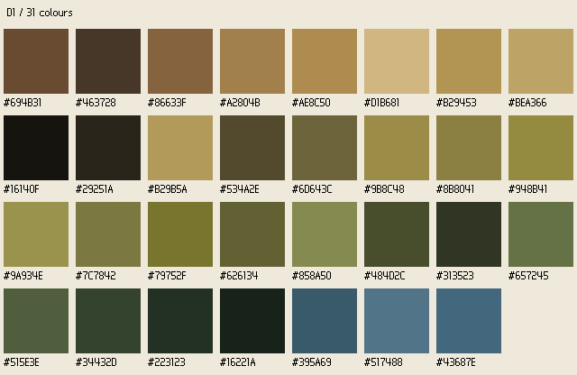
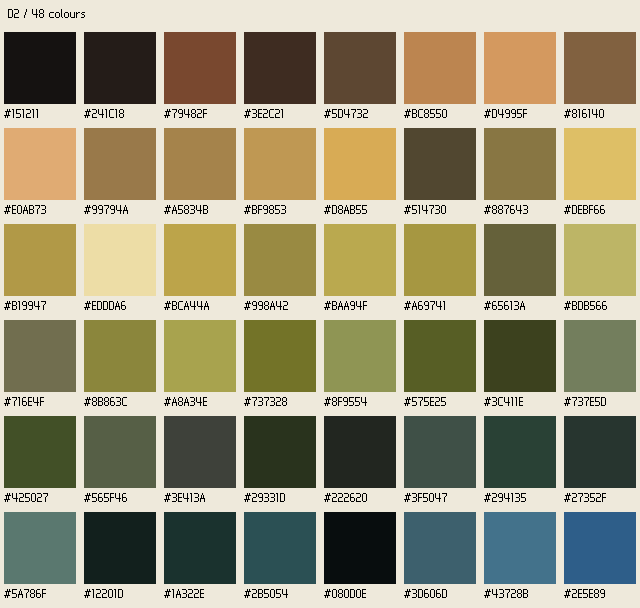
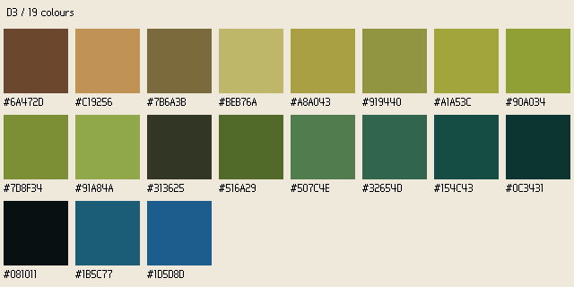

# WorldSim Art Bible

## 한국어 요약

세 방향은 같은 제작 규칙을 따른다. 월드 1픽셀은 아트 1텍셀이고 타일은 16 × 16이다. 주민은 16 × 24, 작은 사물은 16 × 16, 건물은 32 × 32, 키 큰 사물은 16 × 32로 만든다. 정수 배율과 최근접 필터만 쓰며 주민을 세로로 압축하지 않는다. 빛은 왼쪽 위, 그림자는 오른쪽 아래다. 캐릭터와 사물에는 가장 어두운 팔레트 색의 바깥쪽 1픽셀 윤곽선을 넣고 지형에는 넣지 않는다.

D1은 차분한 자연색과 명확한 형태, D2는 따뜻한 밝은 면과 차가운 어두운 면의 풍부한 분위기, D3는 단순하고 강한 실루엣을 비교한다. 방향별 정오 프레임에서 추출한 마스터 팔레트를 정규화 스프라이트에 적용한다. 지면은 저채도, 주민과 상호작용 사물은 높은 대비, UI는 중성색과 강조색 하나를 쓴다. 정오 주민 평균 명도와 바닥 평균 명도의 차이는 최소 0.15가 목표다. 실제 측정값과 실패 여부는 방향별 검증 보고서에 그대로 남긴다.

생성된 장면은 목표 분위기를 보여 주는 콘셉트이며 실제 게임 캡처나 정확한 타일·텍셀 규격의 증거가 아니다. 네이티브 크기 스프라이트와 파이프라인 보고서가 제작 규격의 증거다. 반투명 그림자는 바이너리 알파 스프라이트 본체와 분리한 공용 타원 이미지로 약 40% 불투명도로 표시한다. 밤의 푸른 월드 색조와 화톳불 조명은 UI에 적용하지 않는다. UI에는 Galmuri11, Galmuri9, Galmuri11 Bold를 사용한다. 이번 산출물은 방향 선택용이며 게임 에셋 설치나 대량 생산을 승인하거나 수행하지 않는다.

## Purpose and evidence boundary

WorldSim is a Stone Age god simulation: villagers independently gather, drink, build, store food, raise children, and rest. Its art must remain legible for thousands of villagers across future eras and be maintainable by one developer. The three directions are alternatives for owner selection, not three production styles to install together.

Target frames communicate composition, palette relationships, mood, and interface intent. Generated frames can contain inconsistent object counts, invented detail, or imperfect perspective. Resizing a frame to 1920 × 1080 does not prove a 16-texel grid or exact 4× scale. They are conceptual screenshots, not captures of the Rust/Godot game. JPEG copies are viewing artifacts; compression can introduce off-palette colours and softened boundaries.

Native-size normalized PNGs are the measurable pipeline artifacts. Their dimensions, binary alpha, palette membership, outline, placement, and luma report establish only the specific checks recorded in each direction's normalization and readability reports. They do not establish animation quality, in-engine rendering, performance, or production readiness. Existing in-game villager squashing remains outside this task.

## Common production rules

| Rule | Required value |
|---|---|
| Texel density | 1 texel = 1 world pixel everywhere. Each world tile is 16 × 16 texels. No fractional sprite scale or nonuniform stretching. |
| Villagers | 16 × 24 texels; feet anchored on the tile's lower edge. Preserve natural proportions inside the canvas. |
| Small objects | 16 × 16 texels. |
| Buildings | 32 × 32 texels, corresponding to a 2 × 2 tile footprint. |
| Tall objects | 16 × 32 texels. |
| Camera | Top-down orthographic ground; people and objects shown in slight three-quarter front view standing on their tiles. No camera rotation. |
| Zoom and sampling | Integer zoom steps only: 1, 2, 3, 4, 6, 8. Nearest filtering; crisp square texels; no smoothing or fractional movement introduced by art scaling. |
| World extent | 64 × 64 tiles. Overview is intended for 1×; village view for approximately 4×, where a tile occupies 64 screen pixels. |
| Light | Upper-left light source; cast shadows fall toward the lower right. |
| Outline | Characters and objects use a 1-texel outside-only outline in the master palette's darkest colour. Terrain has no outline. All three comparison directions retain this rule, including D3. |
| Contact shadow | One shared soft elliptical shadow sprite under characters and objects, approximately 40% opacity. It is a separate rendering layer, not baked into the sprite body. |
| Palette | One master palette per direction. Ground uses a low-saturation subset; characters and interactive objects use a high-contrast subset; UI uses neutral colours plus one accent. |
| Noon readability | Each villager's mean luma over opaque texels must differ from the underlying ground mean by at least 0.15 on a 0–1 scale. Measure and report the minimum across villagers. |
| Night | Tint the world toward blue and give hearths warm local illumination. Never tint UI. |
| UI type | Galmuri11 for body text at its 12 px reference size; Galmuri9 for small numbers at 10 px; Galmuri11 Bold for headings. Use exact integer sizes and nearest integer enlargement, with no smoothing. |
| UI panels | Palette-based 9-slice panels with integer borders and flat text fills. No textures beneath text. |

The size classes above define canvas dimensions, not permission to distort source silhouettes. Fit proportionally and bottom-centre. Reserve room for the outside outline before fitting; keep top and side safety margins. A bottom-aligned base or feet may meet the designated bottom edge. Raw generated items must remain separated from every source-cell edge so extraction does not cut them off.

### Shared shadows and alpha

The normalized object PNG has only alpha 0 or 255. Do not insert a 40% shadow into that PNG: it would violate the pipeline's binary-alpha validation and contaminate colour and silhouette measurements. Use the same separate ellipse for every direction, tinted consistently with that direction and drawn below the object at approximately 0.4 opacity. A soft alpha edge is permitted in this dedicated shadow asset only. Scale shadow placement in integer world pixels and keep its perceived footprint subordinate to the object. Do not paint dark halos or magenta residues into object edges.

### World, light, and interface layers

Keep ground, contact shadow, object body, world lighting, and UI conceptually separate. Night shifts the world toward cool blues; a hearth restores warm local colour around nearby villagers and shelter surfaces. Warm light should reveal shapes, not obscure them with blur or broad orange fog. The UI stays at daytime palette values, with stable text contrast. Mock HUD panels demonstrate this separation; they are not an implementation of Godot light or canvas settings.

### Palette authority and extraction

For each direction, extract a master palette from the noon source using median-cut at the direction's requested colour count, merge colours with CIELAB ΔE below 3, then sort by hue and lightness. The final palette can contain fewer entries than the requested count after merging. Record both the requested budget and actual extracted count; do not invent missing colours to reach a headline number.

`palette.hex` is the exact machine-readable authority; `palette.png` is its visual swatch. The exact extracted hex lists are appended to the direction sections after extraction. A generated target frame is not guaranteed to use only those colours. Quantize every opaque normalized sprite texel to its nearest master-palette colour in CIELAB and report 100% membership only after checking the output.

### Korean interface composition

The noon HUD concept includes:

- Top bar: `3일차 12:00 · 낮 · 인구 31 · 정착지 1 · 거처 5 · 건설 중 1`.
- Resource row: `식량 42 · 열매 18 · 출생 9 · 사망 0`.
- Three short Korean notifications, separated from the world with a flat panel.
- Inspector: `주민 17`, `위치 (33, 30)`, `상태: 이동 중`, `목표: 물`, and need bars labelled `허기`, `갈증`, `수면`.

Retain the requested literal noon HUD as the comparison baseline. If a night HUD variant is produced, use a night-appropriate clock and 밤 label without changing the interface's colours. Bar labels must remain readable without interpreting colour alone. Panels must not cover the central camp's important interactions. Use small, restrained borders rather than default debug rectangles, map-wide lines, or oversized floating labels.

## D1 — Earthy readable

**Palette budget:** approximately 32 colours before ΔE merging. Exact palette: [hex list](D1/palette.hex) and [swatch](D1/palette.png).

**Direction statement:** Muted natural palette of about 32 colours: olive and sage greens, ochre and umber earth, slate-blue water. Low-saturation ground so people and buildings stand out. People have a crisp 1-pixel dark outline and warm skin and cloth colours. Clean, very readable shapes.

**Shading:** Use a small number of clear, contiguous value clusters. Upper-left faces get restrained warm highlights; lower-right faces get darker earth or cool neutral shadows. Preserve broad torso, head, roof, and tool masses. Avoid a separate highlight on every tiny feature.

**Texture density:** Sparse grass tufts and low-contrast earth marks. Give foliage a few large clusters rather than grain. River surface marks should indicate flow without competing with villagers. Keep terrain quiet immediately beneath people.

**Mood:** Grounded, calm, human, and easy to inspect. A small camp should feel inhabited and fragile within a natural landscape. Night offers a clear, warm hearth refuge against slate-blue surroundings.

**UI:** Flat charcoal/umber neutrals with a light neutral text colour and one restrained ochre accent drawn from the extracted palette. The final choice must use actual palette entries. Borders are thin and practical.

| Do | Don't |
|---|---|
| Separate a warm villager torso from sage grass with a dark outside edge and a clear value gap. | Use equally saturated grass and clothing that merge at 1×. |
| Describe a hide shelter using a broad roof plane and a few supporting branches. | Fill every roof texel with mottled noise. |
| Use red berries as small, controlled interactive markers. | Scatter equally bright red highlights across unrelated terrain. |
| Keep hearth light local and warm at night. | Lift the entire night scene to orange or tint the HUD blue. |

## D2 — Painterly pixel

**Palette budget:** approximately 48 colours before ΔE merging. Exact palette: [hex list](D2/palette.hex) and [swatch](D2/palette.png).

**Direction statement:** Richer atmospheric pixel art of about 48 colours with hue-shifted shading: warm highlights, cool shadows, more texture on ground and foliage, gentle light falloff. Still crisp pixels with no blur.

**Shading:** Build warm-lit and cool-shadowed colour clusters with deliberate hue shifts. Gentle light falloff is expressed through discrete palette bands and larger clusters, never smoothing or subpixel gradients. Retain the shared darkest outside outline on people and objects even where interior shading becomes richer.

**Texture density:** Moderate texture, concentrated in foliage groups, shelter material, and shore transitions. Preserve broad low-contrast ground areas behind villagers. Detail must survive block-mode reduction; isolated decorative single pixels are expendable, but the main silhouette and action cue are not.

**Mood:** Atmospheric, tactile, intimate, and seasonal. Daylight should feel warm without excessive saturation. Night emphasizes the contrast between cool open ground and warm faces and hides near the fire.

**UI:** Cool dark neutral panels, pale neutral text, and one warm accent from the extracted palette. Atmospheric texture belongs in the world; panel interiors remain flat. Do not give every need bar a new independent accent family.

| Do | Don't |
|---|---|
| Hue-shift a shelter's lit plane warm and shaded plane cool while preserving its outline. | Substitute a smooth gradient or blur for pixel clusters. |
| Group foliage texture into a few readable masses. | Let leaf noise erase a villager at 1×. |
| Reserve extra colours for meaningful material and lighting distinctions. | Add colours merely to make every texel different. |
| Compare raw and normalized cells for lost tools, faces, and construction gaps. | Treat an attractive large source image as proof of a reusable 16 × 24 sprite. |

## D3 — Bold minimal

**Palette budget:** approximately 20 colours before ΔE merging. Exact palette: [hex list](D3/palette.hex) and [swatch](D3/palette.png).

**Direction statement:** Flat, bold pixel art of about 20 colours, strong silhouettes, minimal texture, large simple shapes that stay readable when hundreds of people are on screen.

**Shading:** Primarily flat fills with one economical dark plane or small upper-left highlight where necessary. Use the common 1-texel darkest outside outline on characters and objects. D3 does not exercise the optional no-outline exception; keeping the common rule makes the comparison and pipeline consistent.

**Texture density:** Minimal. Ground is mostly broad quiet colour fields with occasional low-contrast marks. Trees, shelters, rocks, and people must be recognizable by their outer contours before interior detail is added. Use only enough surface marks to distinguish material and state.

**Mood:** Direct, energetic, orderly, and highly legible at crowded scales. Stone Age identity comes from hide roof shapes, branch frames, woven baskets, stone tools, and the hearth ring rather than intricate decoration.

**UI:** Strong neutral filled panels, simple single-pixel borders, and one high-contrast accent selected from the extracted palette. Strong does not mean large debug labels or a multicoloured dashboard.

| Do | Don't |
|---|---|
| Distinguish gatherer, builder, elder, and child through silhouette and held-object shape. | Depend on tiny facial pixels or many similar shades. |
| Show berry depletion with clearly countable red clusters and a bare-bush state. | Change only a subtle green shade between resource states. |
| Use a branch frame with obvious negative space to indicate construction. | Render the unfinished frame as a filled shelter silhouette. |
| Keep a stone-ring hearth readable using a few decisive clusters. | Add bright noisy particles that obscure nearby people. |

## Pipeline and acceptance evidence

The 4 × 4 sheet has fixed row-major content: hearth, lean-to, storage pit, construction frame; four berry stages; gatherer, builder, elder, child; boulder, young tree, reeds, berry basket. Cells 1–4 target 32 × 32; 5–8, 13, 15, and 16 target 16 × 16; 9–12 target 16 × 24; cell 14 targets 16 × 32.

Use an opaque flat magenta source background. Key RGB distance within 60 of `#FF00FF`, remove remaining magenta spill by hue within ±20° and saturation greater than 0.45, crop to opaque bounds, proportionally fit and bottom-centre, then reduce by block mode using 5-bit colour buckets. A footprint with less than half opaque coverage becomes transparent. Quantize opaque colours in CIELAB and apply the external outline without growing the required canvas.

For every output, report native dimensions, palette membership, binary alpha, border safety, and colour count. Show raw cells beside normalized sprites at 8× so lost features remain visible. A procedural ground strip shows villagers, bushes, shelter, and hearth at both 4× and 1×; ground marks must not touch tile borders. Measure villager luma against ground and report each result and the minimum. A value below 0.15 is a failed target, even when the image looks attractive.

Readability measurements describe the supplied procedural noon ground only. They do not prove contrast over every generated ground patch, terrain type, night condition, or runtime camera position. The comparison report must also visually assess both zoom levels, cohesion, Stone Age fit, night mood, and the reliability of extending the pipeline by roughly 200 assets. Preserve failures and losses as decision evidence rather than hiding them behind an overall score.
