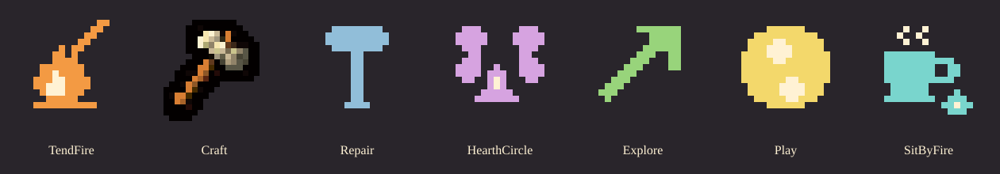

# Seven activity icons

| Kind | Activity | Silhouette | Hue | Source |
|---|---|---|---|---|
| 0 | TendFire | diagonal poker over upright flame | orange | procedural 16×16 |
| 1 | Craft | existing tool icon | existing warm neutral | accepted U1_04, 18×18, unchanged |
| 2 | Repair | broad hammer head and narrow vertical handle | blue | procedural 16×16 |
| 3 | HearthCircle | two facing heads around small flame | violet | procedural 16×16 |
| 4 | Explore | northeast arrow | green | procedural 16×16 |
| 5 | Play | round spotted ball | yellow | procedural 16×16 |
| 6 | SitByFire | steaming handled cup beside a low flame | turquoise | procedural 16×16 |

Explore retains the directional-arrow idea, enlarged from 9×9 to the specified 12–18 source-pixel range. Craft retains U1_04 and its existing sprite-library application path. Every other silhouette has a dark one-pixel outline at runtime. No image generations used.

`activity_icons_p11.gd` caches each texture once. Both daily choice paths emit the same icon IDs. Activity gates remain active walking-or-arrived and zoom≥2. Summary at zoom<2 joins activity entity bits to AgentId and then `SettlementSelection.home_for_agent`, counting only until_tick≥0. It is recomputed on a new simulation tick after observing current society membership; each village shows at most three counts ordered descending then ascending kind.

The sheet is a design key, never input to blind reviewers. Unit tests cover all textures, distinct alpha silhouettes, zoom gate, anchor, arrived filtering, identity joins, ordering, missing IDs, separate homes, empty/abandoned hiding, 120 fixed-tick frames, reset and capture metadata. The real-capture blind test and sidecar pose oracle remain required; no acceptance result is asserted by this document.
