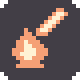
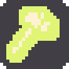
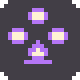
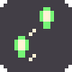
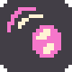
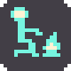

# Activity icons: implementation and source-image evidence

Status: focused headless checks PASS; source-sheet blind recognition is 7/7 (see blind-stage-a.md); framebuffer/terrain review remains pending. These source exports are not captured game frames.

The seven cached textures share the same path in agent activity and village summaries. Six pictograms use 16×16 source canvases; Craft recolors the original 18×18 U1_04 shape without editing that asset. Each adds a two-source-pixel margin and a rounded #211C25 badge at alpha 0.85 (RGBA8 quantization is recorded in the metrics). Pictograms contain exactly the main color and #FFF2D4, both opaque. Craft selects its highlight by original luminance >0.5 and preserves every original nontransparent pixel.

World sprites retain scale 1, nearest filtering, existing icon IDs, anchor placement and visibility gates. Summaries use the same cached texture at integer scale 2 and reserve 44 pixels in height. No simulation or activity selection logic changed.

## Named enlarged source sheet

These PNGs are nearest-neighbor source-image enlargements. The controlled headless canvas transform at Z4 produces 80×80 rectangles, or 88×88 for Craft; actual framebuffer measurements remain NOT_MEASURED.

| Kind | Meaning | Main | Source badge | Summary at 2× | Z4 source preview |
|---|---|---|---|---|---|
| 0 | TendFire | #F5A076 | 20×20 | 40×40 |  |
| 1 | Craft | #E0F576 | 22×22 | 44×44 |  |
| 2 | Repair | #76A0F5 | 20×20 | 40×40 |  |
| 3 | HearthCircle | #B576F5 | 20×20 | 40×40 |  |
| 4 | Explore | #76F576 | 20×20 | 40×40 |  |
| 5 | Play | #F576CA | 20×20 | 40×40 |  |
| 6 | SitByFire | #76F5E0 | 20×20 | 40×40 |  |

## Pairwise measurements

Actual Godot Image alpha masks are centered on an 18×18 canvas using their original 16×16/18×18 canvases, thresholded at alpha ≥0.5 before the badge is added. Common badge pixels are excluded. All 21 pairs exceed XOR/union ≥0.25 and circular main-hue separation ≥40°. Minimum mask distance is 0.613636 (TendFire/Explore); minimum hue separation is 49.606318° (Repair/HearthCircle).

| Pair | XOR pixels | Union pixels | XOR/union | Hue distance ° |
|---|---:|---:|---:|---:|
| TendFire / Craft | 127 | 197 | 0.644670 | 50.078735 |
| TendFire / Repair | 111 | 139 | 0.798561 | 159.685047 |
| TendFire / HearthCircle | 102 | 128 | 0.796875 | 110.078728 |
| TendFire / Explore | 54 | 88 | 0.613636 | 100.157481 |
| TendFire / Play | 137 | 151 | 0.907285 | 59.527564 |
| TendFire / SitByFire | 106 | 130 | 0.815385 | 150.236223 |
| Craft / Repair | 166 | 218 | 0.761468 | 150.236219 |
| Craft / HearthCircle | 149 | 203 | 0.733990 | 160.157463 |
| Craft / Explore | 149 | 187 | 0.796791 | 50.078747 |
| Craft / Play | 166 | 217 | 0.764977 | 109.606299 |
| Craft / SitByFire | 167 | 212 | 0.787736 | 100.157488 |
| Repair / HearthCircle | 99 | 128 | 0.773438 | 49.606318 |
| Repair / Explore | 109 | 117 | 0.931624 | 100.157472 |
| Repair / Play | 98 | 133 | 0.736842 | 100.157483 |
| Repair / SitByFire | 85 | 121 | 0.702479 | 50.078731 |
| HearthCircle / Explore | 96 | 104 | 0.923077 | 149.763790 |
| HearthCircle / Play | 87 | 121 | 0.719008 | 50.551164 |
| HearthCircle / SitByFire | 102 | 123 | 0.829268 | 99.685049 |
| Explore / Play | 117 | 120 | 0.975000 | 159.685045 |
| Explore / SitByFire | 94 | 103 | 0.912621 | 50.078741 |
| Play / SitByFire | 83 | 119 | 0.697479 | 150.236213 |

## Verification and provenance

- `test_activity_p11.gd`: explicit `ACTIVITY_P11 failures=0`, exit 0, empty stderr.
- `test_activity_icons_p13.gd`: explicit `ACTIVITY_ICONS_P13 failures=0`, exit 0, empty stderr, both without export and with fresh attempt1 export.
- Both ran through `/Users/rexxa/.local/bin/cli-anything-godot --json -p /Users/rexxa/work/new-world-art-prod script run scripts/test/art/<test>.gd --timeout 60`, with `GODOT_BIN=/Users/rexxa/Downloads/Godot.app/Contents/MacOS/Godot`. Export run additionally set `P13_ICON_EXPORT=/Users/rexxa/work/art-production13-evidence/activity-icons/attempt1`. The adapter runs headlessly; no GUI fallback was used.
- Godot: 4.6-stable (official), build hash `89cea143987d564363e15d207438530651d943ac`.
- Icon source SHA-256: `1956d50dc26973471ad68f736ef1d711b398198b3332b51fc148e8c00f3ef428`.
- Immutable Craft asset SHA-256: `90e0f18522ca2b215ebaf02bc5a7d77faf72d41449150d89e004663fd684cc58`.
- [Complete real-Image geometry, colors, masks and all pair results](source-icons/metrics.json). Raw `icon-0.png` through `icon-6.png` and transparent `pictogram-0.png` through `pictogram-6.png` are alongside it. Existing export directories are rejected, so subsequent iterations require a fresh attempt directory.

Tests cover exact two-tone pictograms, badge alpha/RGB, corner transparency, margin, Craft alpha-mask preservation, cache identity, shared icon application, retained IDs, nearest/integer scaling, hidden-person gating, summary sizing, controlled canvas rectangles, and all pair distances. Existing broader activity coverage remains in the p11 fixture. `git diff --check` passes.

Source-image visual inspection confirms the exported colors, distinct shapes and rounded badges. This is implementation review, not blind recognition. Stage A and B must be recorded separately by the leader and a fresh reader. Contrast against real terrain, overlap in live settlements and actual framebuffer size remain NOT_MEASURED because the headless dummy renderer cannot capture the GPU framebuffer. No full gate, cargo, performance measurement or windowed run was performed for this slice.
