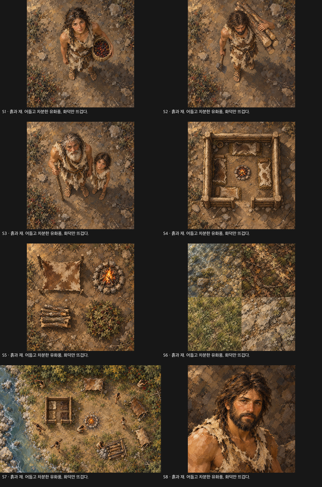
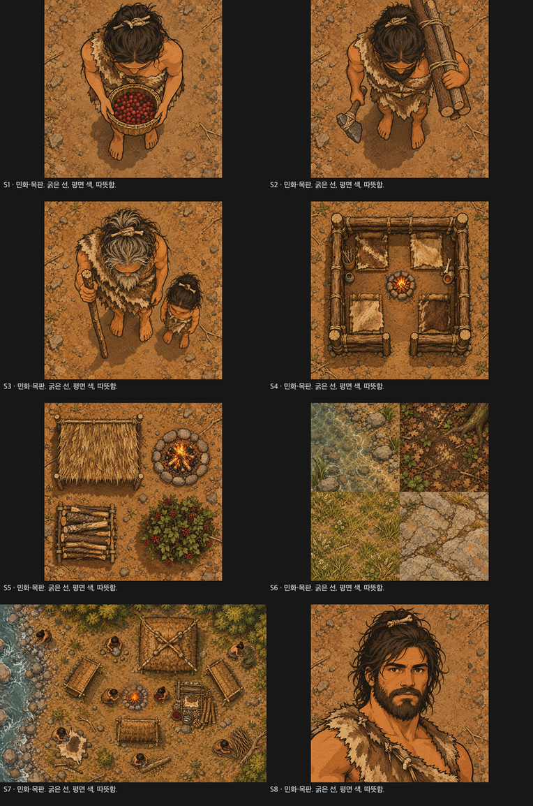
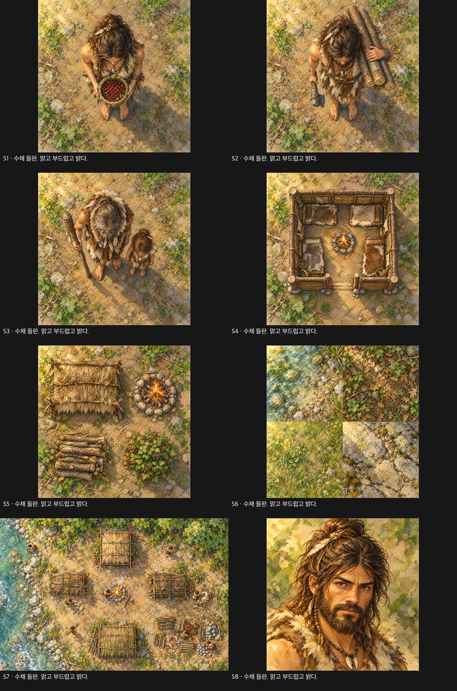
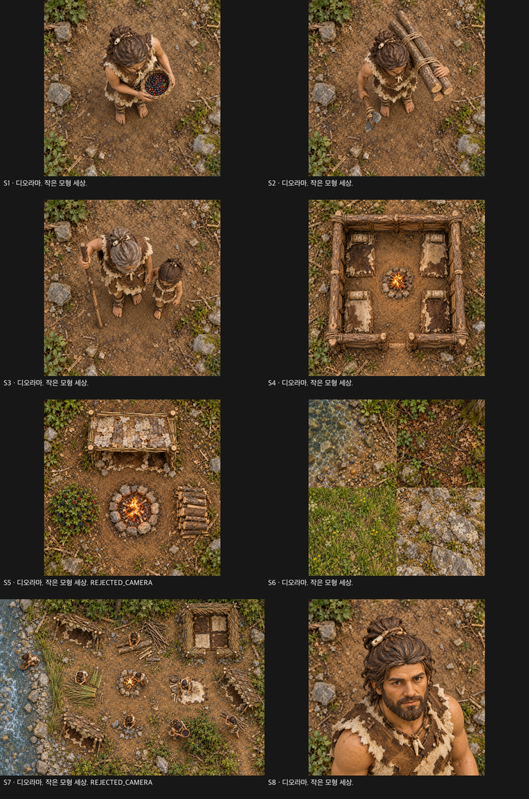
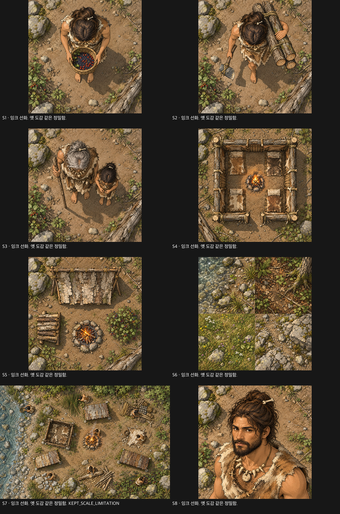
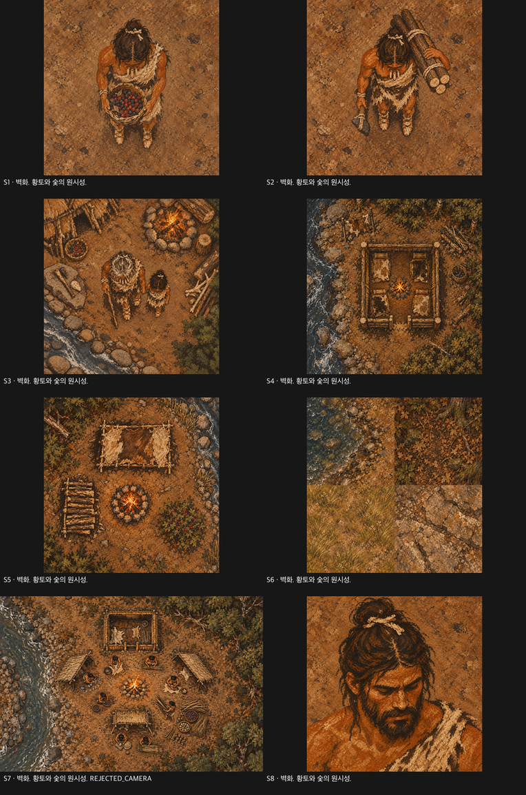
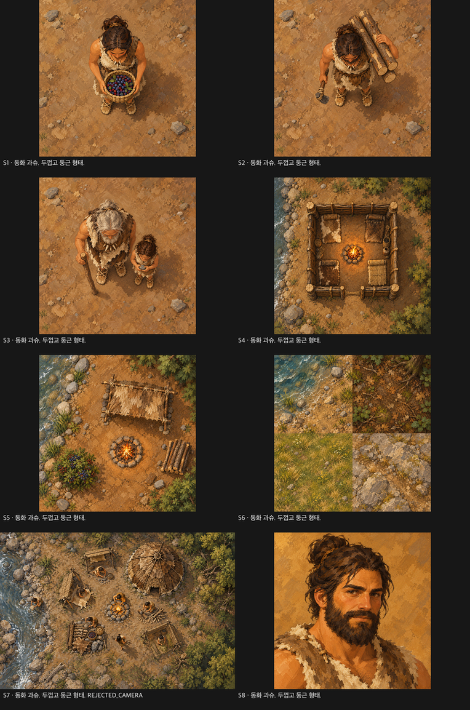
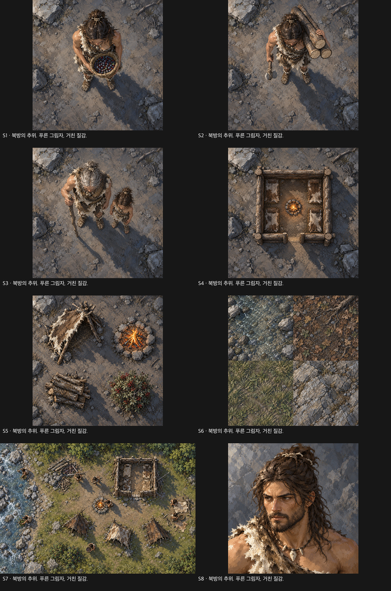

# WorldSim ART-CONCEPT — 컨셉 북

**판정: 비교 자료 제작 완료, 전체 요구 충족은 PARTIAL.** 생성 114회 중 엄격 채택 73개(주제 60개 + 추가 컷아웃 13개), 진단용 카메라 실패 슬롯 4개, 내용 불일치 컷아웃 2개, 사용할 수 없는 컷아웃 1개를 구분한다. 카메라 실패를 아름다운 그림이라는 이유로 채택하지 않았다. 최종 화풍 선택은 오너에게 남긴다.

[사람 한눈 비교](../../../art/concepts/boards/overview_people.png) · [장면 비교](../../../art/concepts/boards/overview_scene.png) · [오두막 비교](../../../art/concepts/boards/overview_hut.png) · [가독성 보드](../../../art/concepts/boards/readability.png)

공통 조건은 [COMMON_BRIEF.md](../../../art/concepts/COMMON_BRIEF.md). 지도는 수직 탑다운, 초상만 3/4 정면이며 석기시대 자연 재료와 강가·숲가의 작은 개척촌을 사용했다. 도구는 정사각 원본을 1254²로 반환했으며 원본을 1024/512로 가공하지 않았다. 색 양자화·픽셀 블록화·외곽선 후처리는 없다.

## 01 earth_and_ash — 흙과 재. 어둡고 차분한 유화풍, 화덕만 뜨겁다.

- **6.1 가독성:** 숲 3/3, 초원 3/3. 두 사람과 바구니·통나무 운반, 지면 범주를 식별했다.
- **6.2 분위기·시청:** 6위 / 4위. 장면 ID F.
- **6.3 일관성:** low. 실제 S1/S2/S4를 비교한 매체·광원·선 판독은 [검사 기록](CHECKS.md)에 있다.
- **6.4 제작 적합:** 리그의 관절 겹침과 붓 크기를 고정해야 한다. 큰 돌과 밝은 붓자국은 타일 반복을 드러낸다. 200개 자산을 제작하려면 명도 범위·광원·붓질 밀도의 기준표가 필요하다.

**강점:** 넓은 붓질과 흙색 덩어리, 작은 화덕의 따뜻함이 잘 이어진다.

**약점·제한:** 명도와 색이 바닥에 가까워 팔다리의 작은 구분이 약하다. 장면 인물은 목표 64px보다 크다.

[정의](../../../art/concepts/01_earth_and_ash/CONCEPT.md) · [모든 시도와 원문 프롬프트](../../../art/concepts/01_earth_and_ash/LOG.md)

## 02 folk_woodcut — 민화·목판. 굵은 선, 평면 색, 따뜻함.

- **6.1 가독성:** 숲 3/3, 초원 3/3. 두 사람과 바구니·통나무 운반, 지면 범주를 식별했다.
- **6.2 분위기·시청:** 5위 / 8위. 장면 ID D.
- **6.3 일관성:** low. 실제 S1/S2/S4를 비교한 매체·광원·선 판독은 [검사 기록](CHECKS.md)에 있다.
- **6.4 제작 적합:** 관절 외곽선의 중복 문제를 해결하고 도구 접합 규칙을 정해야 한다. 판화 결의 방향이 경계에서 끊기지 않아야 한다. 200개 자산에서는 게임 크기의 선 굵기·팔레트·실루엣 규칙을 고정한다.

**강점:** 굵은 외곽선과 평평한 황토색 면으로 여덟 방향 중 차이가 가장 즉시 보인다.

**약점·제한:** 미세 물성의 발견 재미는 낮게 평가됐다. 장면 인물 축척이 약 100px로 크며 선이 200개 자산에서도 유지될지는 미검증이다.

[정의](../../../art/concepts/02_folk_woodcut/CONCEPT.md) · [모든 시도와 원문 프롬프트](../../../art/concepts/02_folk_woodcut/LOG.md)

## 03 watercolor_field — 수채 들판. 맑고 부드럽고 밝다.

- **6.1 가독성:** 숲 3/3, 초원 3/3. 두 사람과 바구니·통나무 운반, 지면 범주를 식별했다.
- **6.2 분위기·시청:** 8위 / 6위. 장면 ID B.
- **6.3 일관성:** medium. 실제 S1/S2/S4를 비교한 매체·광원·선 판독은 [검사 기록](CHECKS.md)에 있다.
- **6.4 제작 적합:** 부품의 반투명 번짐과 관절이 겹치는 부분의 색이 문제다. 종이 밝기와 물감 농도가 타일마다 달라지면 체크무늬가 생긴다. 200개 자산에는 동일한 종이 바탕·농도·경계 대비가 필요하다.

**강점:** 밝은 종이 바탕과 녹색 번짐이 쾌적하고 인물·건물에서 매체가 이어진다.

**약점·제한:** 건물이 인물보다 단단하다. 초원 반복에서 체크무늬가 뚜렷하고 화덕의 중심성이 약하다.

[정의](../../../art/concepts/03_watercolor_field/CONCEPT.md) · [모든 시도와 원문 프롬프트](../../../art/concepts/03_watercolor_field/LOG.md)

## 04 diorama — 디오라마. 작은 모형 세상.

- **6.1 가독성:** 숲 3/3, 초원 3/3. 두 사람과 바구니·통나무 운반, 지면 범주를 식별했다.
- **6.2 분위기·시청:** 1위 / 1위. 장면 ID H는 카메라 불합격 진단 이미지다.
- **6.3 일관성:** medium. 실제 S1/S2/S4를 비교한 매체·광원·선 판독은 [검사 기록](CHECKS.md)에 있다.
- **6.4 제작 적합:** 부품에 그려진 접촉 그림자가 리그 회전과 어긋날 수 있다. 타일 재료의 축척과 모형의 광원을 고정해야 한다. 200개 자산을 양산하기 전에 수직 카메라로 생성하는 문제부터 해결해야 한다.

**강점:** 모형 재료와 작은 작업물이 풍부해 블라인드 분위기·시청 선호 모두 1위였다.

**약점·제한:** S5와 S7 모두 세 번 후에도 카메라 실패. 좋은 장면 평가가 게임용 수직 카메라 재현성을 입증하지 않는다.

[정의](../../../art/concepts/04_diorama/CONCEPT.md) · [모든 시도와 원문 프롬프트](../../../art/concepts/04_diorama/LOG.md)

## 05 ink_and_tone — 잉크 선화. 옛 도감 같은 정밀함.

- **6.1 가독성:** 숲 3/3, 초원 3/3. 두 사람과 바구니·통나무 운반, 지면 범주를 식별했다. 통나무가 4개인 내용 불일치 진단 입력을 사용했으므로 공정한 동일 내용 점수로 단정하지 않는다.
- **6.2 분위기·시청:** 3위 / 2위. 장면 ID G.
- **6.3 일관성:** medium. 실제 S1/S2/S4를 비교한 매체·광원·선 판독은 [검사 기록](CHECKS.md)에 있다.
- **6.4 제작 적합:** 머리·팔·다리의 외곽선과 내부선 비율을 고정해야 한다. 해칭 방향과 뿌리 반복을 줄이는 무봉합 제작 검증이 필요하다. 200개 자산에는 선 밀도와 두 단계 명암의 기준이 필요하다.

**강점:** 선과 제한된 색면으로 도구·돌·작업 공간이 읽히며 분위기 3위·시청 2위였다.

**약점·제한:** 건물의 해칭이 조밀하고 숲 뿌리 반복이 강하다. 추가 벌목꾼은 통나무 4개, 장면 인물은 약 70–90px이므로 동일 조건 비교에 제약이 있다.

[정의](../../../art/concepts/05_ink_and_tone/CONCEPT.md) · [모든 시도와 원문 프롬프트](../../../art/concepts/05_ink_and_tone/LOG.md)

## 06 cave_ochre — 벽화. 황토와 숯의 원시성.

- **6.1 가독성:** 숲 3/3, 초원 3/3. 두 사람과 바구니·통나무 운반, 지면 범주를 식별했다. 통나무가 4개인 내용 불일치 진단 입력을 사용했으므로 공정한 동일 내용 점수로 단정하지 않는다.
- **6.2 분위기·시청:** 2위 / 7위. 장면 ID A는 카메라 불합격 진단 이미지다.
- **6.3 일관성:** medium. 실제 S1/S2/S4를 비교한 매체·광원·선 판독은 [검사 기록](CHECKS.md)에 있다.
- **6.4 제작 적합:** 사지와 도구를 분리해도 실루엣 구분이 유지돼야 한다. 광물 반점의 크기가 타일마다 달라지지 않아야 한다. 200개 자산에서는 황토·숯·뼈색의 면적과 기호화 규칙을 고정한다.

**강점:** 황토와 숯의 대비, 광물 질감과 주황색 화덕이 원시적인 온기를 만든다.

**약점·제한:** 단순 벽화보다는 상세한 그림에 가까운 부분이 있고, S7 카메라 실패와 C2의 통나무 4개 오류가 남는다.

[정의](../../../art/concepts/06_cave_ochre/CONCEPT.md) · [모든 시도와 원문 프롬프트](../../../art/concepts/06_cave_ochre/LOG.md)

## 07 storybook_gouache — 동화 과슈. 두껍고 둥근 형태.

- **6.1 가독성:** 숲 3/3, 초원 3/3. 두 사람과 바구니·통나무 운반, 지면 범주를 식별했다.
- **6.2 분위기·시청:** 4위 / 5위. 장면 ID E는 카메라 불합격 진단 이미지다.
- **6.3 일관성:** medium. 실제 S1/S2/S4를 비교한 매체·광원·선 판독은 [검사 기록](CHECKS.md)에 있다.
- **6.4 제작 적합:** 둥근 불투명 부품은 겹치기 쉽지만 머리/몸 비율이 흔들릴 수 있다. 넓은 색면의 밝기 차가 이음 없는 연결을 방해하는지 시험해야 한다. 200개 자산에는 비율·그림자 색·붓 크기의 표준이 필요하다.

**강점:** 따뜻한 불투명 붓질과 둥근 인물 형태가 친근하다.

**약점·제한:** 건물은 더 사실적이고 S7 카메라는 세 번 모두 실패했다. 서로 다른 주제에서도 둥근 단순화가 유지된다고 보기 어렵다.

[정의](../../../art/concepts/07_storybook_gouache/CONCEPT.md) · [모든 시도와 원문 프롬프트](../../../art/concepts/07_storybook_gouache/LOG.md)

## 08 cold_north — 북방의 추위. 푸른 그림자, 거친 질감.

- **6.1 가독성:** 숲/초원 모두 NOT_VERIFIED. 추가 벌목꾼의 마젠타 배경 실패로 두 사람 조건을 만들지 못했다.
- **6.2 분위기·시청:** 7위 / 3위. 장면 ID C.
- **6.3 일관성:** low. 실제 S1/S2/S4를 비교한 매체·광원·선 판독은 [검사 기록](CHECKS.md)에 있다.
- **6.4 제작 적합:** 긴 푸른 그림자가 부품에 고정되지 않도록 리그를 설계해야 한다. 반복 타일의 긴 그림자가 이어지는지 확인해야 한다. 200개 자산을 제작하기 전에 마젠타 컷아웃의 재현과 색온도 고정부터 검증한다.

**강점:** 청회색 그림자와 차분한 재질, 작은 앰버색 화덕의 온도 차가 뚜렷하다. 장면 인물의 몸 높이는 약 58–70px다.

**약점·제한:** 마젠타 배경의 벌목꾼 생성에 실패해 가독성 크롭 2장을 만들지 못했다. 낮은 색채 대비가 실제 게임 크기에서도 유효한지는 비교하지 못했다.

[정의](../../../art/concepts/08_cold_north/CONCEPT.md) · [모든 시도와 원문 프롬프트](../../../art/concepts/08_cold_north/LOG.md)

## 비교표

| 컨셉 | 가독성 숲/초원 | 분위기 | 시청 | 일관성 위험 | 다음 제작 핵심 |
|---|---|---:|---:|---|---|
| 01_earth_and_ash | 3/3 · 3/3 | 6 | 4 | low | 붓질·관절 명도 |
| 02_folk_woodcut | 3/3 · 3/3 | 5 | 8 | low | 외곽선 접합·선 굵기 |
| 03_watercolor_field | 3/3 · 3/3 | 8 | 6 | medium | 번짐·종이와 지면 이음 |
| 04_diorama | 3/3 · 3/3 | 1† | 1† | medium | 수직 카메라·접촉 그림자 |
| 05_ink_and_tone | 3/3 · 3/3 (진단) | 3 | 2 | medium | 선 밀도·해칭과 관절 |
| 06_cave_ochre | 3/3 · 3/3 (진단) | 2† | 7† | medium | 실루엣·광물 반점 |
| 07_storybook_gouache | 3/3 · 3/3 | 4† | 5† | medium | 인체 비율·건축 단순화 |
| 08_cold_north | 미검증/미검증 | 7 | 3 | low | 컷아웃 성공·긴 그림자 |

† 카메라 불합격 장면을 본 선호 순위다. 가독성은 단순 3점 척도가 전부 포화되어 우열을 가리지 못했다. 원래 크기의 도구 세부와 타일 반복, 활동 애니메이션까지 잘 읽힌다는 뜻이 아니다. 검토자는 한 명의 새 문맥 모델이며 실제 한 시간 플레이를 하지 않았다. [질문과 답변 원문](BLIND_REVIEW.md), [채점·ID 대응](CHECKS.md).

## 추천 결선 두 개 — 선택은 오너

**02 folk_woodcut**을 명확한 형태와 일관성 중심의 결선으로 추천한다. 인물·도구·건물의 굵은 선이 다른 컨셉과 확실히 구분되고, 작은 크기의 인원·운반 활동이 읽혔다. 시청 선호는 8위였으므로 장시간 감상의 재미가 약할 수 있다는 평가도 함께 받아들여야 한다. 다음 시험에서는 선의 중복 없이 움직이는 컷아웃 리그와 반복이 덜한 지면이 핵심이다.

**05 ink_and_tone**을 촘촘한 생활 묘사 중심의 결선으로 추천한다. 분위기 3위·시청 2위이며, 실패 진단인 디오라마를 제외하면 선호 근거가 강하다. 다만 가독성 입력의 통나무 개수 오류와 장면 축척 편차가 있어 검증된 우승안은 아니다. 다음 시험에서 정확한 도구 내용, 56px 리그 선 두께, 해칭·뿌리 반복을 먼저 해결해야 한다.

04 diorama는 두 선호 순위 모두 1위지만 카메라 재현에 실패했으므로 이번의 실용 결선에서 제외한다. 08 cold_north는 차분한 시청 선호 3위지만 두 사람 가독성 시험이 없으므로 별도 후보로 남긴다. 이 추천은 새 생산 승인이나 오너의 최종 선택을 대신하지 않는다.

## 무엇이 남았는가

04 S5/S7, 06 S7, 07 S7 카메라 실패와 05/06의 4개 통나무 컷아웃, 08의 비마젠타 컷아웃은 정해진 생성 한도 안에서 해결하지 못했다. 거절 이미지를 수리하거나 재생성 한도를 넘어 해결한 척하지 않는다. 컨셉·주제 드롭은 없지만 모든 슬롯이 유효한 비교 이미지인 것은 아니다. 원래 목표를 완료 상태로 표시할 수 없으며, 전체 동일 조건 비교를 완성하려면 이러한 한도·입력 제약이 바뀌어야 한다.

[§8 보고](CONCEPT_REPORT.md) · [비용](COST.md) · [요구사항 감사](REQUIREMENT_AUDIT.md) · [원본 경로·SHA](ORIGINALS.json)
