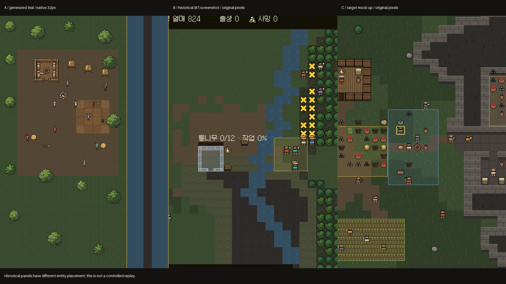

# ART-TRIAL — 32px 전환 결정 요약

**권고: 혼합. 현재16px 코드 기반을 유지하고, 생성 환경 일부만 후속 아트 후보로 남긴다.32px 전면 전환은 보류한다.**

[네이티브 A/B 비교](../../images/arttrial_ab.png) · [24명 범위 보드](../../images/arttrial_people.png) · [최종 정답/응답 시트](../../images/arttrial_crops.png)

| 판단 항목 | 결과 | 의미 |
|---|---:|---|
| 기존 M1 코드 그림 |7/10 | 계약에 주어진 역사 점수, 이번에 재측정하지 않음 |
| 생성32px, 첫 판독 |3/10 | 기준8/10 미달 |
| 한 차례 수정 후 새 판독 |3/10 | 일반 운반만 인정해도4/10, 미달 |
| 무작위6명 속성 판독 |10/24 | 기준20/24 미달 |
| 요청24명 완전 합성 |22/24 |2명 누락을 붉은 테두리로 명시 |
| 실제 렌더 픽셀 구별 |24/24 | 색 차이를 포함한 기술적 구별, 의미 구별 아님 |
| 파이프라인 코드 |65테스트, 정적검사PASS | 아트 채택 점수와 별개 |

나무·불·일부 건축 재료의 표면은 생성 후보로 가치가 있다. 그러나 작은 정합 레이어는 관련 없는 신체 픽셀을 자주 바꾸며, 엄격히 거부하면 옷장을 완성하기 위한 재시도가 늘어난다. 옷144조합은 확보했지만54개는 두 갈색 질감 값을 모두 유지하지 못했다.머리53·수염17·도구42프레임을 확보했지만 전체 조합은256/612에 그쳤고 창은 없다. 현재404자산의 기계 검사는 모두 통과했다. 두 번째 추가43시도는0채택으로 끝나 자산·보드가 그대로다. 기존 도구29개는 손 방향 미확인,1개는 반대 손 쪽이며 수정 큰 통나무의17~25개 수량도 미검증이다.

읽기 실패는 색상 규칙만으로 해결되지 않았다. 지붕 없는 집은 나무 울타리, 임시 거처는 가죽 건조대, 통나무 운반자는 짐을 단 멜대로 읽혔다. 아이·노인·잠자는 사람은 수정 후에도 구별되지 않았다. 원문과 채점은[BLIND_RESULTS.md](BLIND_RESULTS.md), 전체 제한은[TRIAL_REPORT.md](TRIAL_REPORT.md)에 있다.

**32px를 채택할 때 필요한 별도 작업:** 현재2×카메라를1×로 바꾸고 원거리0.5×를 추가한다. 타일당 이미지 픽셀은4배가 된다. 종이인형 레이어 렌더러, 장비/상태 매핑, 스프라이트 로딩과 실제 화면·성능 검증이 필요하다. `gen_tiles.py`는 폐기 또는 지형 전용 유지 중 결정해야 한다. 본 브랜치는 게임 코드와 메인 브랜치를 변경하지 않았다.

**비용:** 누적1,019호출에서1,008원본이 반환되었고 현재 시트의 생성 원본은306장이다. 첫 추가142호출·140반환에서21개, 두 번째43호출·43반환에서0개를 채택했다. 두 번째43보관본 모두 원본과 바이트가 일치한다. 과거7중단 슬롯 결과와3호출 시간은UNKNOWN이다. 측정 호출 시간 합64.08시간과 병렬 중복을 제거한133.60분은 실제 경과3시간9분45초와 다르다(최신 비용 동결 시점). [COST.md](COST.md)에 가족별 시도와 시간을 기록했다. 도구가 청구액을 제공하지 않아 달러 비용은NOT_REPORTED이다. 원본·거부·중간 결과는`/Users/rexxa/work/arttrial-data/`에 보존한다.

A/B의 역사 패널은 배치가 다르므로 통제된 동일 상태 재생이 아니다. 신뢰할 수 있는 결론은 **이 시도는32px 전면 채택을 정당화하지 못했다**는 것이다. 자동 검사 성공이나 생성 후보의 표면 디테일로 실패한 판독 점수를 대체하지 않는다.
