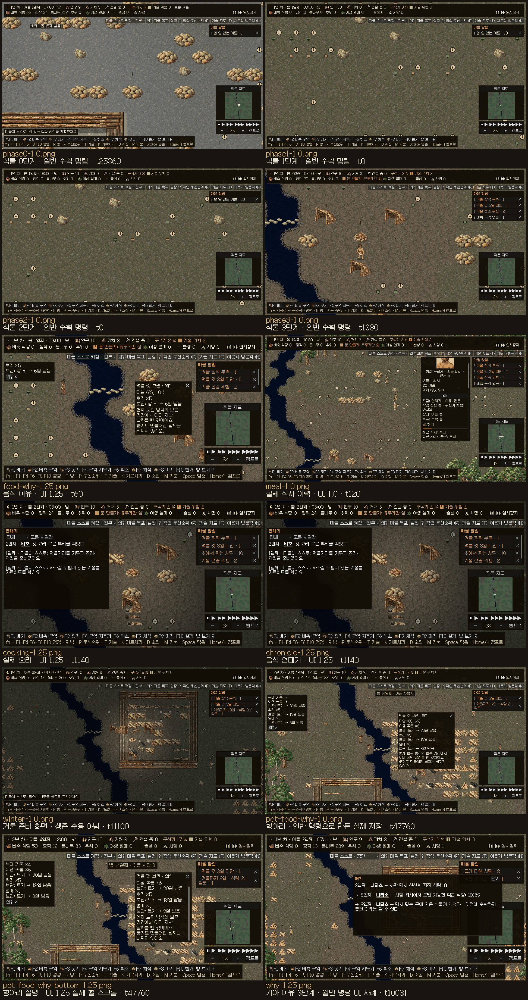

# 수용 FAIL / 미게시 — M6a 보고서

**게시 (2026-10-31, 오너 결정 O-1..O-4): 제품 `d67b42fff`(gate2 47/48, 45단계 실패는 철회된 `no_hungry_spoilage` 하나뿐) + 문서 후속을 `v8/wip`·`v8/main`에 fast-forward. 41단계는 M-UX2.1 stall waiver 사용(54.0ms 1프레임).** **최신 결과는 R2(문서 끝): gate2 `d67b42fff` 47/48 PASS, 45 held-out만 FAIL(`no_hungry_spoilage` 1/32) → 미게시.** **최신 R1 결과(P27): 전체42/48 PASS,25·30·39·40·41·45 FAIL·미게시.** 최종 soak4세계는 사망0·KnowledgeLost0이나 신선 부패3/32(필요26), 유효 성능4항목, 이웃 거래, 새 화면·입력 및 stall 캡처 실패가 남았다. [최종48단계와 원인](#r1-p27-최종-부록--4248-pass-수용-fail미게시), [신선 BASE 비교·사망/조리 표](#r1-p26-부록--신선-수용-fail미게시-최종-게이트-대기). 아래 초기 본문은 이전 P0–P13 시점의 실패 기록이며 R1 결과와 구분한다.

이 문서는 목표 §4의 보고서 양식을 채운 **수용 FAIL·미게시 보고서**다. 동결 held-out에서 생존 29/32(필요30), 조리 식사 기준 충족 24/32(필요26)로 실패했다. 독립 원시 감사도 두 실패를 확인했으며 면제는 없다. “구현 완료 보고” 제목은 수용 완료 선언이 아니다. P9 `5c7e05e677cebda16fea5825f88d83561acd9d2d`의 새 성능 **유효 33/33쌍 PASS**, 마지막 보정 **4/4회 완료·정책 동결**, 후보 held-out **32세계 ×72일 실행 완료**다. BASE 원본 observer의 72일 시작 실패는 보존했고, 별도 BASE 어댑터의 seed 0 자격 검증 48/72일과 BASE 32세계 실행은 완료했다. 비교 수용은 FAIL이며 이야기 비교는 양쪽32세계×3년 완료했으며 P11 전체 게이트1은43/48 PASS(16·26·39·41·45 FAIL)로 끝났다. 게시하지 않았고 원격 main/wip는 BASE에 남는다. P10 도구 수정 커밋은 `bd799460c25a7019dd5d3f30296587c96674615b`다. BASE는 `5b0c88812374b87e7854cc9203f144ad0ccd9009`이다. P4·P5·P6 성능 FAIL과 자연 전체 UI 촬영 13/15·실패2는 유지한다. 집중 화면을 합친 15사례 검토는 자연 전체 실행이나 오너 플레이테스트를 대신하지 않는다.

최종 실행은 **P12 전체 게이트2 44/48 PASS·4 FAIL(26·39·41·45), exit1, timeout/signal 없음**이다. 검증 HEAD는 `a9ae9c87cfc322ff9ef06db7c3de470f799a7be3`, 동결 제품은 P9다. P13은 문서 전용 후속이며 **NOT_FULL_GATED**다. 목표는 완료되지 않았고 제품 개선에는 별도 미래 평가 프로토콜이 필요하다. 게시/이슈 폐쇄 없이 #670–673 OPEN, 원격 main/wip는 모두 `5b0c88812374b87e7854cc9203f144ad0ccd9009`로 재확인됐다.

## 구현 완료 보고 — M6a

### 설계 산수 (먹을 양, 겨울 필요량, 막대 유도)

[설계](M6A_DESIGN.md)의 사전 산수를 유지한다. 성인 허기 증가량은 0.05/tick, 하루 1,440틱으로 72/day다. 음식 1단위의 명목 완화량 30에 따라 따뜻한 성인은 2.4단위/day, 57.6단위/year가 필요하다. 어린이는 1.44단위/day다. 겨울 성인 막대는 정착지별 `ceil(72 × 생존 성인 수 / 5)`이며, 10명은 144단위다. 계획은 어린이와 실제 Cold도 포함한다. 계속 추운 성인의 조건부 수요는 3.6단위/day이며 실제 추위 관측치와 혼동하지 않는다.

식물 수확·손실 계산과 보존 시나리오는 설계의 조건부 상한이다. 실제 노동·이동·섭취·겨울 생존 결과가 아니다. 정수 음식 회계는 명목 단위, 실제 허기 완화량, 포만으로 버려진 완화량을 분리한다. 수용 기준은 아래 held-out 표에 그대로 남겼다.

### 바뀐 것과 남긴 것 (V7 먹이 층: 콜로니에서 대체, 기준선 유지)

콜로니의 음식 생산·저장·운반·섭취를 실제 물건과 소유자·연령으로 연결했다. 기준선의 V7 먹이 층과 기존 계산 분기는 유지한다. [기준선 동일성 3차](</Users/rexxa/work/m6a-data/20261029/candidate-identity-3.log>)는 PASS다. 공유 값 228,748개 차이·단측 경로 0, 연대기 64개 파일·19,683개 항목 동일, 원시 표본 64개 파일 동일, 종자 0–3 결정성을 확인했다. 연대기는 `git_sha`, 원시 표본은 `git_sha`와 제거된 0값 키 5개를 제외한 비교다. 당시 미커밋 후속 변경을 포함한 실행 증거이며, 이후 변경이 있는 최종 후보의 검증을 대신하지 않는다.

이전 콜로니 저장의 유한 음식 잔고와 운반분은 중립 `legacy_food` 물건으로 이관한다. 확인할 수 없는 나이는 보수적으로 만료하고 손실을 회계에 남기며, 존재하지 않은 식사·음식군 이력은 만들지 않는다. 형식 13은 물리적 음식 상태를 추가했다. P8의 형식 14는 기존 12개 필드 뒤에 실제 사건 근거를 추가하며 정확한 형식 13 디코더로 이전 저장을 읽는다. 이 변경을 이전 형식과 원시 바이트가 같다는 주장으로 표현하지 않는다.

### 식물 (종, 계절, 배치, 데이터만으로 종 추가 시험)

`plants.ron`의 berry_bush, hazel, wild_grain, wild_root, wild_flax를 타일 테이블에 배치하고 일·계절 경계에서 갱신한다. 생곡물은 바로 먹지 못하며 아마는 음식이 아니다. 수확은 실제 작업·예약·작업 시간·지면 산출물을 거친다. 데이터만 추가하는 wild_apple 검증 경로를 구현했으나 최종 게이트 결과는 아직 없다.

허기 때문에 일반 작업에서 수확으로 옮길 때 기존 운반물과 연령을 보존하고 정상 취소·예약 해제를 사용한다. 기존 수확을 매 틱 취소하지 않으며 플레이어 취소·지식·직업 우선순위·접근 가능성 조건을 유지한다. 원격 식물까지 실제로 이동해 수확하는 검증을 포함한 [집중 테스트 12/12](</Users/rexxa/work/m6a-data/20261029/autonomous-harvest-test-6.log>)가 통과했다. 일별·내비게이션 변경별 지역 캐시는 성능 막대 통과를 뜻하지 않는다.

### 먹을 것 물건과 먹기 (고르는 규칙, 두뇌 노드·사실·행동 추가)

음식 데이터의 units, groups, raw_edible, 보존 기간과 선호도를 사용한다. 저자가 지정한 조리·새 음식군 우선순위 안에서 가까운 실제 신선 음식 후보를 고르고, 같은 거리에서는 데이터 선호도와 안정된 순서로 결정한다. 먹기는 실제 한 조각을 차감한 뒤 이력과 회계에 기록한다.

`need_harvest_food`, `need_job_harvest_food`, 식물 후보 사실과 `harvest_food` 행동은 [결정 기록](M6A_DECISIONS.md)에 남겼다. 수확 시작 시 Job과 목적지를 함께 설치하는 수정, 공사 종료 후 물을 찾으면서 공사 목적지가 남던 콜로니 목적지 수정이 포함된다. 이 변경은 생존 임계값 완화가 아니다.

### 요리·다양성·썩음·보존

실제 재료와 지식·불·도구 조건을 사용하는 조리 및 건조 경로, 저장 종류별 수명, 배치 연령 이전과 일별 만료를 구현했다. 냄비는 실제 물건을 배치하고 물리적 용량 안에서 저장한다. 음식군은 최근 3일의 실제 식사 이력에서 계산하며, 화면의 최근 8개 식사 목록과 별도로 유지한다.

기존 압력 효과를 실제 식물 재생에 연결하고 가뭄의 완료된 성장 구간을 계산한다. 손실·부패·조리 입력과 출력은 별도 회계 항목이며 시뮬레이션 기록을 숨기거나 합격 수치로 대체하지 않는다. 보정 1회차에서는 부패율 기준 2/8, 조리 비율 기준 0/8을 관측했다. BASE 비교를 포함한 held-out 수용 판정은 FAIL이다.

### 겨울 준비 (집사, 경고, 연대기)

집사는 현재 사용 가능한 물리적 저장량과 성인·어린이·추위 수요로 수확·조리·건조·냄비 저장을 계획한다. 여름의 비축 시작일과 목표량은 데이터에 둔다. 재료·지식 발견·실제 냄비 공급 조건을 연결하고 플레이어의 취소·우선순위를 보존한다. 겨울 준비와 실제 음식 사건을 경고·연대기·정보창에 연결했다. 보정 2회차 8개 세계에서 72일 생존과 겨울 기아사 없음은 각각 8/8이었다. BASE 비교를 포함한 held-out 수용 판정은 FAIL이다.

화면 확인은 일부만 확보했다. [capture 1 receipt](</Users/rexxa/work/m6a-data/20261029/ui-capture-1/evidence.json>)는 `complete=false`, 실패 9개이며 [capture 2 receipt](</Users/rexxa/work/m6a-data/20261029/ui-capture-2/evidence.json>)도 `complete=false`, 실패 6개다. 예시 [식사 1.0](</Users/rexxa/work/m6a-data/20261029/ui-capture-2/meal-1.0.png>), [음식 이유 1.25](</Users/rexxa/work/m6a-data/20261029/ui-capture-2/food-why-1.25.png>), [연대기 1.25](</Users/rexxa/work/m6a-data/20261029/ui-capture-2/chronicle-1.25.png>)는 부분 증거이며 전체 UI 수용이나 오너 플레이를 대신하지 않는다.

세 번째 [실제 화면 receipt](</Users/rexxa/work/m6a-data/20261029/ui-capture-3/evidence.json>)도 `complete=false`, 실패 15개다. 새 음식 사건 종류가 기존 `NOTABLE` 목록에서 제거되는 실제 연대기 필터 결함을 확인했다. 데이터 기반 종류 허용과 표시 라벨을 수정한 뒤 [분리 회귀](</Users/rexxa/work/m6a-data/20261029/chronicle-feed-regression-after.log>)는 exit 0·실패 0으로 통과했지만 전체 화면 재촬영 capture 4는 실패 4개로 미완료다. 야간 색상 곱셈을 빠뜨린 식물 픽셀 검사 오류를 수정했으며, 당시 누락된 왜?·항아리 화면은 아래 후속 집중 촬영으로 별도 확인했다. UI 1.25 식물 crop을 빈 땅으로 판단했던 초기 검토는 철회했다. 개별 이미지와 capture 3/4의 동일 해시를 확인해 식물 표시를 재확인했으며, 추가 픽셀 검사는 검증 강화로 분류한다. [화면 검토 기록](</Users/rexxa/work/m6a-data/20261029/ui-capture-3-visual-review-content.md>)의 이 구분을 유지한다.

2026-10-29의 capture 5도 실패 9개로 미완료다. 화덕의 국소 조명을 반영하지 않은 식물 색상 검사 오류와 그 뒤 미실행된 8개 장면을 보존한다. 후속 capture 6에서는 자연적인 낮의 조명 조건을 기록해 식물 검사를 다시 수행했다. 제품 조명이나 시뮬레이션 시간을 바꾸지 않았다.

최신 [capture 6 receipt](</Users/rexxa/work/m6a-data/20261029/ui-capture-6/evidence.json>)는 `complete=false`, 실패 2개다. 자연적인 왜?·음식 저장 항아리 장면이 누락되어 전체 화면 확인은 미완료다. 나머지 식물 단계·텍스트 검사 통과와 실제 화면 부분 확인을 자연 장면 전체 확보로 확대하지 않는다. 후속 [실제 저장 항아리 집중 촬영 1차](</Users/rexxa/work/m6a-data/20261029/ui-pot-round2-1/evidence.json>)는 해당 범위에서 `complete=true`, 실패 0이다. 상태 주입 없이 생성한 실제 저장 파일을 로드해 [1.0배](</Users/rexxa/work/m6a-data/20261029/ui-pot-round2-1/pot-food-why-1.0.png>)와 [1.25배](</Users/rexxa/work/m6a-data/20261029/ui-pot-round2-1/pot-food-why-1.25.png>)의 음식 저장 항아리·이유 패널을 확보했다. 후속 [항아리 집중 촬영 2차 receipt](</Users/rexxa/work/m6a-data/20261029/ui-pot-round2-2/evidence.json>)는 `complete=true`, 실패 0이며 `full_suite_complete=false`다. 1.25배에서 실제 마우스 휠로 스크롤 0→37 이동 후 `fully_enclosed=true`를 기록했다. 루트가 [1.25배 하단 설명 문단](</Users/rexxa/work/m6a-data/20261029/ui-pot-round2-2/pot-food-why-bottom-1.25.png>)을 직접 확인해 전체 문단이 읽히고 겹침이 없음을 확인했다. 집중 receipt 완료는 전체 UI 수용 완료가 아니다. 별도의 굶주림 UI fixture 1차는 집사 전체를 끄고 일반 명령으로 진행했으나 day 12까지 실제 `HungerFoodChain`을 확보하지 못해 실패했다. [로그](</Users/rexxa/work/m6a-data/20261029/hunger-fixture-1.log>)와 [receipt](</Users/rexxa/work/m6a-data/20261029/hunger-fixture-1/receipt.json>)를 과거 실패로 보존한다. 이는 UI 증거 준비이며 보정 회차나 완료된 촬영 증거로 세지 않는다.

후속 기아 왜? [촬영 1차](</Users/rexxa/work/m6a-data/20261029/ui-hunger-round2-1/evidence.json>)는 receipt 자체는 완료였지만 연쇄 말단만 보여 부분 증거였다. [촬영 2차](</Users/rexxa/work/m6a-data/20261029/ui-hunger-round2-2/evidence.json>)는 실제 연결된 저장 0 → 도달 가능한 익은 식량 10,159 → 익은 식물 존재·과거 미수확 이유 모름의 3단계 전체를 표시했다. 루트가 [1.25배 실제 화면](</Users/rexxa/work/m6a-data/20261029/ui-hunger-round2-2/why-1.25.png>)의 전체 가독성을 확인했다. seed 0에서 day 6 일반 Haul/Hunt 우선순위 0 및 Housing 명령 후 실제 기아 사건을 관측한 tick 10,031(day 7; 화면은 8일째)의 UI 전용 사례이며 보정이 아니다. 2차는 `complete=true`, 실패 0, `full_suite_complete=false`다.

### held-out 1296–1327 (M6a / BASE 표)

보정 4/4회를 마치고 P9 정책을 동결했다. 아래 1–3회차 기록은 과거 관측으로 보존한다. 첫 회차 seed 0–7의 72일 실행은 exit 0이나 생존 0/8, 겨울 저장·조리·다양성 0/8, 부패율 기준 2/8이다. 식량 회계는 8/8 일치했다. [1회차 점수](</Users/rexxa/work/m6a-data/20261029/calibration-1-score.json>)의 상태는 `OBSERVED`, 수용 판정은 `NOT_EVALUATED`다. [2회차 점수](</Users/rexxa/work/m6a-data/20261029/calibration-2-score.json>)는 생존·겨울 기아사 없음·다양성·부패율·회계·day 1 저장소·day 10 침대·늑대 피해 기준 각각 8/8, 조리 비율 7/8(seed 3 미달), 겨울 저장 7/8(seed 5의 day 66 미달)이다. 겨울 시작 저장은 day 42에 8/8, day 66에 7/8이다. 2회차 역시 `OBSERVED`이며 수용 판정은 아니다. 이는 보정 관측이며 held-out 수용 결과가 아니다. 이 당시에는 held-out을 열지 않았다. 이후 마지막 보정과 동결을 거쳐 후보 held-out을 실행했으며 결과에 맞춘 조정은 하지 않는다.

|항목|기준|M6a|BASE|
|---|---|---|---|
|72일 생존|30/32 이상|**29/32 FAIL**|음식망 생존 막대의 직접 분모 아님|
|2·3년 겨울 기아사 없음|28/32 이상|29/32 PASS|음식망 지표 없음|
|2·3년 겨울 시작 저장량|충족 세계26/32 이상|28/32 PASS; day42 31/31, day66 28/31 생존 세계|음식망 지표 없음|
|2년차 이후 조리 식사|50% 이상인 세계26/32 이상|**24/32 FAIL**|음식망 지표 없음|
|2년차 여름 성인 음식군 중앙값|3일간3군 이상인 세계26/32 이상|30/32 PASS|음식망 지표 없음|
|72일 부패 단위/수확 단위|30% 이하인 세계26/32 이상|31/32 PASS|음식망 지표 없음|
|day1 저장소|BASE 대비 한 세계 초과 악화 없음; 필요31|32/32 PASS|32/32|
|day10 침대|BASE 대비 한 세계 초과 악화 없음; 필요30|31/32 PASS|31/32|
|늑대 사망1명 이하|BASE 대비 한 세계 초과 악화 없음; 필요28|31/32 PASS|29/32|
|회계 (후보 음식 단위 포함 / BASE 기존 회계)|32/32|32/32 PASS|32/32 PASS (기존 회계)|

[최종 held-out 점수](</Users/rexxa/work/m6a-data/20261029/p10-heldout-score.json>)는 **FAIL: alive, cooked_share**다. [BASE receipt](</Users/rexxa/work/m6a-data/20261029/p10-heldout-base/receipt.json>)는 P10 `bd799460c25a7019dd5d3f30296587c96674615b` 출처, 32세계 exit0·`source_unchanged=true`다. 후보는 원래 P9 동결과 receipt를 그대로 사용한다. [독립 원시 감사](</Users/rexxa/work/m6a-data/20261029/p10-heldout-failure-audit.md>)는 후보96개 파일의 해시·크기와 동결·scorer 참조를 확인하고 scorer 호출 없이 두 실패를 재계산했다. 생존 기준은 1세계, 조리 기준은 2세계 부족하다. 멸종 세계는1300·1305·1307이며 조리 미달은1300·1305·1306·1307·1312·1315·1318·1319다. 1306은651/1304로 실제50% 미만이고1305는 식사0건으로 실패한다. 구체적인 scorer 결함은 발견하지 않았다. 나머지 막대 PASS는 scorer 결과이며 이 독립 감사가 모든 막대를 재계산했다는 주장은 하지 않는다. 정책 튜닝·추가 보정·재시딩·면제 없이 실패를 보존한다.

보정3은 P7 소스로 원래 기한 안에 exit 0으로 끝났다. [정확 비교](</Users/rexxa/work/m6a-data/20261029/calibration-2-to-3-exact.json>)에서 8개 세계의 24개 파일 모두 보정2와 바이트가 같고 8개 fingerprint도 일치했다. 정규화는 없었다. [보정3 점수](</Users/rexxa/work/m6a-data/20261029/calibration-3-score.json>)는 조리·두 겨울 저장 7/8, 나머지 음식·공통 기준 8/8로 동일하며 held-out 수용 판정이 아니다. 의도적으로 기록과 저장을 확장한 P8에는 이 바이트 동일성 결과를 전용하지 않는다.

[보정4 receipt](</Users/rexxa/work/m6a-data/20261029/calibration-4/receipt.json>)와 [점수](</Users/rexxa/work/m6a-data/20261029/calibration-4-score.json>)는 8세계 완료, 생존·기아 없는 겨울·다양성·부패·회계·저장소·침대·늑대 기준 8/8, 조리와 겨울 저장 7/8을 기록한다. `OBSERVED / NOT_EVALUATED`이며 추가 보정은 없다. [보정3→4 독립 비교 v2](</Users/rexxa/work/m6a-data/20261029/p9-calibration3-to4-v2-receipt.json>)는 `PASS_OBSERVED_ONLY`다. 관측된 물리 결과·식사 근거의 일치를 확인했지만 fingerprint 차이를 보존하며 전체 상태와 모든 내부 행동 동일성은 `NOT_PROVEN`이다.

[원래 P9 동결](</Users/rexxa/work/m6a-data/20261029/p9-policy-freeze.json>) 뒤 [후보 held-out receipt](</Users/rexxa/work/m6a-data/20261029/p9-heldout-candidate/receipt.json>)는 종자1296–1327의 32세계 ×72일, exit0, `source_unchanged=true`로 완료했다. 후속 BASE 비교 수용은 위 점수처럼 FAIL이며 후보 receipt를 변경하지 않았다. 원래 BASE `--mux2-observe --days 72`는 48일 전용 CLI 검사에서 시뮬레이션 시작 전에 실패했다. 이 도구 결함을 세계 생존 실패로 세지 않는다.

### 성능 (장면별 비율)

P9의 [새 성능 receipt](</Users/rexxa/work/m6a-data/20261029/perf-p9-session-1/receipt.json>)와 [원시 요약](</Users/rexxa/work/m6a-data/20261029/p9-perf-summary.md>)은 **33/33 유효쌍 PASS, 무효0, 예외0**이다. 시간18쌍과 RSS15쌍, 실행66회 모두 첫 admission에서 부하·경쟁 프로세스 조건을 통과했다. 시작 부하1/5/15분 범위는 각각 2.0303–5.3013 / 3.0645–4.2041 / 3.5835–4.0884였다. 아래 비율은 P9/같은 세션 BASE다.

|P9 장면|평균|p99|할당량|
|---|---|---|---|
|n200|0.992266|0.985969|1.050077|
|n1000|0.947098|0.825787|1.032241|
|n2000|0.746988|0.867965|1.024471|
|n200_script|1.011114|0.956570|1.050017|
|n200_side64|1.054325|0.970674|1.034398|
|n1000_wolves|1.066629|1.013389|1.032241|

할당량 기울기 비율 agent 0.996305 / tile 1.061745, C3 6/6 PASS다. allocator/agent 1863.393333, allocator/tile 68.795288바이트이며 외부 RSS 기울기와 구분한다. 후보 빌드 HEAD는 P9, BASE 빌드 HEAD는 `cb3f79cc69df10ee05b10d5a5330e0226f67fc68`이며 비교 기준 BASE `5b0c88812374b87e7854cc9203f144ad0ccd9009`의 소스 동일성 근거를 유지한다. 이는 P9 당시 성능이며 아래 P12 전체 게이트2 성능과 구분한다.

2회차 후보의 [유효 성능 receipt](</Users/rexxa/work/m6a-data/20261029/perf-round2-session-1/receipt.json>)와 [측정 로그](</Users/rexxa/work/m6a-data/20261029/perf-round2-session-1.log>)는 **FAIL**이다. BASE/후보 독립 빌드와 부하·실행 독점·교차 반복 검증을 통과한 측정 실패로 보존한다. 이전 P7/UI 예외를 계승하지 않는다.

|p4 장면 (과거 유효 실패)|평균 후보/BASE|p99 후보/BASE|
|---|---|---|
|n200|1.197|1.213|
|n1000|1.219|1.064|
|n2000|1.113|1.294|
|n200_script|1.134|1.096|
|n200_side64|1.238|1.144|
|n1000_wolves|1.493|1.587|

모든 비율 ≤1.10, 할당량의 인원·타일 기울기 비율 ≤1.10 및 C3 6개 상한 PASS가 필요하다. C3 6개 상한은 모두 PASS지만 시간 비율 10개와 `n200_side64/alloc_after_build` 비율이 실패했다. alloc/agent 기울기 0.996만으로 이 실패를 상쇄하지 않는다.

p5 최적화는 음식 존재 여부 조회의 불필요한 정렬 제거, 작업 후보 필터 순서 조정, 정적 mind 정책 원문의 `Cow` 차용을 포함한다. 동작 보존을 목표로 한다. [release 메모리 계수 재측정](</Users/rexxa/work/m6a-data/20261029/food-build-memory-after-1.log>)은 PASS이며 side 64의 live_after 1,798,188→1,601,984바이트, side 192의 4,052,564→3,856,360바이트로 각각 정확히 196,204바이트 감소했다. 식물 수·단위·항목 수는 동일했다. 이는 메모리 진단이며 정식 성능 막대 통과가 아니다. [수정 전 정적 포인터 회귀](</Users/rexxa/work/m6a-data/20261029/policy-source-before-1.log>)는 정적 원문 1 FAIL·동적 원문 1 PASS였고, 수정 후 [sim-systems 474/474](</Users/rexxa/work/m6a-data/20261029/systems-perf-opt-2.log>) 및 [전체 workspace/all-targets Clippy](</Users/rexxa/work/m6a-data/20261029/clippy-perf-opt-2.log>)가 통과했다. 기준선 동일성 4차도 PASS다(공유 값228,748개 차이0, 연대기64파일19,683항목 및 원시64파일 일치, 결정성0–3 통과). 이는 p5까지의 소스 검증이다. 이후 p5 성능 측정은 아래와 같이 실패했다. 후속 P7 성능·보정3 결과는 별도로 기록하며 전체 게이트는 아직 진행 전이다.

이전 p5 [receipt](</Users/rexxa/work/m6a-data/20261029/perf-p5-session-1/receipt.json>)는 **유효 33쌍 완료, 시간 비율 9개 FAIL**이다. [BASE 요약](</Users/rexxa/work/m6a-data/20261029/perf-p5-session-1/base-summary.json>)·[후보 요약](</Users/rexxa/work/m6a-data/20261029/perf-p5-session-1/new-summary.json>)·[교차 비교 기록](</Users/rexxa/work/m6a-data/20261029/perf-p5-session-1/comparison-ledger.md>) 및 [원시 자료 재검증](</Users/rexxa/work/m6a-data/20261029/perf-p5-raw-recheck.json>)을 보존한다. 아래 비율은 소수점 여섯 자리 표시이며 판정은 원래 정밀도로 수행했다.

|p5 장면|평균 후보/BASE|p99 후보/BASE|빌드 후 할당량 후보/BASE|
|---|---|---|---|
|n200|1.199116 FAIL|1.179762 FAIL|1.040261 PASS|
|n1000|1.147255 FAIL|1.041728 PASS|1.025323 PASS|
|n2000|1.013350 PASS|1.171590 FAIL|1.019329 PASS|
|n200_script|1.119866 FAIL|1.093319 PASS|1.040212 PASS|
|n200_side64|1.209843 FAIL|1.132682 FAIL|1.011391 PASS|
|n1000_wolves|1.388358 FAIL|1.485908 FAIL|1.025323 PASS|

할당량 인원 기울기는 1,870.304444→1,863.393333 B/명(비율 0.996305), 타일 기울기는 64.794556→68.795288 B/타일(1.061745)로 모두 PASS다. 장면별 빌드 후 할당량과 C3 6개 상한도 모두 PASS다. 앞서 관측한 196,204바이트 감소는 메모리 진단으로 유지하며, p5의 시간 실패를 상쇄하지 않는다.

별도의 [단발 CPU 샘플](</Users/rexxa/work/m6a-data/20261029/p5-cpu-sample-1/stacks.txt>)은 심볼화된 7,435개 샘플 중 `loose_haul` 포함 스택 2,059개를 관측했다. 이는 병목 조사용이며 독립 성능 수용 결과나 시간 비율이 아니다. p6는 저장할 곳이 없는 물건 종류를 제외한 뒤 두 운반 탐색의 이전 후보 관측만 초기화한다. 수정 전 회귀는 예상한 1 FAIL·비교 시험 2 PASS였고, 수정 후 sim-systems 477/477, Clippy 및 기존 연료 운반·수면 통합 17/17이 통과했다. 기준선 동일성6차는 공유 값228,748개 차이0, 연대기64파일19,683항목 및 원시64파일 일치, 결정성0–3 PASS다. 중단된 동일성5차는 INTERRUPTED로 보존한다. 이 시점에는 전체 콜로니 궤적 비교 전이었다. 후속 P7 보정3의 정확 비교는 아래에 기록하며 당시 p6 검증과 구분한다.

이전 p6 `e156ae29b804038224ff8928895025f64742f478`의 [성능 영수증](</Users/rexxa/work/m6a-data/20261029/perf-p6-session-1/receipt.json>)은 **유효33쌍 완료, side64 평균만 FAIL**이다. [원시 재검증](</Users/rexxa/work/m6a-data/20261029/perf-p6-raw-recheck.json>)도 같은 실패를 확인했다. 모든 할당량 비율과 C3 6개 상한은 PASS다. 이전 실패를 덮어쓰지 않는다.

|p6 장면|평균 후보/BASE|p99 후보/BASE|
|---|---|---|
|n200|1.022818 PASS|0.997449 PASS|
|n1000|0.995217 PASS|0.880104 PASS|
|n2000|0.757130 PASS|0.881627 PASS|
|n200_script|1.048019 PASS|0.989691 PASS|
|n200_side64|1.119897 FAIL|1.021180 PASS|
|n1000_wolves|1.084432 PASS|1.022252 PASS|

side64 평균은 BASE345.179861→후보386.565972µs/tick이다. 이번 BASE의1.10배 상한까지6.868125µs/tick 감소가 필요하다. [시스템별 분석](</Users/rexxa/work/m6a-data/20261029/p6-side64-attribution.md>)에서 Mind 증가40.3273µs가 전체 증가41.3861µs의 대부분이다. 짧은 CPU 샘플은 continuation guard 비중 증가를 보여주지만, 호출 수·캐시 실패·호출당 비용을 구분하지 못한다. 진단은 정식 성능 수용이나 정책 변경 근거로 대체하지 않는다.

커밋된 P7 `5857cdc4f89c24d4a4d5f2ad2f55703c937572c3`은 수치가 달라져도 모든 조건식의 판정이 같은 경우 continuation 경로를 재사용한다. 첫 불일치 계수는 배고픔147,795·갈증118,286회였고 캐시 길이는8–15개였다. 기존32개 한도·판단 주기·사실 읽기 순서·오류 처리는 유지한다. 회귀1FAIL을 보존했고, 수정 후 코어484개 및 관련 통합, 시스템477개와 Clippy가 통과했다. 기준선 동일성7차는 exit0: 공유228,748값 차이0, 연대기64파일19,683항목·원시64파일 및 결정성0–3 PASS다. 로그의 SHA는 미커밋 P7 변경을 시험한 부모 p6이며 최종 clean-head gate가 아니다. 이 동일성 로그와 후속 커밋 소스의 성능·보정3 증거를 구분한다. [독립 검토](</Users/rexxa/work/m6a-data/20261029/p7-cache-code-review.md>).

P7 [성능 receipt](</Users/rexxa/work/m6a-data/20261029/perf-p7-session-1/receipt.json>)는 같은 세션에서 새로 측정한 BASE 대비 **유효 33/33쌍 PASS**다. 독립 원시 재검증도 PASS이며 모든 할당량 비율과 C3 6개 상한을 통과했다. 시간 비율은 아래와 같다. 이는 P7 결과이며 P8 성능 수용을 대신하지 않는다.

|장면|평균 비율|p99 비율|
|---|---:|---:|
|n200|0.972124 PASS|0.960710 PASS|
|n1000|0.947506 PASS|0.827639 PASS|
|n2000|0.741673 PASS|0.861640 PASS|
|n200_script|1.044607 PASS|1.037530 PASS|
|n200_side64|1.051704 PASS|0.968085 PASS|
|n1000_wolves|1.062197 PASS|1.037320 PASS|

### P9 실제 화면 후속 기록 (2026-10-30)

P8 `e2ba280f345202b7f334b213ea2c13e2de828c46`의 [실제 빌드 receipt](</Users/rexxa/work/m6a-data/20261029/candidate-p8-binaries/build-receipt.json>)는 exit0·49.22초다. 기준선 동일성8차와 전체 문서 검증도 PASS다. 동일성8차는 커밋 전 staged 소스 검증이며 최종 clean-head 전체 게이트로 바꾸어 표현하지 않는다.

일반 명령으로 만든 실제 기아 fixture는 tick10031/day7에 도달했다. P8 기아 촬영 metadata는 PASS였으나 KO/EN ×1.0/1.25의 32개 PNG 직접 검토는 [REVISE](</Users/rexxa/work/m6a-data/20261029/p8-ui-hunger-qa-b.md>)였다. 당시 “과거 이유를 알 수 없다”는 문구가 실제 운반 비활성 개인 기록과 충돌했다. P9는 사망 당시 관측만으로 과거 이유를 판단할 수 없다고 한정했다. [32개 재촬영 직접 검토](</Users/rexxa/work/m6a-data/20261029/p9-ui-hunger-qa-b.md>)는 **PASS**이며 한글·영문 줄바꿈, 개인 기록과 마을 전체 흐름 구분을 확인했다. 이 집중 검토는 전체 UI 수용이 아니다.

|전체 촬영|보존할 결과|
|---|---|
|P8 full|FAIL: owner feed에서 숨겨야 할 kind53에 대한 이전 기대4개와 조기 종료 시 미확보 사례6개|
|P9 full1,30일 (과거)|FAIL:13/15사례 확보, 기아 왜?·항아리 미확보|
|P9 full1 건조 음식 이미지 (과거)|모달에 가려져 수용 거부; 원래 실패 판정 보존|

후속 촬영·직접 검토 결과는 다음과 같다. 서로 다른 실행의 합성 증거이며 자연 전체 촬영 PASS로 바꾸지 않는다.

|후속 증거|결과와 범위|
|---|---|
|[full2 receipt](</Users/rexxa/work/m6a-data/20261029/p9-ui-full-2/evidence.json>)|30일, 46장, 관측 13/15; `complete=false`, `failures=2` (기아 왜?·항아리 미관측). 관측 항목은 [QA-A](</Users/rexxa/work/m6a-data/20261029/p9-ui-full-2-qa-a.md>)·[QA-B](</Users/rexxa/work/m6a-data/20261029/p9-ui-full-2-qa-b.md>) 범위 한정 PASS|
|[hunger2 receipt](</Users/rexxa/work/m6a-data/20261029/p9-ui-hunger-2/evidence.json>)|32장, 집중 범위 `complete=true`, 실패0; [QA-B](</Users/rexxa/work/m6a-data/20261029/p9-ui-hunger-2-qa-b.md>) PASS. 공개된 일반 명령으로 만든 실제 저장 사용|
|[pot1 receipt](</Users/rexxa/work/m6a-data/20261029/p9-ui-pot-1/evidence.json>)|3장, 집중 범위 `complete=true`, 실패0. 기존 실제 format13 fixture의 현재 디코더·UI 증거이며 P9 자연 항아리 획득이나 보정 증거 아님|
|[native2 receipt](</Users/rexxa/work/m6a-data/20261029/p9-core-ui-native-2/evidence.json>)|18장, 실패0; [직접 검토](</Users/rexxa/work/m6a-data/20261029/p9-core-ui-native-2-visual-review.md>)에서 사람·왜?·연대기 가독성과 fact key 미노출 확인|
|[기준선 동일성9 로그](</Users/rexxa/work/m6a-data/20261029/p9-identity9-launch/child.log>)|summary·chronicle·raw samples·determinism 4개 PASS. 미커밋 후보 검증이며 clean final-commit 전체 게이트 아님|

full2는 실제 ‘나중에’ 버튼 입력으로 모달을 닫았다. tick16140/wave1 및 tick31980/wave2가 유지됐고, 건조 음식 설명은 두 배율에서 가림 없이 읽힌다. 이전 full1 가림 실패는 소급 변경하지 않는다. 합성 대상의 제품 `res://` 입력 해시는 동일하며 실제 fixture의 절대 경로 차이는 정당한 입력 출처 차이로 기록한다. [합성 receipt](</Users/rexxa/work/m6a-data/20261029/p9-ui-composite-coverage.json>)는 제품 `res://` 27개 해시의 실행 간 일치와 현재 소스 일치, PNG 81개 해시, 15개 사례의 합집합을 확인한다. 최초 전체 입력 맵 비교는 fixture 절대 경로 차이로 실패했으며 원본 receipt는 그대로 보존한다. 이는 full2 자체의 실패2를 해제하지 않는다. 이 화면 기록의 제품은 P9 `5c7e05e677cebda16fea5825f88d83561acd9d2d`로 커밋됐다. P9 새 성능·보정4·후보 held-out 실행 완료는 위 별도 receipt에 근거하며 전체 게이트와 게시로 확대하지 않는다. 정책·수용 기준은 유지한다.

### P10 관측 도구 후속 수정 (`bd799460c`)

수정 범위는 `tools/v8/`의 `m6a_base72_entry.rs`, `m6a_base72.py`, `test_m6a_base72.py`, `m6a_observer_successor.py`, `test_m6a_observer_successor.py`, `m6a_gate_source.py`, `m6a_gate_evidence.py` 7개다. BASE 라이브러리·데이터의 정확한 소스와 컴파일 입력을 바인딩한 별도 실행 파일로 72일 observer를 제공한다. 기존 BASE 바이너리가 그대로라고 주장하지 않는다. 원래 P9 동결·후보 receipt·runner·scorer를 유지하고, 정확히 지정한 도구 변경 외 제품 입력 동일성을 successor 증명으로 검사한다. 다섯 번째 보정·재동결·수용 막대 완화는 없다.

[48일 자격 receipt](</Users/rexxa/work/m6a-data/20261029/base72-adapter/qualification48.json>)는 seed0 원본/어댑터 exit0 및 summary SHA 동일성을 기록한다. [72일 자격 receipt](</Users/rexxa/work/m6a-data/20261029/base72-adapter/qualification72.json>)는 seed0 양쪽 exit0이며 원본의 observer 없는 72일 결과와 어댑터 결과를 비교한다. 새 `mux2` 관측 필드 외 동일성 검증을 적용하며 48일의 바이트 동일성 주장과 구분한다. 자격 검증 자체는 어댑터 범위에 한정된다. 이후 BASE 32세계 실행을 완료했으나 held-out 수용은 FAIL이다. 이야기 비교는 완료했고 P11 전체 게이트1은43/48 PASS·5 FAIL이며 게시 PASS는 없다. 원래 기한 `1793335103`을 유지한다.

### 이야기 수확량

[후보 receipt](</Users/rexxa/work/m6a-data/20261029/p10-story-candidate-receipt.json>)와 [BASE receipt](</Users/rexxa/work/m6a-data/20261029/p10-story-base-receipt.json>)는 각각32세계×72일(완전한96세계·연도), exit0이다. 기존 각 arm의 인증된 원본 실행 파일을 사용했으며 BASE72 관측 어댑터의 결과가 아니다. 참고용으로 집계하며 수용 막대는 없다.

|세계·연도별 값의 합|M6a|BASE|
|---|---:|---:|
|기록 수|57,155|32,173|
|검증된 깊이3 이상 기록|86|7|
|서로 다른 깊은 인과 종류 경로|19|7|
|연간3회 이상 등장한 사람|991|990|
|누락된 조상 연결|115|176|
|순환 연결|0|0|

고유 경로와 사람 수도 세계·연도별 개수를 합한 값이며 전체 세계·기간의 전역 고유 수가 아니다. 누락된 조상은 숨기지 않으며 검증된 접두 경로만 깊이에 포함한다. 이 참고 통계는 실제 이야기 품질 수용이나 held-out 실패 해제가 아니다.

### 닫은 GitHub 이슈 / 새로 연 이슈

[임시 원장](../../ISSUES.md)의 M6A-1 [#670 식물 전용 아트 부재](https://github.com/hyunlord/new-world/issues/670), M6A-2 [#671 held-out 생존·조리 수용 실패](https://github.com/hyunlord/new-world/issues/671), M6A-3 [#672 soak](https://github.com/hyunlord/new-world/issues/672), M6A-4 [#673 가시성](https://github.com/hyunlord/new-world/issues/673)는 **OPEN**이다. 이번 패스에서 닫은 이슈와 게시 커밋은 없다. 임시 식별자를 ISS 번호로 바꾸지 않는다.

최종 결과 댓글을 [#671](https://github.com/hyunlord/new-world/issues/671#issuecomment-6512553876), [#672](https://github.com/hyunlord/new-world/issues/672#issuecomment-6512556023), [#673](https://github.com/hyunlord/new-world/issues/673#issuecomment-6512558060)에 남기고 본문을 재조회했다. 기존 제목·본문·상태·라벨·담당자·마일스톤은 그대로이며 네 이슈 모두 OPEN이다. [재조회 근거](</Users/rexxa/work/m6a-data/20261029/p13-github-final-readback.json>).

### 변경된 파일 목록 (커밋별)

|커밋/상태|범위|
|---|---|
|`a3106c9d7`|목표와 실행 경계 기록|
|`cb3f79cc6`|승인된 로드맵·패스 순서 문서|
|`31221e26e`|음식망 설계·산수 선행 기록|
|`dba478e54` 초기 제품 구현 (293개 파일)|음식·식물 데이터, runtime/food, 작업·mind·집사·공유 음식 관측, 저장·마이그레이션, 브리지·UI·현지화, 회귀 테스트와 게이트 도구|
|`de25dd74e` 2회차 제품 변경|음식 목적지 유지, 수확·보존 계획과 연료 조건의 후속 수정; 정확한 경로는 아래 파일 목록 참조|
|`9936a8fd2` p5 최적화|음식 존재 조회·작업 필터 순서·정적 mind 정책 원문 차용; 유효 성능 측정 FAIL|
|p6 e156ae29|운반 탐색의 오래된 후보 관측 초기화; 유효 성능33쌍 중 side64 평균 FAIL|
|`5857cdc4f` P7|조건식 판정이 같은 수치 변화의 continuation 재사용; 유효 성능 33쌍 PASS·보정3 정확 비교 PASS|
|`e2ba280f3` P8|실제 음식 획득 실패·흐름·최초 섭취/저장 부모 사건, 형식14·정확13 이관, 왜? 표시; 후속 P9에서 새 성능·보정4·held-out 실행; 당시 전체 gate 대기, 최신 P12 결과 별도|
|`5c7e05e67` P9 (11개 파일)|사망 시점 문구 한정·숨겨진 사건 촬영 선택 수정·네이티브 음식 사실 번역; 새 성능·보정4·후보 held-out 완료|
|`bd799460c` P10 (도구 7개 및 진행 문서)|BASE72 관측 어댑터·원본 동결 보존 successor 증명·게이트 연결; 제품·정책 변경 없음|
|`3191890c` P11|동결 수용 FAIL 기록 및 게이트1 검증;43/48 PASS|
|`a9ae9c87` P12|fixture/proof 도구4개 및 문서; 새 BASE-only·전체 게이트2 44/48 PASS|
|P13 문서 후속|미생성 SHA를 추정하지 않음; NOT_FULL_GATED, 제품 변경·게시 없음|

[커밋별 정확한 변경 파일 목록](M6A_CHANGED_FILES.md)은 BASE `5b0c88812374b87e7854cc9203f144ad0ccd9009` 이후 P0–P12의 13개 커밋을 `git show --name-status --no-renames`로 기록한다. 위 표는 변경 목적 요약이며 정확한 A/M/D 경로는 연결된 문서에 있다. 목록의 마지막 커밋은 `a9ae9c87cfc322ff9ef06db7c3de470f799a7be3`이며 후속 문서 마감은 별도다. 구현 커밋은 게시 또는 수용 완료를 뜻하지 않는다.

### 확인된 제한사항

이전 촬영의 과거 미수확 이유 UNKNOWN은 당시 기록 부재를 정확히 표시한 증거로 보존한다. P8은 실제 판단·작업 시점의 획득 실패와 시각, 명시적인 콜로니 전체 흐름 구간, 실제 최초 조리 음식 섭취·보존 음식 저장의 부모 사건을 기록하도록 구현했다. 현재 우선순위로 과거 원인을 추정하지 않으며 작성된 정책은 바꾸지 않았다. [일반 명령 기아 검증](</Users/rexxa/work/m6a-data/20261029/p8-hunger-admission.log>)은 1/1 PASS로 실제 WorkDisabled 조상 사건을 확인했다. [시스템 검증](</Users/rexxa/work/m6a-data/20261029/p8-integration-green-1.log>)은 497 PASS·0 FAIL·1 ignored, [원본 형식13 저장 검증](</Users/rexxa/work/m6a-data/20261029/p8-original13-save-test-3.log>)은 1/1 PASS다. 이는 당시 미커밋 소스 집중 검증이다. 이후 P8은 `e2ba280f345202b7f334b213ea2c13e2de828c46`로 커밋했으며 실제 촬영의 후속 결과는 아래에 별도로 기록한다.

P8의 FoodOperation(53) 추가는 연대기 번호·인과 참조·이야기 수확량, 저장 근거와 전체 FoodState fingerprint를 의도적으로 바꾼다. P7의 바이트 동일성을 P8에 주장하거나 이 차이를 조용히 정규화하지 않는다. 물리적 결과·흐름·식사는 별도로 비교하고 이전 사건 참조는 명시적 번호 대응으로 검증해야 한다. 관측 파일만으로 모든 내부 행동의 동일성을 입증하지 않는다.

P9 새 성능·보정4/4·정책 동결·후보 held-out 실행을 마쳤다. BASE held-out 비교는 수용 FAIL이다. 이야기 비교는 완료했고 P11 전체 게이트1은43/48 PASS·5 FAIL이며 게시하지 않는다. 2026-10-29의 실제 화면 receipt 1–6차 실패는 보존하며, 세 번째 촬영의 crop 무효 판정은 재검토 후 철회했다. 식물 전용 완성 아트가 없으며 임시 표현을 완성 아트로 수용하지 않는다. 원래 실패 로그와 당시 원인 분류를 보존한다.

주택 실패는 조건을 완화하지 않고 실제 음식 획득·목적지 인계 경로를 수정한 뒤 [동일한 두 주택 검증](</Users/rexxa/work/m6a-data/20261029/housing-repair-test-1.log>)에서 통과했다. 이 2/2 결과를 모든 세계의 장기 생존으로 확대하지 않는다.

토기 공급 수정 직후 당시 임신 저장 복원 재검증은 FAIL이었다. [토기 공급 수정 후 로그](</Users/rexxa/work/m6a-data/20261029/pregnancy-post-pot-release-1.log>)에서 첫 임신은 tick 20,400, 예정일은 46,320이지만 첫 산모는 40,764에 사망했다. 86,400틱에 생존 4명·출생 0이며 출산 대기열 검증에 도달하지 못했다. 겨울 기아사 5명과 전투사 1명이 기록되어, 모든 사망을 같은 원인으로 합치지 않는다. 이 과거 실행을 성공으로 바꾸지 않는다. 이후 동일 fixture의 [2회차 임신·예정 출산 저장 복원](</Users/rexxa/work/m6a-data/20261029/pregnancy-round2-1.log>)은 1/1 PASS했다. 이는 해당 저장 검증의 후속 성공이며 전체 게이트 통과는 아니다.

[저장 공간 진단](</Users/rexxa/work/m6a-data/20261029/seed1-storage-diagnostic-1.log>)은 day 10의 저장칸 16개가 모두 장작으로 차고 day 18에도 비음식 물건으로 가득 차, 흩어진 음식을 옮길 목적지가 0인 상태를 확인했다. [수정 전 회귀](</Users/rexxa/work/m6a-data/20261029/storage-capacity-regression-before.log>)는 2 PASS·1 FAIL이다. 저장 공간 수정은 생으로 먹지 못하는 조리 재료에도 물리적 공간이 필요하다는 회귀 실패(기대 1, 실제 0)를 추가로 거친 뒤 [5/5 통과](</Users/rexxa/work/m6a-data/20261029/storage-capacity-regression-after-2.log>)했다. 이는 보정 회차나 정책 막대 완화가 아니다. 이 저장 공간 집중 검증만으로 장기 생존을 입증하지 않는다. 이후 보정 2회차의 72일 생존 8/8과 후속 held-out 수용 FAIL을 구분한다.

저장 공간 수정 후 [release 저장 검증](</Users/rexxa/work/m6a-data/20261029/storage-save-release-after-1.log>)은 **6 PASS·1 FAIL**이며, 임신 사례에서는 10명 모두 기아사했다. 이 실행은 아래 조리 주문 소유권 수정 **이전** 증거다. 수정 뒤 결과로 바꾸거나 현재 해결로 보고하지 않는다.

[정확한 저장 로드 관측](</Users/rexxa/work/m6a-data/20261029/seed1-expiry-load-only-2.json>)은 day 18 저장 음식 **156단위(선반 1 포함)**, expiry ≥24인 분량 **22단위**다. 지면 소계는 155/21, 전체 소유자 합계는 164/30이다. 앞선 “저장 155”는 지면만 센 수치였으므로 저장 전체로 사용하지 않는다. load-only 1차는 테스트의 카탈로그 부트 누락으로 실패했고, 2차는 성공했으며 추가 시뮬레이션 진행은 0틱이다. 따라서 겨울 생존 결과가 아니다.

일반 `Steward(AddBill)`로 생성된 주문의 엔진 `auto:false`를 플레이어 소유로 오인해 조리 목표를 갱신하지 못하는 결함을 수정했다. 소유권은 수락된 `OwnedOrder`와 실제 플레이어 편집·취소 보호 기록으로 판단한다. [수정 전 회귀](</Users/rexxa/work/m6a-data/20261029/cooking-bill-regression-before.log>)는 2 FAIL·2 PASS였으며, 수정 후 [음식 계획 검증 9/9](</Users/rexxa/work/m6a-data/20261029/food-planning-regression-after-1.log>)가 통과했다. 이 수정은 보정 1회차 전의 정확성 수리였으며, 당시에는 보정 회차를 사용하지 않았다. 이후 1회차 결과와 후속 변경의 장기 재검증을 구분한다.

2026-10-29 후속 음식 목적지 유지 수정의 자연 seed 7 진단은 6일(tick 8,640) 사망이 [수정 전 10명](</Users/rexxa/work/m6a-data/20261029/water-diagnostic-1.jsonl>)에서 [수정 후 0명](</Users/rexxa/work/m6a-data/20261029/water-diagnostic-2.jsonl>)으로 바뀌었다. 이는 이동·음식·물 진행을 확인한 진단이며 72일 생존 막대, 추가 보정 회차 또는 held-out 수용 결과가 아니다.

### 오너 결정 필요

현재 오너에게 승인 요청이나 질문을 보내지 않는다. 동결 held-out 실패를 우회할 면제는 없다. 향후 제품 개선과 재평가에는 이번 결과와 독립적인 새 프로토콜 결정이 필요하며 이번 패스의 추가 보정·튜닝·재시딩으로 대신하지 않는다. 이는 후속 결정 사항 기록이며 실행 승인이나 게시 허가가 아니다.

### Gate 결과

|검증|상태|증거/범위|
|---|---|---|
|자율 수확·캐시 집중 검증|PASS 12/12|[autonomous-harvest-test-6.log](</Users/rexxa/work/m6a-data/20261029/autonomous-harvest-test-6.log>)|
|평지·지형 장애 주택|PASS 2/2|[housing-repair-test-1.log](</Users/rexxa/work/m6a-data/20261029/housing-repair-test-1.log>)|
|초기 제품 이전 전체 대상 Clippy 11차|PASS (과거 증거)|[clippy-11.log](</Users/rexxa/work/m6a-data/20261029/clippy-11.log>)|
|2회차 준비 sim-systems 전체 단위 검증|PASS 470/470|[systems-round2-test-1.log](</Users/rexxa/work/m6a-data/20261029/systems-round2-test-1.log>)|
|2회차 준비 전체 대상 Clippy 3차|PASS|[clippy-round2-3.log](</Users/rexxa/work/m6a-data/20261029/clippy-round2-3.log>)|
|워크스페이스 테스트 5차 (2026-10-29 과거 실행)|FAIL: 2,723 통과·1 실패·8 제외, Criterion 별도 호출 오류|[workspace-test-5.log](</Users/rexxa/work/m6a-data/20261029/workspace-test-5.log>)|
|all-targets Criterion 호출|실행 인자 오류 보존|동일 로그의 `unexpected argument`; 루트 호출 실수이며 제품 결함으로 분류하지 않음. 올바른 명령으로 재검증 필요|
|항아리 재료 공급|PASS 3/3, 관련 작업 24/24|[수정 후 회귀](</Users/rexxa/work/m6a-data/20261029/pot-supply-regression-after-1.log>); 실제 운반·요리와 원자적 실패 보존|
|임신 저장 복원 (토기 공급 수정 직후 과거 실행)|FAIL 보존: 겨울 사망으로 출산 대기열 미도달|[release 재검증](</Users/rexxa/work/m6a-data/20261029/pregnancy-post-pot-release-1.log>)|
|임신·예정 출산 저장 복원 2회차|PASS 1/1, 동일 fixture|[pregnancy-round2-1.log](</Users/rexxa/work/m6a-data/20261029/pregnancy-round2-1.log>)|
|debug 브리지 6차|PASS|[bridge-debug-6.log](</Users/rexxa/work/m6a-data/20261029/bridge-debug-6.log>)|
|GDScript strict 6차|PASS: 파일 78개·FFI 호출 60개|[gdscript-strict-6.log](</Users/rexxa/work/m6a-data/20261029/gdscript-strict-6.log>)|
|현지화 컴파일 6차|PASS: KO/EN 각각 1,217개, 중복 0|[localization-compile-6.log](</Users/rexxa/work/m6a-data/20261029/localization-compile-6.log>)|
|창 렌더러 식물 구조 검사 2차|PASS 55개; 시각 수용 아님|[plant-art-windowed-2.log](</Users/rexxa/work/m6a-data/20261029/plant-art-windowed-2.log>)|
|화면 capture 1 / 2 / 3|PARTIAL / FAIL|실패 9개 / 6개 / 15개; crop 무효 초기 판정은 철회|
|연대기 데이터 종류 필터 수정 후 분리 회귀|PASS: exit 0·실패 0; capture 6도 별도 장면 누락으로 미완료|[chronicle-feed-regression-after.log](</Users/rexxa/work/m6a-data/20261029/chronicle-feed-regression-after.log>)|
|저장 공간 수정 전 회귀|FAIL 보존: 2 PASS·1 FAIL|[storage-capacity-regression-before.log](</Users/rexxa/work/m6a-data/20261029/storage-capacity-regression-before.log>)|
|저장 공간 수정 후 회귀|PASS 5/5; 원료 전용 공간 실패도 수정|[storage-capacity-regression-after-2.log](</Users/rexxa/work/m6a-data/20261029/storage-capacity-regression-after-2.log>)|
|조리 주문 소유권·음식 계획|수정 전 2 FAIL·2 PASS → 수정 후 PASS 9/9|[food-planning-regression-after-1.log](</Users/rexxa/work/m6a-data/20261029/food-planning-regression-after-1.log>)|
|저장 공간 수정 후 release 저장 검증|6 PASS·1 FAIL; 조리 소유권 수정 이전, 전원 기아사|[storage-save-release-after-1.log](</Users/rexxa/work/m6a-data/20261029/storage-save-release-after-1.log>)|
|정확한 저장 load-only|1차 카탈로그 설정 실패, 2차 PASS·진행 0틱|[seed1-expiry-load-only-2.log](</Users/rexxa/work/m6a-data/20261029/seed1-expiry-load-only-2.log>)|
|화면 capture 4 (2026-10-29)|FAIL 4개, 미완료|[ui-capture-4.log](</Users/rexxa/work/m6a-data/20261029/ui-capture-4.log>)|
|화면 capture 5 (2026-10-29)|FAIL 9개, 미완료|[receipt](</Users/rexxa/work/m6a-data/20261029/ui-capture-5/evidence.json>)|
|최신 화면 capture 6|FAIL 2개, 미완료|[receipt](</Users/rexxa/work/m6a-data/20261029/ui-capture-6/evidence.json>); 자연 왜?·음식 저장 항아리 누락|
|자연 seed 7의 6일 진단|사망 10 → 0; 수용 판정 아님|water-diagnostic 1/2, tick 8,640|
|기준선 런타임 동일성 3차|PASS|[로그](</Users/rexxa/work/m6a-data/20261029/candidate-identity-3.log>); 228,748개 값·연대기 64파일/19,683항목·원시 64파일·결정성 0–3. 당시 미커밋 변경 포함; 이후 변경 시 최종 후보 재검증 필요|
|실제 항아리 집중 촬영 2차|범위 한정 PASS, 전체 화면 완료 아님|[receipt](</Users/rexxa/work/m6a-data/20261029/ui-pot-round2-2/evidence.json>); 1.25배 실제 휠 0→37, 하단 문단 전체 표시·가독성·겹침 없음 확인|
|굶주림 UI fixture 1차|FAIL: day 12까지 실제 HungerFoodChain 미확보|[receipt](</Users/rexxa/work/m6a-data/20261029/hunger-fixture-1/receipt.json>); 집사 전체 OFF·일반 명령, UI 전용이며 보정 아님|
|기아 왜? 집중 촬영 2차|범위 한정 PASS; 1차는 말단만 표시한 부분 증거|[receipt](</Users/rexxa/work/m6a-data/20261029/ui-hunger-round2-2/evidence.json>); 실제 3단계 연결·가독성 확인, UI 전용|
|보정 1회차|완료 1/4회, 수용 판정 아님|종자 0–7: 생존 0/8·회계 8/8; [점수](</Users/rexxa/work/m6a-data/20261029/calibration-1-score.json>)|
|보정 2회차|완료 2/4회, 수용 판정 아님|[점수](</Users/rexxa/work/m6a-data/20261029/calibration-2-score.json>); 생존 등 8/8, 조리·겨울 저장 7/8|
|held-out 후보 / BASE|각32세계 완료; **수용 FAIL**|생존29<30, 조리24<26; 독립 원시 감사 일치|
|p4 성능·C3 (과거 유효 실행)|유효 측정 FAIL / C3 6개 PASS|[receipt](</Users/rexxa/work/m6a-data/20261029/perf-round2-session-1/receipt.json>); 시간 비율 10개와 side64 할당량 실패|
|후속 최적화 수정 전 회귀|정적 원문 1 FAIL·동적 원문 1 PASS 보존|[policy-source-before-1.log](</Users/rexxa/work/m6a-data/20261029/policy-source-before-1.log>)|
|후속 최적화 sim-systems / Clippy|PASS 474/474 / PASS|[단위 검증](</Users/rexxa/work/m6a-data/20261029/systems-perf-opt-2.log>) · [전체 대상 Clippy](</Users/rexxa/work/m6a-data/20261029/clippy-perf-opt-2.log>)|
|최적화 후 release 메모리 계수|PASS, 두 지도 각각 196,204바이트 감소|[진단 로그](</Users/rexxa/work/m6a-data/20261029/food-build-memory-after-1.log>); 식물·단위·항목 수 동일, 정식 성능 막대 아님|
|기준선 동일성 4차|PASS, 공유228,748값 차이0·연대기64·원시64·결정성0–3|[완료 로그](</Users/rexxa/work/m6a-data/20261029/candidate-identity-4.log>)|
|p5 성능|유효 33쌍 FAIL: 시간 비율 9개|[receipt](</Users/rexxa/work/m6a-data/20261029/perf-p5-session-1/receipt.json>); 할당량·C3 6개 PASS|
|p5 단발 CPU 샘플|진단만 완료, 수용 증거 아님|7,435개 샘플; loose_haul 포함 2,059개|
|p6 운반 메모 회귀·단위·통합|수정 전 1 FAIL 보존; 수정 후 477/477·17/17·Clippy PASS|[수정 전](</Users/rexxa/work/m6a-data/20261029/p6-haul-before.log>) · [단위](</Users/rexxa/work/m6a-data/20261029/p6-systems-after.log>) · [통합](</Users/rexxa/work/m6a-data/20261029/p6-haul-integration.log>) · [Clippy](</Users/rexxa/work/m6a-data/20261029/p6-clippy-after.log>)|
|p6 성능 (과거 유효 실행)|유효33쌍 완료·side64 평균 FAIL|기존 receipt와 실패 판정 보존|
|P7 성능|유효33/33쌍 PASS|[receipt](</Users/rexxa/work/m6a-data/20261029/perf-p7-session-1/receipt.json>); 시간12개·할당량·C3 PASS|
|보정3 / 보정2 정확 비교|완료 3/4회 / 24파일·8 fingerprint 일치|[비교](</Users/rexxa/work/m6a-data/20261029/calibration-2-to-3-exact.json>); 정규화 없음, held-out 수용 아님|
|P8 시스템 / 원본13 저장 / 일반 명령 기아 근거|497 PASS·1 ignored / 1 PASS / 1 PASS|미커밋 소스 집중 검증; 위 로그 링크 참조|
|P9 실제 화면|집중 합성15사례·81PNG|full2 13/15·실패2 유지; hunger2·pot1 별도 증거|
|P9 성능|유효33/33쌍 PASS|새 receipt; 할당량·C3 6/6 PASS|
|보정4 / 정책 동결|완료4/4 / 동결 완료|보정 점수 NOT_EVALUATED; 원래 동결 유지|
|BASE 원본 observer72|시작 FAIL|48일 전용 CLI 검사; 시뮬레이션 미시작|
|BASE 어댑터 자격48/72|seed0 PASS|후보/BASE held-out 수용이나 전체 게이트 아님|
|전체 게이트1 / 게시|43/48 PASS·5 FAIL / NOT_PUBLISHED|P11 3191890c;16·26·39·41·45 FAIL. 아래48단계 실제 표 참조|

### P11 전체 게이트1 결과와 P12 후속

[실제48단계 결과](</Users/rexxa/work/m6a-data/20261029/p11-full-gate-summary.json>)의 HEAD는 `3191890c1b5d829b126d27cd5fd885c82d83c246`, gate SHA256은 `c69ee77925705b1915790e23f4848a56a7def51824e7540202f3c47c27fea70f`다. **43/48 PASS, 실패16·26·39·41·45, 미게시**다.

|단계|검사|결과(exit)|
|---:|---|---|
|1|fmt|PASS (0)|
|2|bridge_build|PASS (0)|
|3|godot_import|PASS (0)|
|4|test_debug|PASS (0)|
|5|test_release|PASS (0)|
|6|clippy|PASS (0)|
|7|forbidden_math|PASS (0)|
|8|gdscript_strict|PASS (0)|
|9|smoke|PASS (0)|
|10|identity|PASS (0)|
|11|determinism|PASS (0)|
|12|perf|PASS (0)|
|13|bridge_api|PASS (0)|
|14|docs|PASS (0)|
|15|inventory_closure|PASS (0)|
|16|python_unittest|FAIL (1)|
|17|m1_tests|PASS (0)|
|18|colony_determinism|PASS (0)|
|19|replay|PASS (0)|
|20|uid_check|PASS (0)|
|21|play_check|PASS (0)|
|22|schema_docs|PASS (0)|
|23|renderer_agreement|PASS (0)|
|24|save_roundtrip|PASS (0)|
|25|bench|PASS (0)|
|26|soak|FAIL (1)|
|27|nav_bench|PASS (0)|
|28|knowledge|PASS (0)|
|29|story|PASS (0)|
|30|neighbours|PASS (0)|
|31|art_manifest|PASS (0)|
|32|resolver_parity|PASS (0)|
|33|extensibility_grep|PASS (0)|
|34|mart2_render|PASS (0)|
|35|steward|PASS (0)|
|36|data_only_ext|PASS (0)|
|37|mux2_defence|PASS (0)|
|38|mux2_oracles|PASS (0)|
|39|mux2_visibility|FAIL (1)|
|40|mux2_why|PASS (0)|
|41|mux2_stall_receipt|FAIL (1)|
|42|baseline_isolation|PASS (0)|
|43|mind_data_only|PASS (0)|
|44|core_shadow|PASS (0)|
|45|core_evaluation|FAIL (1)|
|46|mux21_regressions|PASS (0)|
|47|m6a_food_fixture|PASS (0)|
|48|m6a_food_data_only|PASS (0)|

16단계는 부모 M6A 설정이 legacy/UI 자식 fixture 분기를 선택해471개 중3개 assertion이 실패했다. P12는 test_core_shadow_freeze.py·test_core_ui_successor_dispatch.py·m6a_observer_successor.py·test_m6a_observer_successor.py의 **도구4개만** 수정했다. 자식 환경만 격리하고 실제 dispatch·부모 환경·기존 assertion은 유지한다. [집중40 PASS/부모 불변](</Users/rexxa/work/m6a-data/20261029/p12-focused.log>) 및 [전체 Python473 PASS](</Users/rexxa/work/m6a-data/20261029/p12-python-all.log>)는 후속 검증이며 과거 step16 FAIL을 지우지 않는다. [적용본 검토](</Users/rexxa/work/m6a-data/20261029/p12-applied-review.md>)는 작성자 검토로 독립 검토가 아니다. 별도 [비작성자 독립 검토](</Users/rexxa/work/m6a-data/20261029/p12-independent-review.md>)도 blocking defect를 찾지 못했다. [AST/compile4 PASS](</Users/rexxa/work/m6a-data/20261029/p12-static.json>)와 달리 LSP는 UNAVAILABLE이다.

25단계 성능은33유효쌍·66 ADMITTED·무효0·C3 6개 PASS다. 사전 NOT_RUN1회와15분 대기는 보존한다. 26단계는 유효 soak FAIL: 종자0–3 기아사9/9/9/10·KnowledgeLost0/2/1/0, 회계/예약 위반0·활동 기준 통과. 집사 OFF여도 자율 수확은 존재하며 구체적 원인은 미입증이다. 기존 fixture를 무효화하거나 동결 후 튜닝하지 않는다. [감사](</Users/rexxa/work/m6a-data/20261029/p11-soak-failure-review.md>), M6A-3 [#672 OPEN](https://github.com/hyunlord/new-world/issues/672).

39단계는 day1_noon_half agent9의45/60픽셀, owned235·unstable0·unclipped인 유효 가시성 FAIL이며 다른7장면 PASS다. 기존 상단 집사 HUD의 부분 겹침을 확인했지만 신규 UI 배치 회귀나 캡처 결함으로 단정하지 않는다. [감사](</Users/rexxa/work/m6a-data/20261029/p11-visibility-failure-review.md>), M6A-4 [#673 OPEN](https://github.com/hyunlord/new-world/issues/673).

41단계 [stall receipt 요약](</Users/rexxa/work/m6a-data/20261029/p11-stall-summary.json>)은 complete=true·capture errors0이나 strict FAIL이다. 1×에서34.469124초의 **52.771ms, tick361, ticks_advanced=1** 프레임1개가50ms를 넘었다. 0.5×는50ms 초과0·최대49.539ms다. **NO M6a waiver**이며 M-UX2.1 예외를 상속하지 않는다. 45단계 held-out 생존29/30필요·조리24/26필요 FAIL도 유지한다.

새 명시적 proof v2는 P10 부모와 P9→후속9개/P10→후속4개 경로 및 정확한 test before/after 해시를 묶는다. 기존v1·제품·정책·scorer·runner·후보·보정4/4회 제한은 유지한다. 현재 소스 일치를 요구하는 BASE validator 때문에 새 커밋의 동일 BASE 입력·1296–1327×72일 **BASE-only** 코호트가 필요하며 후보 재실행/보정5회가 아니다. 원본 proof/config/cohort는 고치지 않는다. 이 문단 작성 당시 새 proof·BASE 코호트·gate2는 NOT_RUN이었다. 후속 실제 완료 결과는 아래 P12 절에 기록하며, 후속 Python PASS만으로 게시하지 않았다.

### P12 최종 전체 게이트2 — 44/48 PASS, 수용 FAIL·미게시

[48단계 실제 결과](</Users/rexxa/work/m6a-data/20261029/p12-full-gate-summary.json>): HEAD `a9ae9c87cfc322ff9ef06db7c3de470f799a7be3`, gate SHA256 `fa08d81b1da9c994bbb5d6a9f22b52c6e50672fce29879510fa4cd13b74b74ec`. exit1, timeout/signal 없이 완료했다. 이전 게이트1 43/48 및 실패16·26·39·41·45는 그대로 보존한다. 이번16단계는 PASS이나26·39·41·45는 FAIL이다.

|단계|검사|결과(exit)|
|---:|---|---|
|1|fmt|PASS (0)|
|2|bridge_build|PASS (0)|
|3|godot_import|PASS (0)|
|4|test_debug|PASS (0)|
|5|test_release|PASS (0)|
|6|clippy|PASS (0)|
|7|forbidden_math|PASS (0)|
|8|gdscript_strict|PASS (0)|
|9|smoke|PASS (0)|
|10|identity|PASS (0)|
|11|determinism|PASS (0)|
|12|perf|PASS (0)|
|13|bridge_api|PASS (0)|
|14|docs|PASS (0)|
|15|inventory_closure|PASS (0)|
|16|python_unittest|PASS (0)|
|17|m1_tests|PASS (0)|
|18|colony_determinism|PASS (0)|
|19|replay|PASS (0)|
|20|uid_check|PASS (0)|
|21|play_check|PASS (0)|
|22|schema_docs|PASS (0)|
|23|renderer_agreement|PASS (0)|
|24|save_roundtrip|PASS (0)|
|25|bench|PASS (0)|
|26|soak|FAIL (1)|
|27|nav_bench|PASS (0)|
|28|knowledge|PASS (0)|
|29|story|PASS (0)|
|30|neighbours|PASS (0)|
|31|art_manifest|PASS (0)|
|32|resolver_parity|PASS (0)|
|33|extensibility_grep|PASS (0)|
|34|mart2_render|PASS (0)|
|35|steward|PASS (0)|
|36|data_only_ext|PASS (0)|
|37|mux2_defence|PASS (0)|
|38|mux2_oracles|PASS (0)|
|39|mux2_visibility|FAIL (1)|
|40|mux2_why|PASS (0)|
|41|mux2_stall_receipt|FAIL (1)|
|42|baseline_isolation|PASS (0)|
|43|mind_data_only|PASS (0)|
|44|core_shadow|PASS (0)|
|45|core_evaluation|FAIL (1)|
|46|mux21_regressions|PASS (0)|
|47|m6a_food_fixture|PASS (0)|
|48|m6a_food_data_only|PASS (0)|

[새 BASE strict 검증](</Users/rexxa/work/m6a-data/20261029/p12-base-validation.json>)은 PASS:32세계 summary/churn64개 결정적 파일이 기존 BASE와 바이트 동일하다. timing은 동등성 비교에서 제외했으며 이 비교는 성능 증거가 아니다. [P12 held-out 점수](</Users/rexxa/work/m6a-data/20261029/p12-heldout-score.json>)는 원래 후보를 그대로 써서 동일한 생존29/30필요·조리24/26필요 FAIL을 확인했다. 원래 P9/P10 receipt를 변경하거나 후보를 다시 보정하지 않았다.

39단계 [현재 가시성](</Users/rexxa/work/m6a-data/20261029/p12-visibility-summary.json>)은 day1_noon_half agent9/entity4294967305 **52/60**, owned210, bounds[792,132,16,32], unstable0, valid=true, unclipped, inputs unchanged다. 다른7장면은 PASS. 상단 툴바 부분 겹침을 직접 확인했지만 신규 배치 회귀로 단정하지 않는다. 이전 게이트1 **45/60·owned235**와 구분하며 양쪽 유효 FAIL을 보존한다.

41단계 [현재 stall](</Users/rexxa/work/m6a-data/20261029/p12-stall-summary.json>)은 complete=true·errors=[]이나 strict FAIL이다. 1× **34.448181초,52.056ms,tick361,ticks_advanced=1** 프레임1개가50ms를 넘었다. 0.5×는 초과0·최대49.157ms다. 이전 게이트1의52.771ms와 구분한다. **NO M6a waiver**이며 M-UX2.1 예외를 상속하지 않는다. 26단계 soak와45단계 동결 수용 실패도 해소되지 않았다.

[P12 새 성능](</Users/rexxa/work/m6a-data/20261029/p12-perf-summary.json>)은33유효쌍·66 ADMITTED·무효0·NOT_RUN0·예외0·C3 6/6 PASS다. 시작 부하1/5/15분 범위는2.48681640625–5.52587890625 /3.52001953125–5.0107421875 /4.08984375–4.88232421875다. 아래는 P12/같은 세션BASE 비율이며 P9·P11과 별개다.

|장면|평균|p99|할당량|
|---|---:|---:|---:|
|n200|0.994148|0.984231|1.050077|
|n1000|0.945447|0.816812|1.032241|
|n2000|0.746461|0.884526|1.024471|
|n200_script|1.031641|0.998824|1.050017|
|n200_side64|1.019370|0.927536|1.034398|
|n1000_wolves|1.062002|0.994707|1.032241|

할당량 기울기 비율 agent0.9963048202491098 / tile1.0617448855212068. 성능 PASS는 전체 게이트·제품 수용을 대체하지 않는다. 보정4/4 소진·제품/정책/scorer 동결·전체 상태/모든 내부 행동 NOT_PROVEN·자연 UI13/15 FAIL2와 합성15사례의 구분을 유지한다. 이번 패스 목표는 미완료다. 추가 제품 개선은 별도 미래 제품/평가 프로토콜로 다뤄야 하며 이 문서는 허가나 다섯 번째 보정을 만들지 않는다.

원격 읽기 결과는 `refs/heads/v8/main`과 `refs/heads/v8/wip` 모두 `5b0c88812374b87e7854cc9203f144ad0ccd9009`다. 미게시·닫은 이슈 없음, #670·#671·#672·#673 OPEN이다. 게이트 소스 P12와 이후 문서 전용 P13을 구분하며 P13은 NOT_FULL_GATED다.

[독립 최종 증거 감사](</Users/rexxa/work/m6a-data/20261029/p13-final-evidence-review.md>)는 48단계/terminal, BASE64파일, 동결 점수 연속성, 교차 성능33쌍·66회 입장·402개 파일 해시, stall 원시 프레임과 가시성 수치를 검증했다. 증거 요약의 차단 결함은 없지만 제품 수용 실패4개는 그대로다. P13 문서 검사는 [PASS](</Users/rexxa/work/m6a-data/20261029/p13-docs-check.log>)이며 P13 전체 게이트 PASS를 뜻하지 않는다.

### 오너가 할 일 (실행 한 줄: /Users/rexxa/work/new-world-play2-dev/tools/play.sh main)

게시 후 확인에 사용할 명령은 `/Users/rexxa/work/new-world-play2-dev/tools/play.sh main`이다. **현재 M6a는 게시되지 않았으므로 이 명령이 M6a를 실행한다고 주장하지 않는다.** 오너 플레이테스트 결과는 없음이다.

원격 `v8/main`과 `v8/wip`는 BASE `5b0c88812374b87e7854cc9203f144ad0ccd9009`에 남아 있다. M6a push·게시·이슈 종료는 없다. 최종 원격 재조회에서도 두 ref가 위 BASE SHA임을 확인했다.

P8 커밋 전 기준선 동일성8차는 exit 0이다. [원본 로그](</Users/rexxa/work/m6a-data/20261029/p8-identity8-launch/child.log>): 공유228,748값 차이·단측0, 연대기64파일19,683항목 동일, 원시64파일 동일, 결정성0–3 PASS. 로그의 SHA는 부모 P7이며 당시 미커밋 P8 소스 검증이다. 최종 clean-head gate와 구분한다. M6a 통합16개 바이너리70 PASS·1 ignored, 집중 회귀11 PASS 및 workspace/all-targets Clippy PASS. 이전 전체 workspace 실행은 오래된 음식 선택/현재 저장형식 기대값에서 실패했으므로 전체 PASS로 재분류하지 않는다.

P9의 [범위 한정 합성 검증](</Users/rexxa/work/m6a-data/20261029/p9-ui-composite-coverage.json>)은 공통 제품 입력27개·PNG81장 해시와15개 항목의 합집합을 확인했다. 일반 실행 실패2건은 그대로이며, 집중 저장 파일 증거를 자연 실행 성공으로 바꾸지 않는다. 최종 문서 검사 `p9-docs-full.log`는 PASS다.

현재 `/Users/rexxa/work/new-world-play2-dev/tools/play.sh main`은 미게시 M6a가 아닌 공개 BASE를 실행한다. 오너 플레이는 NOT_RUN이며 자동 캡처로 대체하지 않는다.

## R1 보정 종료 부록 (2026-10-30, P25; 최종 수용 아님)

오너의11:20KST 결정으로 별도 R1을 수행했다. 진단66건 이후 식사 admission, 조리 입력 수요 전파, 실제 수확→운반, 음식 나이를 보존하는 저장 배정, 저장 불가 비축 수확 차단을 각각 수리했다. 식물 수치·수명·수용 기준은 바꾸지 않았다. [R1 원인 진단](M6A_R1_DIAGNOSIS.md), [결정·보정2 전수표](M6A_DECISIONS.md#r1-final-calibration-and-freeze-boundary-p25).

|검증|원래 실패|R1 보정1|R1 보정2|
|---|---|---|---|
|soak 기아사(seed0/1/2/3)|9/9/9/10|0/10/0/0|0/0/0/0|
|soak KnowledgeLost|0/2/1/0|0/0/0/0|0/0/0/0|
|72일 생존·조리 기준(보정)|과거 보정 기록 별도|8/8·8/8|8/8·8/8|
|겨울 저장 기준(보정)|과거 보정 기록 별도|7/8|8/8|
|부패≤30%(보정)|과거 보정 기록 별도|0/8|0/8(30.94–51.33%)|

최종 보정의 기존 soak는 결정성·장부·예약·활동 조건까지 통과했다. 신규 수리 회귀11개, 기존 수확7개, 전체 library524개(기존1ignored), workspace clippy/fmt/docs 통과. 가시성의 보존 장면은52/45→89/98px,8장면80명 통과지만 최종 새 장면 게이트는 아직 NOT_RUN이다.

2회 제한을 모두 사용했으므로 동결 후 새1328–1359와 같은 BASE 세계를 평가한다. 새 held-out/BASE 표·48단계 게이트·stall waiver 사용은 이 체크포인트에서 NOT_RUN. `v8/m6a-review`만 수리P24까지 갱신됐고, main/wip은BASE5b0c8881이다. #670–673은OPEN, 게시 SHA는없다. 단위·보정 통과 항목을 최종 수용으로 대체하지 않는다.

### R1 P26 부록 — 신선 수용 FAIL·미게시, 최종 게이트 대기

R1 보정 **2/2회 완료·소진 후 동결**했다. 제품 소스는 P24 `b2fab234210a0ca301ee6b655aed816562501c98`이며 P25 문서/실행 출처와 구분한다. 최종 보정8세계는 생존·조리·겨울 기아 없음·다양성·저장·회계·공통 기준 모두8/8, 부패0/8이다. 이는 보정 관측이지 수용 PASS가 아니다. 신선1328–1359 후보와 동일 BASE의72일 평가를 완료했으며 **부패3/32(필요26)로 공식 수용 FAIL**이다. 이후 추가 보정·숫자 조정·재시딩 없이 실패를 보존한다.

#### 사망·조리·부패 전후

|범위|수정 전|R1 최종 관측|해석|
|---|---|---|---|
|동일 standing soak seeds0–3|기아사9/9/9/10·KnowledgeLost0/2/1/0|기아사0/0/0/0·KnowledgeLost0/0/0/0·생존각10|보정1의기아사0/10/0/0 실패도 보존|
|calibration seeds0–7 조리 기준|7/8|8/8|동일seed 보정 관측; 신선 수용과 별개|
|calibration 부패 기준|8/8|0/8|원래 막대 유지; 손실 개선 완료가 아님|
|은퇴 held-out와 신선 held-out|기아29명·생존29/32·조리24/32|기아14명·생존30/32·조리30/32|서로 다른 seed 집합으로 동일세계 반사실 효과량이 아님|

[같은 calibration seed의 식사·수확·부패 전후 원표](</Users/rexxa/work/m6a-data/20261030-r1/round2-observation-review.md>)에서 식사는days[24,72), 수확/부패는[0,72) 단위다. 식사 조각과 음식 단위를 섞지 않는다. 성인10명576단위/year·144/winter 산수와 지역 이상적 수확 상한의 차이는 노동·이동·저장 등을 생략한 모델 한계로 유지하며 yield/density 변경 근거로 사용하지 않았다.

확인한 수리는 선반 reserve만 있는 meal admission, 기존 조리 목표의 재료 요청 누락, 실제 저장 없이 반복되는 비긴급 stock harvest, 회피 가능한 묶음 연령 혼합이다. 조리 선호가 유효한 cooked food를 무시했다는 증거는 없었고, 겨울 메뉴·예약/섭취 실패의 남은 원인을 임의로 해결됐다고 하지 않는다. 원래66명 전수 진단은 그대로다.

원래 진단의 사망 분류와 조리 부족 원인은 아래처럼 구분한다. 근거는 [원래 전수 진단](</Users/rexxa/work/new-world-m6a-dev/docs/v8/m6a/M6A_R1_DIAGNOSIS.md>)이며, 원본의 은퇴 seed 재현 결과를 새 평가의 원인 증명으로 바꾸지 않는다.

|원래 사망 분류|건수·확인된 원인|수리와 관측 범위·남은 한계|
|---|---|---|
|A: 고갈|58명(soak37·은퇴 held-out21), 사망 시 물리 음식0·익은 식물0|soak의 자율 비축 이식 누락을 P20에서 복원하고 P24에서 실제 운반·저장 가능한 비긴급 수확 admission을 수리했다. 최종 동일 soak 기아0/0/0/0이지만, 58명 전체의 상위 원인이 하나였거나 모두 해결됐다는 뜻은 아니다.|
|B: 선반 reserve와 식사 admission 불일치|7명, 선반 음식은 있지만 실제 먹을 대상 없이 높은 점수의 meal 선택 반복|P16에서 실제 섭취 가능 사실을 meal admission에 반영했다. 계획용 선반 reserve는 유지하며, 신선 14명에 동일 원인이 남았는지는 미확정이다.|
|C: 긴 음식 추적|1명(1307/person6), 수확 취소 뒤 먼 음식을 추적하다 도착 전 고갈|독립 원인으로 보존한다. 세 번째 취소만 실제 critical-hunger 선택 기록이 있고 첫 두 취소 노드는 UNKNOWN이다. 전용 수리·해결 효과를 주장하지 않는다.|

|조리 부족 원인|확인된 실행 근거|수리·결과와 미확정 범위|
|---|---|---|
|조리 목표의 재료 요청 누락|24 portion 목표에 필요한 grain16 대신 한 batch의2만 요청|P17에서 기존 목표의 output 부족분을 recipe batch와 공유 입력으로 전파했다. 목표 수치 변경 없이 최종 calibration 조리8/8·신선30/32를 관측했으나 개선 전부를 이 수리 하나에 귀속하지 않는다.|
|열·연료 부재와 공급 지연|1305의 tick1440/2880/4320/7200/10080 불 꺼짐·연료0; runnable 조리 bill·지식은 존재. SplitFirewood 최초 공급12194·제작12269|열 부재는 직접 조리 차단이다. 식사 빈 반복과 연료 지연이 함께 있었지만 독립적인 우선순위 결함·표본 사이 연속 상태는 미확정이며 수치 조정으로 해결됐다고 하지 않는다.|
|겨울 조리 입력·메뉴 한계|미달7세계 겨울 표본은 견과·말린 열매 위주이며 해당 생식 선택의 cooked_available0. 전체 겨울216표본 중1318의7표본에는 grain 존재|조리 선호 실패나 모든 겨울 grain 부재로 확대하지 않는다. raw_edible 비축에서 WildGrain 제외·견과만으로 칼로리 충족 가능성은 남는다. 전체 겨울 조리 배분, 입력 접근성·첫 작업장 선택의 인과는 미확정이며 새 정책을 만들지 않았다.|

[신선 기아14명 기록](</Users/rexxa/work/m6a-data/20261030-r1/r1-fresh-death-summary.md>):1345의6명 중 첫1명은 저장0·도달가능 익은음식9560, 뒤5명은저장 생식4·익은식물0;1347의8명은기록된 저장 생식0·익은식물0이다. 앞의5명만 평가겨울day42–47에 속하고1347은평가겨울 밖이다. 획득·개인 접근·예약·섭취의 구체적 실패 메커니즘과 고갈의 상위 원인은 미확정이다. 저장 관측은 비지면 저장의 도달가능·미만료 생식량이며 loose/carry 전체가 아니므로0을 세계 전체 음식0으로 확대하지 않는다.

#### 공식 신선 paired score — 동일 BASE 열 포함

[공식 점수](</Users/rexxa/work/m6a-data/20261030-r1/heldout-final-score.json>)의10개행을 그대로 요약한다. 후보와BASE는동일1328–1359×72일이다.

|항목|필요|R1 후보|BASE|판정|
|---|---:|---:|---|---|
|72일 생존|30/32|30/32|31/32 (MEASURED)|PASS|
|2·3년 겨울 기아사 없음|28/32|30/32|NOT_OBSERVED|PASS|
|겨울 저장|26/32|30/32|NOT_OBSERVED|PASS|
|조리 식사≥50%|26/32|30/32|NOT_SUPPORTED|PASS|
|3일 음식군≥3|26/32|30/32|NOT_SUPPORTED|PASS|
|부패/수확≤30%|26/32|3/32|NOT_SUPPORTED|FAIL|
|day1 저장소|31/32|32/32|32/32 (MEASURED)|PASS|
|day10 침대|29/32|30/32|30/32 (MEASURED)|PASS|
|늑대 사망≤1|28/32|29/32|29/32 (MEASURED)|PASS|
|회계|32/32|32/32|32/32 (MEASURED)|PASS|

BASE의 NOT_OBSERVED는 동결 observer의 해당 계절 관측 부재, NOT_SUPPORTED는 물리적 식사 종류·음식군·연령 부패 개념 부재다. 이를0/PASS로 채우지 않는다. 겨울저장은day42 생존31세계 중30,day66 생존30세계 중30이다. 생존 후보30/BASE31을 동일값으로 쓰지 않는다.

#### 실제 화면과 최종 검증 범위

위 모음은 **보존fixture·명시된 P17 debug bridge**의 UI 근거다. 같은tick/camera/pose에서 Actions 배경alpha만0.60→0.45로 바꿔idle/work52/45→89/98픽셀, 보존8장면80/80person·KO낮/밤×1.0/1.25의20화면·why42검사가 통과했다. 텍스트/입력/geometry/식물/metric/threshold는 유지했다. 이는 새 최종 bridge·신선 장면의 전체 게이트를 대신하지 않으며 placeholder #670은 OPEN이다. 원래 자연 UI13/15·실패2와 별도 집중 증거 합성15사례의 구분도 유지한다.

|최종 항목|현재 상태|
|---|---|
|R1 보정·freeze·신선 paired 평가|완료;2/2소진·동결·부패 단독 FAIL|
|최종 story 비교|완료: 양쪽32세계×3년, 후보/BASE entries49,058/32,644·deep42/7·distinct deep chains9/7·people-with-three955/990·missing80/152·cycles0/0; 수치 수용막대 없음|
|최종48단계 게이트·성능·stall|PENDING — 정확한HEAD·각단계·frame/receipt 후속 기입|
|R1 stall waiver|**NOT_ELIGIBLE·미사용**: held-out FAIL로 다른 모든 단계 PASS 조건 불충족|
|게시·이슈|NOT_PUBLISHED; #670·#671·#672·#673 OPEN, 폐쇄 없음|
|오너 플레이|NOT_RUN; main 실행은 현재 공개 BASE|

원래 P12 44/48·stall52.056ms 당시 NO waiver와 과거 실패를 변경하지 않는다. 현재main/wip는BASE `5b0c88812374b87e7854cc9203f144ad0ccd9009`이며 최종 원격 재조회 원문은 root의 실제 기록으로 덧붙인다. 목표 완료 선언은 하지 않는다. main/wip 게시SHA 없음; 수리 커밋은 review ref에 공개됨. gate의 미래 PASS를 추정하지 않는다.

이야기의 people-with-three와 distinct chains 합계는 세계/연도별 값의 합이며 전체 기간 고유 사람/연쇄 수가 아니다. [완료 실행 영수증](</Users/rexxa/work/m6a-data/20261030-r1/story-comparison.launch/terminal.json>)은 exit0·timeout없음·source unchanged다. 이전 [M6a 화면 모음](</Users/rexxa/work/m6a-data/20261030-r1/m6a-contact-sheet-before-r1.png>)은 별도 보존했다. 최종48단계는 `20261030-r1/final-gate/`에 새로 실행하며 현재 NOT_RUN이다.

### R1 P27 최종 부록 — 42/48 PASS, 수용 FAIL·미게시

[최종 게이트 원문](/Users/rexxa/work/m6a-data/20261030-r1/final-gate/gate.txt)은 2026-10-30 14:23:12–20:56:53 KST에 clean HEAD `9b664457933a2ef2a1dc091dec5849f01cbd4adf`를 검증했고 exit1로 종료했다. **42/48 PASS, 실패25·30·39·40·41·45**다. P27은 이 결과를 기록하는 문서 전용 후속이며 **NOT_FULL_GATED**다. review ref의 공개 수리 커밋과 main/wip 게시를 구분한다. 목표 완료·게시를 선언하지 않는다.

#### 전체 48단계

|단계|검사|결과|
|---:|---|---|
|1|`fmt`|PASS|
|2|`bridge_build`|PASS|
|3|`godot_import`|PASS|
|4|`test_debug`|PASS|
|5|`test_release`|PASS|
|6|`clippy`|PASS|
|7|`forbidden_math`|PASS|
|8|`gdscript_strict`|PASS|
|9|`smoke`|PASS|
|10|`identity`|PASS|
|11|`determinism`|PASS|
|12|`perf`|PASS|
|13|`bridge_api`|PASS|
|14|`docs`|PASS|
|15|`inventory_closure`|PASS|
|16|`python_unittest`|PASS|
|17|`m1_tests`|PASS|
|18|`colony_determinism`|PASS|
|19|`replay`|PASS|
|20|`uid_check`|PASS|
|21|`play_check`|PASS|
|22|`schema_docs`|PASS|
|23|`renderer_agreement`|PASS|
|24|`save_roundtrip`|PASS|
|25|`bench`|FAIL|
|26|`soak`|PASS|
|27|`nav_bench`|PASS|
|28|`knowledge`|PASS|
|29|`story`|PASS|
|30|`neighbours`|FAIL|
|31|`art_manifest`|PASS|
|32|`resolver_parity`|PASS|
|33|`extensibility_grep`|PASS|
|34|`mart2_render`|PASS|
|35|`steward`|PASS|
|36|`data_only_ext`|PASS|
|37|`mux2_defence`|PASS|
|38|`mux2_oracles`|PASS|
|39|`mux2_visibility`|FAIL|
|40|`mux2_why`|FAIL|
|41|`mux2_stall_receipt`|FAIL|
|42|`baseline_isolation`|PASS|
|43|`mind_data_only`|PASS|
|44|`core_shadow`|PASS|
|45|`core_evaluation`|FAIL|
|46|`mux21_regressions`|PASS|
|47|`m6a_food_fixture`|PASS|
|48|`m6a_food_data_only`|PASS|

step4 debug 2819 PASS/10 ignored, step5 release 2818 PASS/10 ignored다. **step26 soak는 4 seeds×20일, 사망0·KnowledgeLost0·회계/예약 정확·결정성 PASS**다. step29 story는 2 seeds의 F1 schedule·회계/예약 PASS이며, 이것만으로 별도 이야기 품질·오너 플레이 수용을 대신하지 않는다.

#### 여섯 실패와 진단 한계

|단계|실제 실패|판정·남은 한계|
|---:|---|---|
|25 bench|N200 p99 755→852µs(×1.128477); N200 script mean456.95→574.336458µs(×1.256891), p99 841→1147µs(×1.363853); N1000 wolves mean2086.091667→2296.509375µs(×1.100867)|새 동일 세션 BASE의 유효한 +10% 막대 FAIL. 33쌍/66 ADMITTED·유효66회, 부하 NOT_RUN1회 후 대기·재입장; invalid0. C3 상한6개는 모두 PASS. step12 perf PASS와 이 별도 막대를 합치지 않는다.|
|30 neighbours|seed1 trades0(필요≥1), seed0 trades7|이웃·서로 다른 방향·두 이주민 수용·회계/예약은 PASS. 7 caravan이 있었지만 거래 성공0. 일별 시도 순간 저장소 잉여 blade·명령 거절·입고 가능 상태 기록이 없어 상위 원인은 UNKNOWN.|
|39 visibility|day20_noon_half agent7:16/60px; 80명 중1명, 8장면 중1장면 FAIL|몸 bounds[408,-28,16,32], 화면 내4행만 남는 위쪽 clipping. visible owned16은 모두 contrast 통과·unstable0·valid=true. 다른7장면 PASS; wrapper는 complete=false/exit1이며 PASS receipt가 아니다.|
|40 why input|42검사 중2 FAIL: empty tile toast 관측과 그에 의존하는2초 만료 검사|첫 검사의 toast 존재·표시·문자열 중 어느 항목이 실패했는지 기록 부족. 두 번째는 같은 false값을 포함해 독립 timer 결함 증거가 아니다. 실제 원인은 UNRESOLVED. 양 scale 폭420px·배치/교차 없음은 PASS.|
|41 stall receipt|`[Errno 9] Bad file descriptor`, capture 시작 전 실패|gate→nested CLI 경계의 lane FD 전달 누락 진단. receipt·raw frame 없음. 측정된 stall 막대 실패가 아니며 프레임 수/최대 ms/ticks advanced는 **없음**, 0으로 채우지 않는다.|
|45 evaluation|동결 신선1328–1359 paired score 부패3/32, 필요26/32|공식10막대 중 유일한 held-out FAIL. 나머지9막대 PASS와 별개로 수용 FAIL을 유지한다.|

근거: [성능 감사](/Users/rexxa/work/m6a-data/20261030-r1/r1-final-perf-audit.md), [거래 실패 진단](/Users/rexxa/work/m6a-data/20261030-r1/r1-neighbours-failure-diagnosis.md), [가시성 감사](/Users/rexxa/work/m6a-data/20261030-r1/r1-final-visibility-audit.md), [입력·stall 진단](/Users/rexxa/work/m6a-data/20261030-r1/r1-final-input-stall-diagnosis.md), [공식 paired score](/Users/rexxa/work/m6a-data/20261030-r1/heldout-final-score.json).

neighbours fixture는 현재 두 세계 모두 최종 생존0, 기아16/17·KnowledgeLost 기록54/52다. 이전 P12 PASS도 최종 생존0·기아18/20이었으므로 그 PASS를 생존 증거로 바꾸지 않는다. 이번 trade0의 원인을 식량·운반 수리에 귀속하지 않으며, 별도 standing soak의 사망0과 혼합하지 않는다.

#### 실제 화면·waiver·게시 상태

- [최종 가시성 실패 원화](/Users/rexxa/work/m6a-data/20261030-r1/final-gate/mux2-visibility/run/day20_noon_half/person-4294967303.png), [상단 잘림 원배율 crop](/Users/rexxa/work/m6a-data/20261030-r1/final-edge-person-4294967303.png). 최종 day1 actor9는 같은 bounds에서90px로 PASS지만, 새 day20 actor7 실패를 대신하지 않는다.
- [why 1.0](/Users/rexxa/work/mux2-data/ui-why/run-36834/why-1.0.png), [why 1.25](/Users/rexxa/work/mux2-data/ui-why/run-36834/why-1.25.png)는 이후 기록된 사건 popup 화면이다. 실패한 empty-toast 순간의 화면 증거로 사용하지 않는다.
- [R1 contact sheet](/Users/rexxa/work/m6a-data/20261030-r1/m6a-r1-contact-sheet.png)는 보존 fixture/P17 bridge의 scoped 증거다. 이전52/45→89/98·80/80 통과를 이번 fresh-world 전체 PASS로 확대하지 않는다.

**Stall waiver NOT_USED·NOT_ELIGIBLE**: 다른 단계들이 실패했고, step41 자체도 완전한 유효 capture 조건을 만족하지 않는다. 이전 P12의52.056ms나 다른 실행의 프레임을 이번 receipt에 이식하지 않는다.

R1 calibration은 허용된 **2/2회 소진 후 동결**했고 fresh held-out까지 열었다. 세 번째 보정·post-freeze 제품 튜닝·막대 완화·좋은 결과 선택 재실행은 승인된 프로토콜에 없으므로 수행하지 않았다. 진단은 실패를 보존하는 읽기 전용 감사이며, 이 부록은 후속 제품 수리 승인이나 미래 PASS를 뜻하지 않는다.

**main/wip 게시SHA 없음; 수리 커밋은 review ref에 공개됨.** #670·#671·#672·#673 모두 OPEN 유지, 폐쇄 없음; #649 게시 링크 갱신은 게시되지 않아 보류한다. 오너 플레이 NOT_RUN. 최종 review/docs SHA, issue comment 링크와 `git ls-remote` 원문은 root가 실제 readback으로 덧붙인다.

[독립 최종 증거 감사](</Users/rexxa/work/m6a-data/20261030-r1/r1-final-evidence-audit.md>)는48개 고유 종료 행과 P26 소스 불변을 확인했다. supervisor의 `complete:false`는 이 구현에서 child exit1을 뜻한다. finished timestamp·timeout없음·signal없음과 함께 **종료된 실패 실행**으로 기록하며 성공한 complete=true로 바꾸지 않는다.

10단계 벽시계9240초는16:36:09→19:10:09KST의 차이다. 공유값228748 차이0·chronicle64/raw64 동일·결정성은 PASS지만, 빌드2m03와 세계별 timing만으로 긴 시간 공백의 원인은 확정되지 않는다. sleep/시계 변경/경합으로 단정하지 않고 시간 예산에 그대로 포함했다. 12단계 참고 측정은 NOT_RUN3회(1분 부하9.1851·10.6177·13.9126)를 별도로 보존한다. 25단계의 NOT_RUN1회와 섞지 않는다.

최종 문서 변경은 이 보고서·결정·CHANGELOG·이력·원장·커밋별 파일 목록뿐이며 제품/도구 동결을 유지한다. [원격 재조회](</Users/rexxa/work/m6a-data/20261030-r1/p27-ls-remote-after.txt>)와 [이슈 기록](</Users/rexxa/work/m6a-data/20261030-r1/p27-github-journal.json>)은 실제 후속 readback이다. 공개main/wip는5b0c88812374b87e7854cc9203f144ad0ccd9009에 남고, 리뷰 브랜치만 문서 후속으로 갱신한다.

## R2 (Claude Code, 2026-10-30 21:38 – 2026-10-31 KST)

근거: [R2 brief](M6A_R2_GOAL.md), 결정은 [M6A_DECISIONS R2](M6A_DECISIONS.md#repair-round-r2--r2-brief-2026-10-30-claude-code). 원시 자료 `/Users/rexxa/work/m6a-data/20261030-r2/`. 시작 확인: `origin/v8/m6a-review`=`ae340c11a`, `origin/v8/main`=`5b0c8881`, m6a-dev를 cwd로 쓰는 프로세스 없음.

### 판정 요약

**최종 게이트(gate2, `d67b42fff`): 47/48 PASS, 45 `core_evaluation`만 FAIL → 미게시.** held-out 1360–1391은 R2 교체 막대 `no_hungry_spoilage` 1/32(필요 28)로 FAIL이며, 나머지 11개 막대는 모두 통과했다(생존 30/32, BASE 31). 이웃 fixture 두 마을은 모두 산다(18·22명, 사망 0, KnowledgeLost 0). 성능은 CHANGELOG 정당화 한도(×1.15) 안에서 통과, 계기 39·40·41은 모두 정상 측정. `v8/wip`·`v8/main`은 BASE `5b0c8881` 그대로, 리뷰 브랜치만 갱신. #670–673 OPEN 유지.

### 이웃 세계 사망 (R2-1)

R1 fixture는 생존을 묻지 않았다. 판독 재현(기아 16/17·KnowledgeLost 54/52 동일)으로 35명 전원을 분류했다.

|분류|사망|증거|
|---|---:|---|
|A 겨울, 비축 0|33|저장 음식 0·익은 식물 0·`stock_shortfall`=1. 가을 내내 손닿는 익은 조각 11,000–16,800, 저장 공간·비축 사실 모두 참인데 수확자 0–3명|
|A′ 봄 재생 전|1|seed0 agent17 day24 수면 중, 식물은 다시 익음|
|B 고기 2단위, 섭취 실패|1|seed1 agent9 `critical_hunger_job_hunger_novel`|

원인: 일감을 가진 배부른 성인은 duty 보유 노드 `job_below_yield_margin`(10)에 묶이고 유휴자는 일감판이 바로 채운다. P20의 work 대역 비축 노드가 top-3에도 오르지 못했다. BASE는 겨울에도 야생 음식 타일 ~950이 남아 겨울 비축이 필요 없었다(읽기 전용 BASE 관측기). 이주민 2·6명 수용, 교역으로 내보낸 음식 0, 집사 OFF.

수리: r2-2 겨울 비축 duty(점수 15, 부족분 비율만큼의 성인을 AgentId 순으로 해제), r2-3 겨울 몫은 겨울 끝까지 남는 음식만 계산, r2-14 집사 식량 계획이 있을 때는 R1 동작 유지(보정 1회차에서 집사 세계가 여름 뿌리로 넘쳐 다양성 0/8·조리 5/8이 되었기 때문). 각 수리에 실패-우선 회귀 시험.

|이웃 fixture (48일)|seed0 생존/창립|seed1 생존/창립|기아|KnowledgeLost|거래|
|---|---:|---:|---:|---:|---:|
|BASE 5b0c8881|18/10|24/10|0/0|0/0|7/7|
|R1 후보|0/10|0/10|16/17|54/52|7/0|
|R2 후보|18/10|22/10|0/0|0/0|7/2|

seed1 거래가 다시 일어난다. 시도한 변형 6개(가을만, 창고 내 FIFO 섭취, 개인별 보관 수명 등)의 수치는 DECISIONS R2-1c 표에 남겼다.

### 썩음 진단 (R2-2)

보정 seed 0–7×72일, 상한 직전 시점 판독. 부패 단위의 99.3 %(후보 r2-3), 95.6 %(R1 소스)가 저장량이 목표(기본일수×수요+여름·가을 겨울몫)를 넘을 때 발생 → **≥80 % 가지 적용**: 30 % 막대를 `no_hungry_spoilage`(≥28/32)와 `covered_storage`(≥90 % pooled)로 교체. 부패의 91 %가 노천 비축구역에서 일어났고 지붕 창고·항아리에 빈 공간이 있었던 경우는 0이었다.

새 막대 1은 보정에서 이미 8/8 실패했다(세계당 27–47일). 음식 만료가 하루 한 번 표시 자정에 일어나고, 그때 잠든 주민 누군가의 배고픔이 찾기 기준을 넘는다. 정의는 보정 결과 전에(r2-8) 등록했고 결과를 보고 바꾸지 않았다. held-out에서도 1/32로 실패했다.

### 성능 (R2-3)

macOS `sample`로 n200_script를 BASE/후보 각 4회 프로파일. 상위 10(자기 시간) 표는 DECISIONS R2-3. 행동 불변 수리 6개(r2-9): 보관 공간 존재 memo, 개인별 최근접 식물 답 공유, 목표 1회 계산, 수확 일감 탐색 memo와 tick별 준비 색인, `nearest_where` 힙 순서(정렬과 같은 방문 순서), 식사 기록 노드 캐시. 각 수리 뒤 보정 8세계 tally/fingerprint와 이웃 fixture 일별 fingerprint가 r2-3와 동일.

|장면|R1 gate 평균 · p99|R2 gate1 step25 (33쌍 기록 측정) 평균 · p99|
|---|---|---|
|n200|R1 p99 ×1.128|418.7/406.9 ×1.029 · p99 ×1.003|
|n1000|—|×0.944 · ×0.819|
|n2000|—|×0.748 · ×0.884|
|n200_script|×1.257 · ×1.364|×1.125 · **×1.155 (한도 ×1.15 초과)**|
|n200_side64|—|×1.090 · ×1.041|
|n1000_wolves|×1.101 · —|×1.067 · ×1.066|

남은 몫은 식량 노드 선택·물리 음식 대상·수확 배정·저장 판정으로 식량 사슬 자체 작업이며, CHANGELOG에 수치와 함께 정당화했다(장면별 ≤×1.15만 허용, 할당·C3 기준 불변). 기록 측정은 gate step25.

### 계기 수리 (39·40·41)

- 39: 몸 bounds가 화면 안에 완전히 들어온 사람만 판정, 잘린 사람은 `partial`로 기록. 낮은 대비의 완전 노출 인물은 여전히 FAIL(검증기 24/24). BASE(분리 worktree, 새 계기): 8/8 장면 PASS, partial 0, 반배율 최소 78px. 후보(gate2): 8/8 장면 PASS, day20_noon_half의 화면 위쪽에 잘린 1명은 `partial`로 기록(R1에서 실패했던 경우), 반배율 최소 79px.
- 40: 토스트 검사가 존재·표시·문자열·기대값·프레임·hover 컨트롤을 기록. 단독 창 실행 5회(부하 9–16) 모두 42/42, 빈 칸 토스트는 frame47에 정확히 표시·hover 없음. R1 실패는 게이트 밖에서 재현되지 않았다. gate1·gate2 모두 42/42 PASS, 기록: present·visible·문구 일치·frame47·hover 없음; 2초 뒤에는 플레이어 토스트가 끝나고 집사 배경 토스트가 보임(설계대로). R1의 2건 실패는 원인을 확정하지 못한 채 재현되지 않았다.
- 41: 원인은 m6a_gate.py가 중첩 stall CLI를 close_fds 기본값으로 실행해 상속 lane FD가 닫힌 것(EBADF). pass_fds 수리와 재현 시험. gate1·gate2 모두 캡처 완료. strict FAIL: 확대1.0에서 50ms 초과 1프레임(gate2 54.0ms, gate1 53.4ms, 모두 tick 361 계획 경계, 1틱 진행), 0.5배는 0프레임. waiver 조건(줌별 ≤2프레임·60ms 이하·완전 캡처)은 충족하지만 다른 단계(45)가 실패해 **waiver NOT_USED**.

### held-out 1360–1391 (후보 / BASE)

72일·집사 ON·명령 없음, 동결 `r2-freeze.json`(소스 `6c1047c20`, probe `8a1473a7…`) 뒤 1회 평가. 첫 실행은 동결 뒤 문서 커밋이 HEAD를 옮겨 세 runner가 끝에서 "source HEAD changed"로 멈췄다. 같은 바이너리로 새 디렉터리에 다시 실행했고 후보 96파일·BASE 32파일이 첫 시도와 바이트 단위로 같다.

|막대|후보|필요|BASE|BASE 상태|판정|
|---|---:|---:|---:|---|---|
|72일 생존|30|30|31|MEASURED|PASS|
|10일차 침상|31|31|32|MEASURED|PASS|
|조리 비율|29|26|—|NOT_SUPPORTED|PASS|
|지붕/항아리 보관(R2-2)|1.000|≥0.90 pooled|—|NOT_SUPPORTED|PASS (지붕/항아리 3336단위, 방 있는데 노천 0, 방 없어 노천 115166)|
|식단 다양성|29|26|—|NOT_SUPPORTED|PASS|
|겨울 기아 없음|30|28|—|NOT_OBSERVED|PASS|
|회계 정확|32|32|32|MEASURED|PASS|
|배고픈 중 부패 없는 날(R2-2)|1|28|—|NOT_SUPPORTED|FAIL|
|1일차 비축구역|32|31|32|MEASURED|PASS|
|겨울 비축|30|26|—|NOT_OBSERVED|PASS|
|늑대 사망 ≤1|30|29|30|MEASURED|PASS|

정보: 옛 30 % 막대 기준으로는 2/32 세계, pooled 부패/수확 0.443(35,992/81,209). 사망 세계 1379·1387.

### Gate 결과 (48단계)

gate1(`7e3e7f3a5`, 02:12–04:46)은 44/48: 16 python_unittest(내 r2-7 변경 뒤 R1 stall fixture가 게이트의 `M6A_DEADLINE_EPOCH`를 상속), 25 bench(n200_script p99 ×1.155 > ×1.15), 38 oracles(r2-5에서 늘린 검증 4개를 고정 개수 20이 거부), 45 evaluation. 16·38을 r2-16에서 고친 뒤 도구 범위가 바뀌어 재동결(보정 3회차, probe 바이너리 동일)·held-out 재실행(후보 96·BASE 32파일 바이트 동일)·gate2를 처음부터 다시 실행했다.

|단계|검사|gate1 `7e3e7f3a5`|gate2 `d67b42fff` (기록)|
|---:|---|---|---|
|1|`fmt`|PASS|PASS|
|2|`bridge_build`|PASS|PASS|
|3|`godot_import`|PASS|PASS|
|4|`test_debug`|PASS|PASS|
|5|`test_release`|PASS|PASS|
|6|`clippy`|PASS|PASS|
|7|`forbidden_math`|PASS|PASS|
|8|`gdscript_strict`|PASS|PASS|
|9|`smoke`|PASS|PASS|
|10|`identity`|PASS|PASS|
|11|`determinism`|PASS|PASS|
|12|`perf`|PASS|PASS|
|13|`bridge_api`|PASS|PASS|
|14|`docs`|PASS|PASS|
|15|`inventory_closure`|PASS|PASS|
|16|`python_unittest`|FAIL|PASS|
|17|`m1_tests`|PASS|PASS|
|18|`colony_determinism`|PASS|PASS|
|19|`replay`|PASS|PASS|
|20|`uid_check`|PASS|PASS|
|21|`play_check`|PASS|PASS|
|22|`schema_docs`|PASS|PASS|
|23|`renderer_agreement`|PASS|PASS|
|24|`save_roundtrip`|PASS|PASS|
|25|`bench`|FAIL|PASS|
|26|`soak`|PASS|PASS|
|27|`nav_bench`|PASS|PASS|
|28|`knowledge`|PASS|PASS|
|29|`story`|PASS|PASS|
|30|`neighbours`|PASS|PASS|
|31|`art_manifest`|PASS|PASS|
|32|`resolver_parity`|PASS|PASS|
|33|`extensibility_grep`|PASS|PASS|
|34|`mart2_render`|PASS|PASS|
|35|`steward`|PASS|PASS|
|36|`data_only_ext`|PASS|PASS|
|37|`mux2_defence`|PASS|PASS|
|38|`mux2_oracles`|FAIL|PASS|
|39|`mux2_visibility`|PASS|PASS|
|40|`mux2_why`|PASS|PASS|
|41|`mux2_stall_receipt`|PASS|PASS|
|42|`baseline_isolation`|PASS|PASS|
|43|`mind_data_only`|PASS|PASS|
|44|`core_shadow`|PASS|PASS|
|45|`core_evaluation`|FAIL|**FAIL**|
|46|`mux21_regressions`|PASS|PASS|
|47|`m6a_food_fixture`|PASS|PASS|
|48|`m6a_food_data_only`|PASS|PASS|

gate2 step25(33쌍, 기록 측정): n200 ×1.046/×1.019, n1000 ×0.954/×0.844, n2000 ×0.752/×0.885, n200_script ×1.110/×1.148, n200_side64 ×1.081/×1.029, n1000_wolves ×1.073/×1.073 (평균/p99); C3 6개·할당 기울기 PASS; CHANGELOG 정당화 사용. 10 identity PASS(228,748값·64/64), 4·5 test 2,824 통과·0 실패, 26 soak 4×20일 사망0·KnowledgeLost0, 30 neighbours PASS(새 생존 조건 포함).

### 닫은 GitHub 이슈 / 새로 연 이슈

없음. 게시하지 않았으므로 #670·#671·#672·#673을 닫지 않고 #649 문서 링크도 바꾸지 않았다. 새 문제는 임시 ID M6A-R2-1…4로 `docs/ISSUES.md`에만 기록(게시 시 ISS 번호·GitHub 이슈 생성).

### 확인된 제한사항

- **R2 교체 막대 1(`no_hungry_spoilage`)은 이 세계에서 달성 불가능에 가깝다.** 음식 만료가 하루 한 번 표시 자정에 일어나고 그때 잠든 주민 중 누군가는 대개 배고픔이 찾기 기준(50)을 넘는다. held-out 세계당 0–47일, 통과 1/32. 정의는 보정 전에 등록했고 결과를 보고 바꾸지 않았다.
- 집사 세계의 과잉 수확·부패(옛 막대 기준 2/32, pooled 0.443)는 그대로다. 저장량이 목표를 넘은 뒤에도 수확이 계속된다. 지붕 창고·항아리 빈 공간이 생긴 적이 거의 없어 `covered_storage`는 덮인 배치 3,336단위만으로 측정됐다(빈 공간이 있는데 노천에 둔 단위 0, 공간이 없어 노천에 둔 단위 115,166).
- n200_script p99는 한도 경계(×1.148–×1.155, 세션 차). 남은 비용의 가장 큰 증가는 길찾기(이동 최대 801→1,266µs) — 식물·저장소 왕복이 늘어난 식량 사슬 자체 비용.
- 이웃 fixture의 seed1 거래는 R1 0회 → R2 2회로 BASE 7회보다 적다.
- 개인별 보관 수명 변형(B3)의 2년차 실패(저장량 420 고정 중 6일간 ~900 부패)는 조사하지 못했다.
- 동결 뒤 문서 커밋이 HEAD를 옮겨 첫 held-out·BASE·story 실행이 끝에서 멈췄다. 재실행 결과가 첫 실행과 바이트 단위로 같음을 확인했다.
- 별도로 만든 BASE worktree `/Users/rexxa/work/m6a-r2-base`(읽기 전용 관측·가시성 증명용)는 정리 결과를 아래 git 기록에 남긴다.

### 마감 결정 (DECISIONS "R2 closing decisions")

1. `no_hungry_spoilage`는 R2에서 등록한 정의를 유지한다. 결과를 본 뒤 정의를 바꾸면 측정을 맞추는 것이므로 R2 평가는 FAIL, 미게시로 둔다. 다음 식량 패스는 실행 전에 "깨어 있고 기준을 넘었는데 먹을 것이 없는 사람이 있을 때 음식이 썩는 날"을 재는 막대를 등록하고 보정 실행으로 먼저 확인한다.
2. 집사 세계의 목표 초과 수확은 M6a 안의 다음 제품 작업으로 정한다: 저장량+예약 생산이 목표에 닿으면 선제 수확을 멈추고, 노천 저장이면 집사가 지붕 창고를 짓는다. R2 동결 뒤에는 바꾸지 않았다.

### 오너 결정 O-1..O-4 (2026-10-31 09:40 KST)

- O-1: `no_hungry_spoilage`는 계획 명세 결함(자정 만료 때 잠든 주민을 잼)으로 M6a에서 철회. R2 held-out의 나머지 11개 막대는 모두 통과. 올바른 막대("깨어 있고 기준을 넘었는데 닿는 곳에 먹을 것이 없는 사람이 있는 날 음식이 썩음")는 M6b에 등록.
- O-2: 첫 보정에서 0/8인 막대는 명세 결함 의심 — 멈추고 원리를 보고하고, 동결·held-out 전에 확정 또는 철회를 받는다. AGENTS.md·docs-upkeep·pitfalls·깊이 로드맵 §7에 추가.
- O-3: gate2 결과를 게시. 41단계에 M-UX2.1 waiver 사용(확대1.0 54.014ms 1프레임 tick361, 0.5배 0프레임, 60ms 초과 없음, 캡처 완료).
- O-4: 후속 이슈 5건(M6b 마일스톤)과 #671·#672·#673 종료, #670 유지, #649 문서 링크 갱신.
