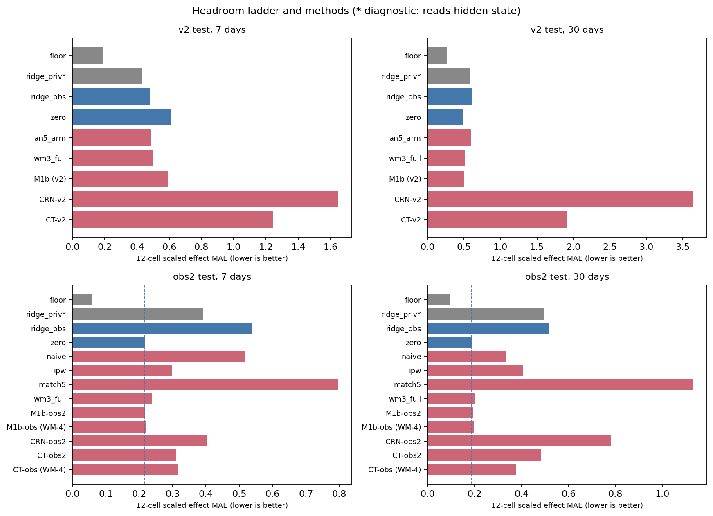
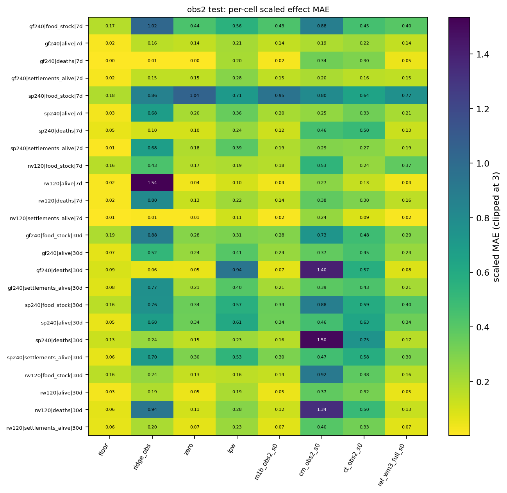
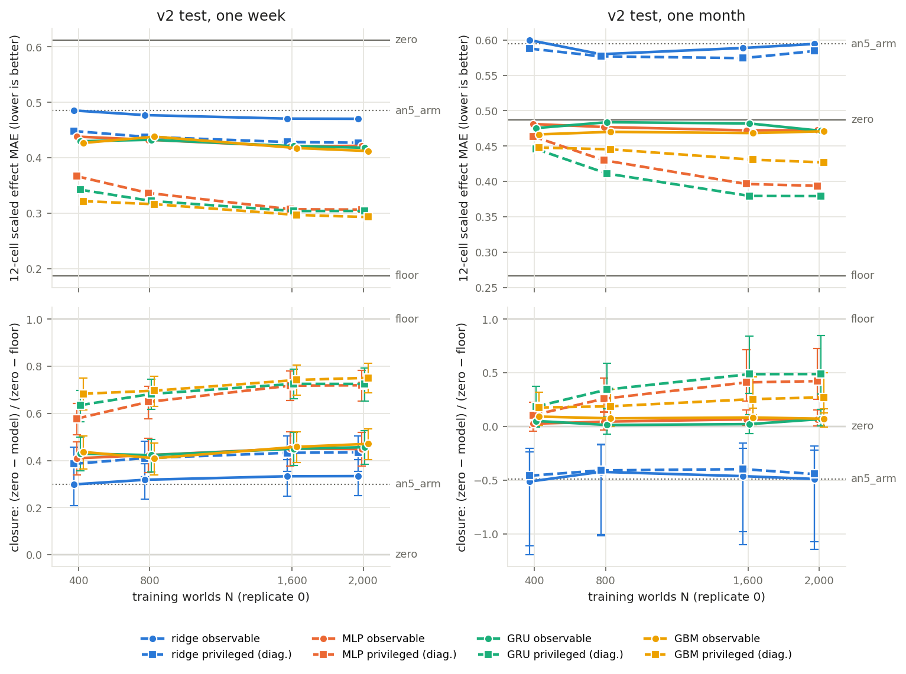
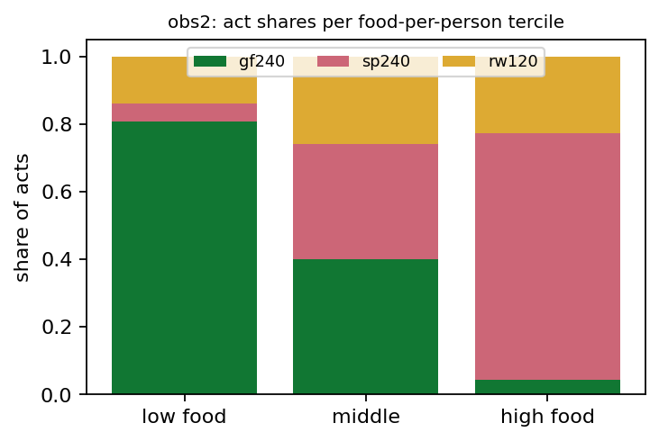
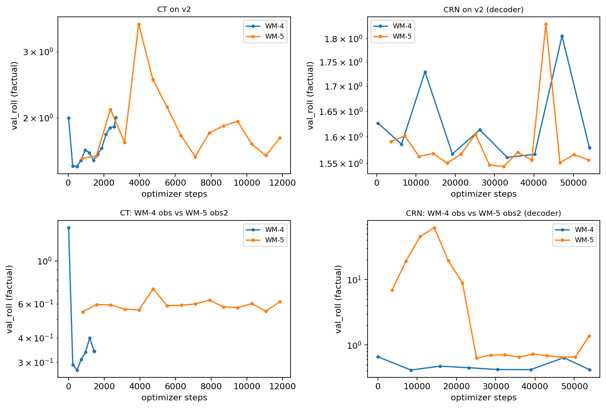

# Predicting a God's Hand: A Benchmark for Intervention Effects in a Simulated Agent Society, with Paired Counterfactual Branches, a Sequentially Confounded Split and a Measured Headroom

[AUTHORS]

Submitted to [VENUE] (datasets and benchmarks track). Draft generated from `docs/worldmodel/paper/paper_src.md` by
`tools/worldmodel/wm5/figures.py`; every quoted result is mapped to its source file in `paper_numbers.json`.

## Abstract

Can a model learned from recorded trajectories predict what an intervention will do? We study this in WorldSim, a
deterministic agent-based village simulation in which a "god" can gift or spoil food or rot wood, and in which every
recorded world can be forked into exact counterfactual branches. The benchmark has three splits from one frozen
simulator: an interventional split with paired branches and noise replicates, a confounded observational split with one
act per world, and a new sequentially confounded split in which a known policy acts up to five times per world, reading
the trajectory its earlier acts have changed (1,640 worlds, 3,966 acts, every propensity
recorded). The task is the per-world effect of an act on food, population, deaths and settlements at one week and one
month, scored against the true branch with a pre-registered rule. We find that (i) the benchmark has room: an effect
floor from noise replicates lies far below predicting no effect on both splits that have noise replicates (0.187 vs
0.612 on the interventional split at one week); (ii) two established estimators of
time-varying treatment effects, CRN and the Causal Transformer, trained for the full optimizer-step schedules of the
Causal Transformer authors' public implementation (which includes CRN) and read at their last checkpoint, are worse than predicting no effect on both the interventional and the sequentially
confounded split, at both horizons; (iii) rounding counts at readout does not change this; (iv) on the interventional
split a linear map of the observable pre-act state reaches only the act's mean effect, and the hidden state adds a little
more (both post hoc); (v) part of the room is learnable from the observable state: nonlinear direct effect models trained
on up to five times as many training worlds close 0.45 of the one-week gap between
"no effect" and the floor and improve slowly with more data, by a margin that depends on the training seeds
(pre-registered reading: learnable from observables; the
same models given the hidden state close 0.72), while at one month the
observable models barely beat "no effect". The benchmark, its pre-registered harness and the paper's numbers are traced
to committed result files.

## 1 Introduction

Learned world models are increasingly used as simulators: a model trained on recorded trajectories is rolled forward to
answer "what happens next?" and, more ambitiously, "what would happen if we acted?" [@ha2018worldmodels; @hafner2020dreamer;
@hafner2023dreamerv3; @hafner2025dreamerv3nature; @bruce2024genie; @valevski2025gamengen]. The second question is a causal one. A model that
forecasts the factual future well can still be useless for decisions if it does not respond correctly to interventions,
and recorded trajectories rarely contain the counterfactual branch against which such responses can be checked.

We study this question in a setting where the counterfactual branch is available exactly: a deterministic agent-based
village simulation (WorldSim) in which a "god" can act on a settlement — gift or spoil food, rot wood — and in which a
recorded world can be forked at any tick into branches that share their whole past and differ only in the act (and, if
desired, in post-fork noise). This makes it possible to measure, per world, the true effect of an act on food,
population, deaths and settlement splits at one week and one month, and to ask whether a model trained on the world's
observable history predicts it.

The answer in earlier rounds of this benchmark has been sobering (Table 1's M1b rows and `wm3_full`): autoregressive
world models trained on the factual stream barely respond to the god's acts; training on paired branches teaches the
first week's effects only; and two established estimators of time-varying
treatment effects, the Counterfactual Recurrent Network (CRN) [@bica2020crn] and the Causal Transformer (CT)
[@melnychuk2022ct], did not beat "predict no effect" on either an interventional or a confounded observational split.
A reviewer could object to the last finding on three grounds: (1) the two methods were not trained as their authors train
them; (2) the observational split was too small, with a single act per world, for balancing to matter; (3) perhaps
nothing can beat "no effect", i.e. the benchmark may not discriminate between methods at all. This paper answers each,
and then asks the question the third answer raises: (4) is the room between "no effect" and the noise floor **learnable**
from the pre-act state, or is the per-world effect essentially unpredictable given it?

**Contributions.**

1. **A benchmark with three splits from one frozen simulator** (Section 3): an interventional split with paired
   branches and two noise replicates per world (v2); a confounded observational split with one act per world (obs); and
   a new, three times larger observational split (obs2) in which a known, state-dependent policy acts up to five times
   per world, read sequentially from the trajectory it has already changed, with two reference rows per evaluation world
   and two noise replicates per test family. Every propensity is recorded.
2. **A measured headroom** (Section 5.2): for every split and horizon we place "predict no effect" against an effect
   floor (the other noise replicate's effect, i.e. the error of a predictor that knows the full state at the act and
   only lacks the post-fork noise) and against direct effect regressions on the observable and on the full (hidden)
   pre-act state. This tells how much room the benchmark leaves and how much of the per-world effect a simple map of the
   observable (or hidden) pre-act state captures.
3. **A fair rematch of CRN and CT** (Sections 4–5): trained for the optimizer-step counts of the authors' public
   implementation with its weight schedules on real progress, evaluated at their last checkpoint, with counts rounded at readout as the world models
   are — beside observational baselines (naive contrast, multi-cast inverse propensity weighting, matching), world
   models trained on factual and on paired data, and the direct regressions. Everything is pre-registered (W1 rule,
   world-level paired bootstrap).
4. **A learning curve of the headroom** (Sections 4.5, 5.4): nonlinear direct effect models (MLP, GRU, gradient-boosted
   trees; observable and, as diagnostics, privileged) trained on nested sets of 400 to 2,000 worlds of paired
   counterfactual branches, with a pre-registered reading of the curve.

**Findings.** On a split three times larger than before, with 2.42 acts per world and
inverse-propensity effective sample sizes of 396–445
per act, CRN and CT trained on the authors' implementation's schedule do not beat "predict no effect" (Section 5.3: every pre-registered
comparison of CRN and CT with `zero` or the analog baseline is NONE), and on the interventional split they are further
behind than the earlier, budget-capped runs (post hoc). Rounding the earlier runs' counts moves their scores by amounts
whose intervals all contain zero. The gap between "no effect" and the
effect floor is large on both splits with noise replicates (v2, obs2), so the benchmark can separate methods; on the
interventional split a linear regression on the observable pre-act state reaches the act's mean effect but no further
(post hoc), and on that split, among the learned models compared with it (E2), only the world model trained on paired
branches ties or beats it. The room is partly learnable: at one week a nonlinear model of the observable pre-act state
beats the linear one (C1 WEAK, 0.422 vs
0.470) and closes +0.45 [+0.38, +0.52] of the gap at 2,000 worlds,
improving by −0.0080 [−0.0121, −0.0034] per doubling of the data (an interval over test worlds; its
seed sensitivity is discussed in Section 5.4); with the hidden state the same model closes
+0.72 [+0.65, +0.78]. About half of what the observable models still miss at one week is recovered by adding the hidden state, and at
one month their gain over "no effect" is small (closure +0.07 [+0.01, +0.15]).

## 2 Related work

**World models and learned simulators.** Recurrent and latent-dynamics world models learn to predict an environment's
next observations from past observations and actions and are used for planning and policy learning
[@ha2018worldmodels; @hafner2020dreamer; @hafner2023dreamerv3]. Generative interactive environments and neural game
engines learn action-conditioned video models of games [@bruce2024genie; @valevski2025gamengen], and graph-network
simulators learn physical dynamics from particle trajectories [@sanchezgonzalez2020gns]. Their evaluation is mostly
factual (prediction error or downstream return); counterfactual correctness of the response to an action, measured
against the true branch, is rarely available. Our benchmark provides it for a social simulation.

**Time-varying treatment effects.** Estimating the effect of a sequence of treatments from observational trajectories
with time-varying confounding is the subject of marginal structural models and inverse probability weighting
[@robins2000msm; @hernan2020whatif], and of a line of neural estimators: recurrent marginal structural networks (RMSN)
[@lim2018rmsn], CRN with adversarially balanced representations via gradient reversal [@bica2020crn; @ganin2016dann],
G-Net based on g-computation [@li2021gnet], the Causal Transformer with counterfactual domain confusion
[@melnychuk2022ct], continuous-time variants [@seedat2022tecde], and methods for hidden confounding
[@bica2020deconfounder]. These methods are evaluated mainly on a pharmacokinetic–pharmacodynamic tumour-growth simulator
with a tunable confounding strength [@geng2017tumour] and on semi-synthetic data built from MIMIC-III
[@johnson2016mimic]. Our benchmark adds a simulator in which the dynamics are those of an agent society (thresholds,
splits, delayed reversals), the confounding comes from a god-player's policy with recorded propensities, and the truth
for every evaluation case is an exactly forked branch.

**Causal benchmarks and simulators.** Semi-synthetic benchmarks with known effects, such as IHDP [@hill2011bart] and the
ACIC data challenges [@dorie2019acic], made static effect estimators comparable; causal reinforcement-learning
environments such as CausalWorld [@ahmed2021causalworld] and the causal-confusion settings of imitation learning
[@dehaan2019causalconfusion] probe causal structure in control. We follow the same principle — simulate, so that the
counterfactual is known — for sequential interventions in a multi-agent system, and add a noise floor so that the
irreducible part of each per-world effect is measured rather than assumed.

**Agent-based social simulation.** Agent-based models have long been used to grow social phenomena from individual
rules [@epstein1996sugarscape], and recent work populates simulated towns with language-model agents
[@park2023generative]. WorldSim is a deterministic, rule-based village simulation of this kind; we use it not to model
any real society but as a controllable source of trajectories with exact counterfactual branches.

## 3 The benchmark

### 3.1 Simulator and scene

WorldSim is a deterministic village simulation written in Rust. A scene (`game_v19`) starts a few dozen agents on a
procedurally generated map with berry bushes, deadwood and water; agents forage, gather wood, keep a fire, eat from a
settlement store, age, die of starvation, dehydration, exposure, combat or old age, and give birth. A village whose food
shortfall persists through spring to autumn accumulates a hidden fission pressure and splits when it reaches a hidden
per-settlement threshold, so splits depend on weeks of history and on hidden state. A world is recorded for 120 display
days at one row per in-game hour (2,881 rows): 39 global columns (population, deaths by cause, trips, the calendar …),
14 columns per settlement (members, food and wood stores, fire …) and a few hidden tables (the winter's severity, the
fission pressure and threshold, the world's generation parameters). Every hidden column is marked in the recording;
no model or baseline in this paper reads one, except one regression that is labelled a diagnostic (Section 4.2).
The recorder is frozen (one binary, its source commit recorded in every episode), and the same arguments give
byte-identical files whatever the number of workers.

**Interventions** ("the god's hand") are applied to the home settlement at a chosen tick: `gift_food` 240,
`spoil_food` 240 (or 120), `rot_wood` 120. The recorder writes the requested and the applied amount.

**Forks.** A world can be recorded as a branch family: members share the whole simulation state up to a fork tick;
replicate 0 continues unchanged, replicate k ≥ 1 receives fresh randomness after the fork. A member with an act at or
after the fork equals its family's no-act member on every row up to the act. This yields, for every evaluation case, the
true effect of an act (the arm member minus the no-act member at the same replicate) and a second, independent
realization of it (the other replicate).

### 3.2 Tasks, cells and metrics

A **case** is a (world, reference row c, act). The history up to row c is observed; the act is applied at c; the
predictor reports the effect of the act on four outcomes — the settlement food store, the number alive, cumulative
deaths, the number of living settlements — at c + 7 days and c + 30 days. The split-day shift is reported but not scored.
Each act × outcome pair is a **cell** (12 per horizon). A cell's error is the mean absolute error of the predicted effect
divided by a fixed per-cell scale (the train standard deviation of that effect on v2, floored by the pooled standard
deviation for the observational splits so that a nearly constant cell cannot dominate); the **score** of a predictor at
a horizon is the mean over the 12 cells. Comparisons use a world-level paired bootstrap (B = 2,000, all cases of a world
resampled together) and the pre-registered **W1 rule**: KEEP if the model's seed mean is at most 0.8 × the baseline,
every seed is below the baseline and the 95 % interval of the difference lies below 0; WEAK if only the interval lies
below 0; TIE if it contains 0; NONE if it lies above 0. A single seed reaches WEAK at most.

### 3.3 Three splits

**v2 (interventional).** 560 worlds (400 train, 80 val, 80 test). Every world is forked at day 11 into two replicates,
and every arm is cast in both at a rule-fixed time: `gf240E` (gift 240) and `rw120E` (rot 120) on the eve of the first
winter, `sp240L` / `sp120L` (spoil) on the first morning the store falls below a line, when it exists. Assignment does not
depend on the state beyond these rules. Test: 604 cases (both replicates).

**obs (confounded, one act per world).** 560 further worlds. A god-player reads the factual trajectory at 06:00 of days
8–60 and acts at most once: with food per person in the lowest train tercile a gift is 15 times as likely as a spoil,
in the highest tercile the reverse, and rot is three times as likely in the highest wood tercile (daily probabilities
0.002–0.030). Training sees one observed episode per world; each val / test world has a family with the no-act member
and all three acts at its act row (or day 30 if it never acted). Test: 240 cases.

**obs2 (confounded, sequential, multi-act; new).** 1,640 worlds (1,200 train, 200 val, 240 test). The same tercile
structure with every daily probability doubled (so the confounding ratios are unchanged), up to five acts per world,
and a refractory period: after an act on day d the next decision is on day d + 8 or later, so no second act falls in the
week after an act. The policy reads the trajectory **already changed by its earlier acts**: the data are recorded in
rounds — round 0 the factual worlds; in round k every world that acted in round k − 1 is re-recorded with all its acts
so far, and the policy continues reading from the row after its last act — until a round adds no act. Replaying the
policy on a world's final (observed) episode reproduces every round's decisions, so the propensity of every decision row
is known. Every val / test world has two **reference rows**: c1 (its first act, or day 30) and c2 (its second act, or
c1 + 14 days). For each, a `pre` schedule (the world's acts before c) and three act schedules (`pre` plus the act at c)
are recorded as a family forked at c; test families have two replicates. Realized (1,640 worlds): 3,966 acts, 2.42 per world, 3.2 % of worlds never acted, and 60.0 % of acts had an earlier act in the world's history. The confounding is the obs split's: in the low-food tercile 80.9 % of acts are gifts and 5.3 % spoils; in the high-food tercile 4.3 % gifts and 72.9 % spoils. With several acts per world the multi-act IPW has effective sample sizes of 396–445 treated units per act at 7 days and 126–141 at 30 days (obs: 44–55). Test: 240 worlds, 1,440 primary cases (two reference rows × three acts, replicate 0) and their replicate-1 twins for the floor.

### 3.4 The effect floor and the headroom ladder

For every test case with two replicates, the **floor** predicts the case's effect by the other replicate's true effect
(on v2 the family's other replicate; on obs2 the r0 case by its r1 twin). This is the error of a predictor that knows the
world's full state at the act and lacks only the post-fork noise. For continuous symmetric noise its mean absolute error is about
√2 times the noise-limited one, so it over-states the attainable error; for sparse count cells (deaths at 30 days) it can
even be worse than predicting no effect. It is a reference point for the 12-cell average, not a hard ceiling. The **ladder** for a split and horizon is: floor ← `ridge_priv` (a regression on
the full pre-act state, including hidden fields) ← `ridge_obs` (the same on the observable state) ← `zero` (no effect).
The gaps say how much headroom exists, how much of it the observable state carries linearly, and how much lies in hidden
state.

### 3.5 Pre-registration and leakage controls

Each study fixed its rules before any test number existed: the obs2 policy, roles, seeds and reference-row rule before
the first treated episode was recorded; the runs, budgets, checkpoint rules, cases, scales, floors and decision rules
before any test evaluation. Models see only observable inputs (74 action-aware or 67 action-blind columns of the hourly
table); training and model selection on the observational splits see only each train / val world's observed episode;
val families are used only to choose among the observational baselines; test families only in evaluation; propensities
are used by inverse probability weighting and analyses, never as model inputs.

## 4 Methods evaluated

### 4.1 Baselines

`zero` predicts no effect. On v2, `arm_mean` predicts the act's mean train effect and `an5_arm` the mean effect of the
same act in the five most similar train worlds (24-row window of eight observable variables before the act). On the
observational splits, from the observed train episodes and the recorded propensities only: `naive` (treated minus
control mean change over the risk set of decision rows); `ipw`, the Hájek-normalized inverse-propensity contrast
[@robins2000msm; @hernan2020whatif] — on obs2 with multi-act weights: a unit treated by act a at row c with no other act
in (c, c + h) has weight 1 / (p_a(c) ∏_{j ∈ (c, c+h)} (1 − p_tot(j))), a control (no act in [c, c + h)) weight
1 / ∏_{j ∈ [c, c+h)} (1 − p_tot(j)), so the post-act survival of the treated is weighted as well (a unit test shows that
dropping that factor biases the estimate); and `match5` (five nearest treated and five nearest controls). The
observational baseline of each horizon is chosen on the val families.

### 4.2 Direct effect regressions

`ridge_obs` fits one ridge regression per cell on the v2 train families (both replicates, every case): the target is the
true effect divided by the cell's scale, the features are the 37 observable state variables at c, their means over the
day and the week before c, the 30 calendar features at c, and (obs2 only) the number of earlier acts per kind and the
days since the last act (constant on v2, so they carry zero weight); the penalty is chosen per cell on the v2 val families. It is applied unchanged to the v2 and
obs2 tests. `ridge_priv` adds every hidden field at c except the region geometry (winter severity, the hidden latent table, fission pressure and
threshold, the world's generation parameters); it is a **diagnostic** of how much a linear map of the full pre-act state
predicts and never enters a method ranking. On obs2 both are a **v2→obs2 transfer** (Section 6). Both regressions are trained on counterfactual labels of other worlds of the
same game, as is the paired world model below.

### 4.3 World models

**M1b** is an action-aware transformer over the hourly table (7-day context) trained to forecast the next hour's state
from scratch; its effect prediction is the difference between two autoregressive rollouts from the same history, one
with the act and one without, with counts rounded at readout when validation prefers it. We evaluate M1b trained on v2's
factual and arm members (`wm2_m1bact`, three seeds), on obs (`m1b_obs`, two seeds) and on obs2 (`m1b_obs2`, new), and
`wm3_full`, M1b fine-tuned on v2's paired branches with a paired-difference loss and a hazard head (three seeds).

### 4.4 CRN and CT on the authors' implementation's schedule

We use the Causal Transformer authors' public implementation [@melnychuk2022ct], which includes CRN (its plain-PyTorch
modules, unchanged); CRN's schedule is the one that implementation uses, not one taken from Bica et al.'s code. We run it at
daily resolution: a token per day carries the 37 state variables (predicted as normalized daily changes and fed back),
the calendar as covariates, and a four-class treatment plus amount. CRN [@bica2020crn] is an LSTM encoder whose
representation is made treatment-invariant by a gradient-reversal classifier, followed by a decoder initialized from it
for multi-step prediction; CT [@melnychuk2022ct] is a three-stream transformer trained with counterfactual domain
confusion and EMA weights. Configurations are those selected by a pre-registered grid on the obs split. In contrast with
the earlier study, each stage now trains for **the number of optimizer steps in that implementation** (CRN encoder
15,700, decoder 53,800; CT 11,850), unless a 300-s cost check on the actual data predicted more than the stage's budget; the balancing
weight α follows the authors' schedule **on real progress** (so a finished run ends at α = α_max); the **last**
checkpoint is primary, as in the authors' code (CT's EMA weights), with the lowest-validation-loss checkpoint reported as
secondary; and **counts are rounded at readout** (food, alive, cumulative deaths), as for M1. All adaptations are listed
in Appendix A.

### 4.5 Nonlinear direct effect models and a learning curve

Section 5.2 shows room between `zero` and the floor that no evaluated method uses. To ask whether that room is
**learnable** from the pre-act state, or whether per-world effects are close to unpredictable given it, we train
nonlinear direct effect models on the v2 design with up to five times as many training worlds. **v2x** adds
1,600 worlds (seeds 50000–51599) recorded exactly as v2's train worlds — the same frozen recorder,
fork tick, four arms and cast-time rules — with one replicate (7,576 episodes); one recorder
call per world reproduces v2's members bit for bit (checked on one world). The **training sets are nested** and use replicate 0 only: N = 400
(v2's train worlds), 800, 1,600 and 2,000 worlds; validation (v2 val), the test cases, cells and scales are v2's,
unchanged. The models:

- `mlp_*`: an MLP (three hidden layers, GELU [@hendrycks2016gelu], dropout [@srivastava2014dropout]) on the ridge's
  features and the act's one-hot, with eight outputs (four outcomes × two horizons), trained on the metric's own loss
  (the mean absolute error of the scaled effects) with AdamW [@loshchilov2019adamw] and early stopping on v2 val; width
  and dropout were chosen once on v2 val at N = 400 (observable 512 /
  0.3, privileged 256 /
  0.3) and frozen for every N;
- `seq_*`: a two-layer GRU [@cho2014gru] over the 168 hourly rows of the 74 observable action-aware inputs that end at
  the act, whose last state joins the same features before the same head;
- `gbm_*`: gradient-boosted trees [@ke2017lightgbm], one per cell, with an absolute-error objective;
- `ridge_*`: the regressions of Section 4.2, re-fitted at every N on replicate 0.

`*_priv` variants add the hidden fields and are diagnostics. Neural models have three seeds. Like the ridges, these are
supervised regressions on the true per-world effects of other worlds of the same game — a direct-target analogue of
meta-learners for heterogeneous effects [@kunzel2019metalearners], possible here because the branches are exact. The
rules (C1–C6) and the reading of the learning curve (Section 5.4) were committed before any of these models was
trained.

## 5 Results

### 5.1 Main results

Table 1 lists the 12-cell scaled effect MAE (lower is better) of every method on every split. Multi-seed rows are
seed-averaged; obs numbers are the earlier study's committed ones. CRN / CT on obs2 and v2 are trained on the authors'
schedule and read at their last checkpoint with counts rounded (primary). The learning-curve models of Section 4.5 are
listed at their largest training set (2,000 worlds). The obs2 columns of the earlier obs-trained runs (M1b-obs, CRN / CT
time-capped) and of the v2-trained world models are evaluations of those checkpoints on the obs2 test; the obs2 columns of the two regressions are a v2→obs2 transfer.

| method | trained on | v2 7 d | v2 30 d | obs 7 d | obs 30 d | obs2 7 d | obs2 30 d |
|---|---|---|---|---|---|---|---|
| `zero` (no effect) | — | 0.612 | 0.487 | 0.218 | 0.168 | 0.217 | 0.188 |
| `naive` | obs / obs2 train | — | — | 0.599 | 0.323 | 0.517 | 0.333 |
| `ipw` (multi-act on obs2) | obs / obs2 train | — | — | 0.391 | 0.382 | 0.297 | 0.405 |
| `match5` | obs / obs2 train | — | — | 0.945 | 0.968 | 0.797 | 1.132 |
| `an5_arm` | v2 train | 0.485 | 0.594 | — | — | — | — |
| `ridge_obs` (obs2: transfer) | v2 train (counterfactual labels) | 0.480 | 0.602 | — | — | 0.537 | 0.514 |
| `ridge_priv` (diagnostic; obs2: transfer) | v2 train, hidden state | 0.434 | 0.590 | — | — | 0.391 | 0.497 |
| M1b (3 seeds) | v2 | 0.592 | 0.501 | 0.216 | 0.174 | 0.221 | 0.199 |
| `wm3_full`, paired (3 seeds) | v2 | 0.496 | 0.511 | 0.229 | 0.175 | 0.239 | 0.200 |
| M1b-obs (2 seeds) | obs | — | — | 0.214 | 0.175 | 0.219 | 0.197 |
| M1b-obs2 (2 seeds) | obs2 | — | — | — | — | 0.216 | 0.194 |
| CRN, time-capped (earlier study, 2 seeds) | obs / v2 | 1.474 | 1.547 | 0.497 | 0.863 | 0.519 | 0.925 |
| CT, time-capped (earlier study, 2 seeds) | obs / v2 | 1.007 | 1.374 | 0.321 | 0.373 | 0.317 | 0.378 |
| **CRN, authors' schedule (2 seeds)** | v2 / obs2 | 1.649 | 3.645 | — | — | 0.402 | 0.780 |
| **CT, authors' schedule (2 seeds)** | v2 / obs2 | 1.243 | 1.920 | — | — | 0.311 | 0.483 |
| `mlp_obs`, N = 2,000 (3 seeds; obs2: transfer) | v2 + v2x train (counterfactual labels) | 0.422 | 0.472 | — | — | 0.226 | 0.236 |
| `seq_obs` (GRU), N = 2,000 (3 seeds; obs2: transfer) | v2 + v2x train (counterfactual labels) | 0.418 | 0.472 | — | — | 0.228 | 0.240 |
| `mlp_priv`, N = 2,000 (diagnostic, 3 seeds) | v2 + v2x train, hidden state | 0.307 | 0.394 | — | — | — | — |
| floor (other replicate) | — | 0.187 | 0.267 | — | — | 0.058 | 0.095 |

### 5.2 The headroom ladder (F1, F2)

*Figure 1. The headroom ladder and every method, per split and horizon (12-cell scaled effect MAE; lower is better).
Grey: the floor and `ridge_priv` (a diagnostic that reads hidden state); blue: `ridge_obs` and `zero` (dashed line).*

*Figure 2. Per-cell scaled effect MAE on the obs2 test (rows: act × outcome × horizon; columns: methods, seed 0 of
multi-seed models; clipped at 3). The v2 counterpart is `figures/cells_v2.png`.*

| split | lag | floor | `ridge_priv` | `ridge_obs` | `zero` | `zero` − floor [95 % CI] | `zero` − `ridge_obs` | `ridge_obs` − `ridge_priv` | `ridge_priv` − floor |
|---|---|---|---|---|---|---|---|---|---|
| v2 | 7 d | 0.187 | 0.434 | 0.480 | 0.612 | +0.425 [+0.374, +0.483] | +0.133 [+0.088, +0.178] | +0.045 [+0.028, +0.063] | +0.247 [+0.213, +0.282] |
| v2 | 30 d | 0.267 | 0.590 | 0.602 | 0.487 | +0.220 [+0.114, +0.327] | −0.115 [−0.155, −0.073] | +0.012 [−0.005, +0.031] | +0.323 [+0.227, +0.411] |
| obs2 | 7 d | 0.058 | 0.391 | 0.537 | 0.217 | +0.159 [+0.144, +0.175] | −0.319 [−0.335, −0.302] | +0.146 [+0.131, +0.159] | +0.333 [+0.318, +0.349] |
| obs2 | 30 d | 0.095 | 0.497 | 0.514 | 0.188 | +0.094 [+0.070, +0.116] | −0.326 [−0.342, −0.309] | +0.017 [−0.011, +0.043] | +0.402 [+0.370, +0.436] |

### 5.3 Pre-registered verdicts

Appendix F lists all 38 pre-registered verdicts of the CRN / CT rematch and the seven of the learning curve (Section 5.4) with their intervals, the training-reached check (R4) and rounding
alone (D2). In brief: every R1–R3 comparison of CRN and CT with `zero` or `an5_arm` is NONE; M1b-obs2 ties `zero` at 7
days (TIE) and is NONE at 30 days; E1 is
WEAK for `ridge_obs` on v2 at 7 days (under the W1 rule a single deterministic run reaches
WEAK at most, even with a ratio of 0.783) and NONE elsewhere; in E2 on v2 only `wm3_full` ties
(7 days, TIE) or beats (30 days, WEAK)
`ridge_obs`. E2 on obs2 compares with a regression that transfers badly from v2 (Section 6), so its KEEP / TIE verdicts
there say little about the models. R4 holds for all eight CRN / CT runs (Appendix B), and every D2 interval contains
zero.

**Q1: trained on the authors' implementation's schedule, CRN and CT still lose to "no effect".** Every primary CRN / CT run
completed that implementation's number of optimizer steps with the balancing weight at its maximum (R4). On obs2 their 12-cell
errors are 0.402 (CRN) and 0.311 (CT) at 7 days and
0.780 and 0.483 at 30 days, against
0.217 and 0.188 for `zero` (the baseline chosen on
the val families); on v2 1.649 and 1.243 at 7 days
against `zero` 0.612 and `an5_arm` 0.485.
The world model trained on obs2 (M1b-obs2) ties `zero` at 7 days
(−0.001 [−0.003, +0.001]), as world models did on the earlier splits, because it barely responds to
the act.

**Q3: more observational data barely helps.** M1b-obs2 is marginally better than the earlier M1b-obs on the obs2 test
(WEAK at both lags:
−0.003 [−0.005, −0.001] at 7 days, −0.004 [−0.006, −0.001]
at 30 days) but still does not beat `zero`. It did not converge: both seeds stopped at the 8,000-step cap with the kept
step at 7,950 and the validation loss still falling, and with three times the worlds each
world is seen less often than in M1b-obs, so this comparison may understate what more data can do. CT-obs2 is not better
than the earlier, budget-capped CT-obs (−0.006 [−0.021, +0.009] at 7 days,
+0.105 [+0.076, +0.135] at 30 days), but that comparison mixes the data size with
the schedule and the checkpoint (the authors' schedule and last checkpoint here, a time-capped run's best-validation
checkpoint there).

**Q4: rounding alone changes little.** Re-scoring the earlier study's runs with rounded counts moves their seed-averaged
scores by amounts whose intervals all contain zero (D2, Appendix F).

### 5.4 Is the headroom learnable? (C1–C6)

*Figure 5. Learning curves on the v2 test: the 12-cell error (top) and the closure (`zero` − model) / (`zero` − floor)
with 95 % world-bootstrap intervals (bottom) against the number of training worlds (replicate 0), at one week (left)
and one month (right). Solid: observable models; dashed: privileged diagnostics. Grey: `zero`, `an5_arm` and the floor.*

*Table 3. 12-cell error at N = 400 and N = 2,000 worlds and closure at N = 2,000 [95 % CI] (v2 test; reference rows
are training-free or trained on v2 alone, so both columns repeat their value).*

| model | 7 d, N = 400 | 7 d, N = 2,000 | closure 7 d | 30 d, N = 400 | 30 d, N = 2,000 | closure 30 d |
|---|---|---|---|---|---|---|
| `ridge_obs` | 0.485 | 0.470 | +0.33 [+0.25, +0.40] | 0.600 | 0.594 | −0.49 [−1.14, −0.22] |
| `mlp_obs` (3 seeds) | 0.438 | 0.422 | +0.45 [+0.38, +0.52] | 0.481 | 0.472 | +0.07 [+0.01, +0.15] |
| `seq_obs` (3 seeds) | 0.430 | 0.418 | +0.46 [+0.38, +0.53] | 0.475 | 0.472 | +0.07 [+0.01, +0.16] |
| `gbm_obs` | 0.427 | 0.412 | +0.47 [+0.40, +0.53] | 0.467 | 0.471 | +0.07 [−0.00, +0.16] |
| `ridge_priv` (diagnostic) | 0.448 | 0.427 | +0.44 [+0.35, +0.51] | 0.588 | 0.584 | −0.44 [−1.07, −0.18] |
| `mlp_priv` (diagnostic, 3 seeds) | 0.367 | 0.307 | +0.72 [+0.65, +0.78] | 0.464 | 0.394 | +0.42 [+0.25, +0.73] |
| `seq_priv` (diagnostic, 3 seeds) | 0.342 | 0.304 | +0.72 [+0.65, +0.79] | 0.446 | 0.379 | +0.49 [+0.30, +0.85] |
| `gbm_priv` (diagnostic) | 0.322 | 0.293 | +0.75 [+0.69, +0.81] | 0.448 | 0.427 | +0.27 [+0.13, +0.50] |
| `zero` | 0.612 | 0.612 | 0.00 | 0.487 | 0.487 | 0.00 |
| `an5_arm` | 0.485 | 0.485 | 0.30 | 0.594 | 0.594 | −0.49 |
| `wm3_full` | 0.496 | 0.496 | 0.27 | 0.511 | 0.511 | −0.11 |
| `floor` | 0.187 | 0.187 | 1.00 | 0.267 | 0.267 | 1.00 |

**The new worlds are consistent with v2's population.** Across 40 two-sample Kolmogorov–Smirnov comparisons of the
true effects per act, outcome and horizon (and of the act rows and split shifts) between the 1,600
v2x worlds and v2's 400 train worlds, the largest statistic is 0.078 and the smallest p-value
0.066: no test rejects (at these sample sizes the test rejects D ≳ 0.08 at α = 0.05). The same recorder and design generated both sets, so the learning curve varies only the number of worlds.

**Nonlinearity helps (C1–C3).** At 2,000 worlds the observable model chosen on validation (`mlp_obs`)
beats the observable ridge at one week (0.422 vs 0.470,
−0.049 [−0.078, −0.019], **WEAK**: the interval excludes zero but the ratio
0.896 misses the 0.8 bar) and at one month (the model chosen at that lag on the seed-averaged validation predictions, `seq_obs` — by a
margin of under 0.001, and the other model is KEEP as well: 0.472 vs
0.594, **KEEP**; the ridge is worse than `zero` there, the
chosen model slightly better). With the hidden state the gap to the ridge is larger (C3, diagnostic: one week
0.307 vs 0.427, **KEEP**; one month
0.394 vs 0.584, **KEEP**). The three
observable nonlinear families (MLP, GRU over the last week, boosted trees) end between 0.412
and 0.422 at one week (descriptive; no rule compares them): the GRU's week of hourly history
adds little beyond the summary features.

**More data helps, slowly from observables (C4).** From 400 to 2,000 worlds `mlp_obs` improves by
−0.017 [−0.026, −0.006] (**WEAK**) and `seq_obs` by
−0.012 [−0.020, −0.002] (**WEAK**); per doubling of the
data, −0.0080 [−0.0121, −0.0034] and −0.0056 [−0.0093, −0.0014]. The privileged diagnostic gains
about three times as fast (−0.0270 [−0.0346, −0.0191] per doubling; −0.060 [−0.077, −0.042]
from 400 to 2,000 worlds, **WEAK**), and its one-month closure rises from
+0.11 [−0.00, +0.23] at 400 worlds to +0.42 [+0.25, +0.73] at 2,000, while
the observable models' stays near zero.

**Observable vs hidden (C6).** At 2,000 worlds adding the hidden state changes the error of the MLP by
−0.115 [−0.158, −0.079] at one week and −0.079 [−0.116, −0.043] at one
month (GRU: −0.114 [−0.159, −0.075], −0.092 [−0.133, −0.054]).
Per cell (descriptive), the observable models' gain over `zero` lies mostly in the one-week food-store cells (a gift:
`zero` 1.560, `mlp_obs` 0.567), and the
hidden state's further gain in the spoil's population and settlement cells (one week: alive
0.843 → 0.268, settlements
0.717 → 0.355) —
plausibly (post hoc, untested) whether the act tips a village into a split, which depends on the hidden fission pressure
and threshold.

**The pre-registered reading: `learnable_from_observables`.** The rule (METRICS.md, committed before any WM-6 model was
trained) reads "learnable from observables" if the C1 model's one-week closure at the largest N is at least 0.5, or if
its C4 slope's interval lies below zero and its closure is at least 0.35. The closure is
0.449 (below 0.5) and the slope's interval −0.0080 [−0.0121, −0.0034] lies below
zero, so the second clause applies. What this does and does not say: part of the room is learnable from the observable
pre-act state, and the error fitted over 400–2,000 worlds still falls with more data; but the gain per doubling is small
(the last step, 1,600 to 2,000 worlds, is only 0.32 doublings and uninformative within seed noise), more than half of the one-week gap remains open from observables at
this scale, almost none of the one-month gap is closed, and about half of what the observable model misses at one week
is recovered when the hidden state (the fission pressure and threshold, the latent table and the world's generation
parameters) is added. Learning curves are often summarized by power laws [@hestness2017scaling]; over 400–2,000
worlds we fit only a log-linear slope and do not extrapolate it.

**How firm is the decisive interval? (post hoc).** The pre-registered intervals resample test worlds only; they do not
include training-seed variation. The reading rests on clause 2, i.e. on the slope of `mlp_obs`, whose three seeds give
−0.0158, −0.0023 and
−0.0058 per doubling. Without seed 0 the slope is
−0.0040 [−0.0078, +0.0001], an interval that contains zero, and a normal interval with both
variance parts (test worlds, and the unbiased between-seed variance of three seeds) is
−0.0080 [−0.0170, +0.0011]: at three seeds, the decisive clause is not robust to
training-seed variation. We therefore trained seven more seeds of `mlp_obs` and `seq_obs` at every N after the review
(post hoc; the rules keep seeds 0–2). With ten seeds the `mlp_obs` slope is
−0.0083 [−0.0133, −0.0034] with both variance parts, and its closure at 2,000
worlds +0.452 [+0.380, +0.522]: the conditions of clause 2 hold at ten seeds. The GRU's
ten-seed slope is smaller (−0.0042 [−0.0091, +0.0006]). The data effect is real
for the C1 model but small, and three seeds were too few to show it firmly.

**Against the methods of Section 5.1 (post hoc).** At one week `mlp_obs` at 2,000 worlds
(0.422) is below every observable method of Table 1 on v2 — `an5_arm`
0.485 (Δ −0.064 [−0.097, −0.028]), `wm3_full`
0.496, CRN and CT far above — and so it is already at 400 worlds, i.e. with replicate 0 of
v2's own training worlds (0.438; Δ vs `an5_arm`
−0.047 [−0.081, −0.012], vs `wm3_full`
−0.058 [−0.112, −0.018]): the earlier models were not held back by the amount of data
alone. On the obs2 test (a v2→obs2 transfer, report only) the same models are worse than `zero` (`mlp_obs`
0.226 vs 0.217 at one week,
+0.009 [+0.001, +0.016]) but transfer far better than the ridge
(0.537).

## 6 Analysis

**The benchmark discriminates; the methods do not use the room.** On both splits and at both horizons the floor lies
far below `zero` (Table 2; v2 +0.425 [+0.374, +0.483] at 7 days, obs2
+0.159 [+0.144, +0.175]): the per-world effect is mostly fixed by the state at the act,
and only a small part is post-act noise. What a simple map of the pre-act state captures is more modest. On v2 at 7
days `ridge_obs` beats `zero` (0.480 vs 0.612, E1
WEAK), but post hoc it only ties the act's mean effect (`arm_mean`:
−0.017 [−0.037, +0.002]; `an5_arm`: −0.006 [−0.037, +0.025]): linearly, the
observable state adds nothing measurable beyond the arm-level mean. Adding the **hidden** state does add per-world
information (`ridge_priv` vs `arm_mean` −0.063 [−0.082, −0.043], post hoc), yet `ridge_priv`
(0.434) stays far above the floor (0.187): most of
the headroom is not linear in the state at the act, observable or hidden (Section 5.4: nonlinear models of the same
state close more of it). At 30 days the regressions do worse than
`zero` (0.602 vs 0.487), as `arm_mean` does. A likely
reason (post hoc, not tested) is that a squared-error fit predicts a mean, while the metric is an absolute error, which
rewards a median near zero for these skewed, mostly-zero effects.

On obs2 the regressions trained on v2 are a test of **transfer**, not of what obs2's state carries: every v2 training
case of a gift or a rot sits at one cast row (the eve of the first winter) and the spoils at a few rule-fixed rows,
while obs2's test cases spread over 61 rows; no obs2 gift or rot case
falls on a v2 training row (0.0 %; spoils
20.4 %). Under this shift the
regressions do far worse than `zero` (0.537 and
0.514 vs 0.217 and
0.188), and F2's ridge rungs say nothing about observable versus hidden state on obs2.
So the gap between `zero` and the floor is real on both splits; on v2 a linear map reaches only the arm-level mean from
the observable state, and none of the methods of Sections 4.1–4.4 closes the gap; the nonlinear direct models of
Section 5.4 close part of it.

*Figure 3. obs2: shares of the three acts among the acts taken in each food-per-person tercile of the decision row.*

**Confounding, measured.** On obs2 the naive treated-minus-control contrast is far worse than `zero` at 7 days
(+0.300 [+0.283, +0.316]); the multi-act inverse-propensity contrast removes most of
that excess (−0.220 [−0.230, −0.209]) and recovers the mean effects much better than
`naive` for two of the three acts — a gift's
7-day food effect +45.6 (naive +128.2, true
+21.7), a spoil's −76.7 (naive −189.0,
true −78.0), while a rot's has the wrong sign
(+4.1; naive −100.2,
true −4.8). (The estimates pool the train worlds and the truths
average the test cases, so the two are different populations.) A pooled average cannot beat `zero` on per-world error
when effects vary this much. At 30 days `ipw` falls behind `naive`
(+0.072 [+0.068, +0.076]); a likely reason (post hoc) is that the post-act survival
weights grow (maximum treated weight 1,388).

**Why CRN and CT fail where they fail.** Their two rollouts (with and without the act) respond to the act in the
confounded direction and too strongly: on obs2 CRN (seed 0) predicts a gift's 7-day food effect of +78.8
and a spoil's −121.1 against true +21.7 and
−78.0, between the truth and the naive contrast. On v2, where assignment is unconfounded, the
deaths cells dominate their error: the two rollouts drift apart by whole deaths over 30 days (v2 30-day deaths cells,
seeds 0 / 1: 14.51 / 10.24 for CRN,
4.99 / 5.47 for CT, against
0.58 for `zero`), and rounding the counts does not remove it (D2).
Trained on the authors' full schedule, both are **worse** than the time-capped runs of the earlier study on v2
(Table 1; a post hoc comparison, not a pre-registered rule). A plausible reading, not tested here: longer training with
the full balancing weight lets the two rollouts diverge further. Their validation factual loss does not track this:
CT's lowest `val_roll` comes at its first or second evaluation and is otherwise flat within noise, and CRN's decoder's
lies in the second half of the plan (Appendix B). The world models (M1b) instead barely respond to the act:
M1b-obs2 (seed 0) predicts a spoil's 7-day food effect of −9.2 against
−78.0, which places it next to `zero`.

**The 30-day sign reversal (post hoc).** On obs2 the mean food effect of a spoil is
−78.0 at 7 days and +32.8
at 30, and that of a gift +21.7 and
−17.3: within a month the sign reverses. We do not analyse why; a
delayed change in settlement splits is one possible route, not tested here. For spoils the simple contrasts and the
observable-state regression get the sign of the 30-day mean right (`ipw` +63.3,
`ridge_obs` +60.9), and the learned dynamics models get it wrong,
flat or small (CRN seeds 0 / 1 −47.3 /
−22.0, M1b-obs2 −0.5 /
−1.4, `wm3_full` seed 0 −13.7),
except CT, which has the right sign but a smaller size in both seeds (+12.6 /
+23.4). For gifts the picture is mixed: CRN seed 1 predicts
nearly the whole 30-day mean (−15.9) and seed 0 the wrong sign
(+12.2); CT seed 0 has the right sign
(−6.6) and seed 1 the wrong one
(+5.2). A right mean is not a right per-world prediction:
CRN seed 1's error in that cell is 0.822 against
0.279 for `zero`.

## 7 Conclusion

Against exact counterfactual branches, two established estimators of time-varying treatment effects, trained as their
authors' implementation trains them, are worse than predicting no effect on the interventional and the sequentially
confounded split; world models trained on the factual stream barely respond to the act, and the one trained on paired
branches beats "no effect" only at one week on the interventional split — although the measured floor shows ample room. That room is partly learnable from the observable
pre-act state: by the pre-registered reading, a nonlinear direct effect model trained on true per-world effects closes
0.45 of the one-week gap at 2,000 worlds, with a small negative slope over 400–2,000
worlds; at one month it
closes almost none of it, and about half of what the observable model misses at one week is recovered once the
hidden state is added. The benchmark therefore separates methods
over a range that the observable models evaluated here, up to 2,000 worlds, enter but do not finish; and (post hoc) a
direct model of the observable state beats the dynamics models already at v2's own size, so their failure is not
explained by a lack of signal in the observable state alone.

## 8 Limitations and broader impact

**Limitations.** One simulator and one scene; single acts of three kinds at one amount each; the observational policies
are synthetic, with known propensities and a refractory period that a real decision-maker would not have; obs2's
evaluation cases sit at the policy's act rows (and their fixed fallbacks), so they inherit its timing; the floor is the
other replicate's effect, which over-states the irreducible error by about √2 for symmetric noise; the direct
regressions of Section 4.2 are linear, and every direct model is trained on counterfactual labels of the same
simulator (other worlds of the same game, not another simulator); CRN and CT run at daily resolution with one configuration each, chosen on the smaller obs split;
the world models run at hourly resolution; GPU-level numerical reproducibility of the transformer rollouts is not
guaranteed (one re-scored run differed at the 1e-4 relative level); two seeds per trained method (three for the
learning-curve models); M1b-obs2 stopped at its 8,000-step cap without converging (kept step in the last 1 % of
training). The learning curve has four points on one design (v2's arms and act times), one feature set, one small
architecture grid chosen at 400 worlds and frozen, and stops at 2,000 worlds; its models are trained on true effects of
other worlds, which only a simulator provides; the slope is a fit over 400–2,000 worlds, not a forecast; the
pre-registered closure and slope intervals resample test worlds only; with three seeds the decisive slope interval is not
robust to seed variation, and only seven further seeds, trained post hoc, show the slope condition with both variance
parts (Section 5.4); the obs2 transfer of these models is reported, not judged. Claims are limited to
the pre-registered rules; comparisons labelled post hoc are descriptive.

**Broader impact.** The benchmark is built on a toy simulation of a village and makes no claim about real societies or
real interventions. Its intended use is to test whether methods that learn dynamics from trajectories respond correctly
to interventions before they are trusted as simulators. A risk is over-reading simulated results: a method that does well
here is not thereby validated for policy or medical use, and one that does poorly may do well where its assumptions
hold. We release no personal data; the simulator and its recordings contain none.

## Data and code release

[OWNER: release plan]

## References

See `references.bib` (every entry verified; `REFERENCES_CHECK.md`).

## Appendix A. CRN and CT: deviations from the papers (selected; full list D1–D24 in METHODS)

Source: the authors' implementation (`github.com/Valentyn1997/CausalTransformer`, commit `c49a24fa`, MIT licence),
plain-PyTorch modules vendored unchanged (`VariationalLSTM`, gradient reversal, `BRTreatmentOutcomeHead`,
`TransformerMultiInputBlock`, relative positional encodings); training loops, data pipeline, rollouts and checkpoint
bookkeeping are ours (no Lightning, Hydra or MLflow). The full list with reasons is in `docs/worldmodel/wm4/METHODS.md`
(D1–D15) and `docs/worldmodel/wm5/METHODS.md` (D16–D24).

| id | papers / authors' code | here |
|---|---|---|
| D1 | one step = one day (tumour simulator) | one token per day: the hourly episode sampled every 24 rows at a clock phase (06:00 on the observational splits; uniform per sequence in training and the act's phase at test on v2); the act falls in exactly one token |
| D2 | levels | tallies (deaths by cause, births) as daily sums; cumulative deaths recovered by summing predicted daily deaths |
| D3 | 1-d outcome | 37 state variables, predicted as normalized daily changes and fed back (clamped ≥ 0; flags ≤ 1); MSE over all 37 |
| D4 | vitals / static features | the calendar as time-varying covariates (history only; CT masks them after the last observed token, as the authors mask vitals); no static features |
| D5 | 4 treatment classes | 4 classes (none, gift, spoil, rot) plus the amount; cross-entropy without the deprecated reduction flag |
| D6 | τ ≤ 5 (CT), ≤ 10 (CRN) | 7- and 30-token horizons; CRN decoder trained on 29-step windows initialized from the encoder representation |
| D7 / D16 | authors' epochs on 10,000 sequences | the authors' number of optimizer steps (CRN 15,700 + 53,800, CT 11,850), reduced only if a 300-s cost check predicts more than the pre-registered budget; a 1.25 × budget safety cap |
| D8 / D18 | last epoch | primary: the last step (CT: EMA weights); secondary: the lowest validation factual-rollout loss |
| D9 | EMA weights swapped inside the forward pass | EMA (β 0.99) updated with the authors' rule but used for evaluation and the kept checkpoint only |
| D10 | small hidden sizes for the 1-d simulator | CRN encoder hidden 128, CT d_model 128, 2 layers, 4 heads; Adam, no weight decay, no clipping, no schedule |
| D11 / D22 | — | one pre-registered 4-configuration grid per method on the obs split (validation factual loss only); chosen: CRN BR 64 / FC 128, decoder BR 64 / FC 32, encoder dropout 0.1; CT lr 1e-3, BR 64, FC 128 |
| D12 / D21 | — | training data: v2 — every train-family member; obs / obs2 — one observed episode per train world |
| D13 / D20 | — | prediction contract: arm rollout − no-act rollout from the same history (the case's `pre` member); counts (food, alive, cumulative deaths) rounded at readout as for M1, unrounded reported as secondary |
| D17 | α ramp per epoch over the planned epochs | α = α_max (2 / (1 + e^(−10 p)) − 1) with p = step / planned steps, set before every step |
| D19 | per-epoch validation | at most 15 validation evaluations per stage |
| D24 | — | M1 effect rollouts zero the action history as in earlier studies; on obs2 the previous act is ≥ 8 days before c, outside M1's 7-day window |

## Appendix B. Hyper-parameters, budgets and training reached

Configurations (pre-registered grid on the obs split, reused): CRN encoder hidden 128, BR 64, FC 128, dropout 0.1,
lr 1e-3, batch 64; decoder hidden 64 (the encoder's BR), BR 64, FC 32, dropout 0.1, lr 1e-3, batch 1,024; gradient
reversal α_max 1. CT d_model 128, 2 layers, 4 heads, BR 64, FC 128, dropout 0.1, lr 1e-3, batch 128 (doubled by the
masked-covariate copy), domain confusion α_max 0.01, EMA β 0.99, relative positions (max 15). Adam, no weight decay,
no clipping. Budgets: CRN 5,400 s per run (both stages), CT 14,400 s, M1b 16,200 s (8,000 steps); safety cap 1.25 ×
budget. Cost checks (300 s on the actual data) are in the run files; the CT-obs2 check was taken three times because the first two ran beside our own evaluations (1.89 and 1.83 s per step, which would have cut the plan to 7,349 and 7,735 steps); the third, without them, measured 0.91 s per step and kept the authors' plan. CT-v2: 1.00 s per step; CRN-v2: 0.097 / 0.040 s per encoder / decoder step; CRN-obs2: 0.044 / 0.011. No plan was reduced. The
final CT-obs2 runs took 10,665 and 10,047 s for 11,850 steps including
15 evaluations, which corroborates the third check. M1b-obs2: a cost check of 613 steps
in 1,431 s including evaluations; both seeds then stopped at the 8,000-step cap
(12,992 and 11,964 s) with the kept step at
7,950 and 7,950 and the validation loss still falling (not
converged).

| run | planned steps | reached | α / α_max at the last step | lowest-`val_roll` step | seconds |
|---|---|---|---|---|---|
| `crn_v2_s0` | 15,700 + 53,800 | 15,700 + 53,800 | 0.9999 | 32,280 | 2,618 |
| `crn_v2_s1` | 15,700 + 53,800 | 15,700 + 53,800 | 0.9999 | 43,040 | 2,905 |
| `ct_v2_s0` | 11,850 | 11,850 | 0.9999 | 790 | 13,114 |
| `ct_v2_s1` | 11,850 | 11,850 | 0.9999 | 1,580 | 12,051 |
| `crn_obs2_s0` | 15,700 + 53,800 | 15,700 + 53,800 | 0.9999 | 25,107 | 2,249 |
| `crn_obs2_s1` | 15,700 + 53,800 | 15,700 + 53,800 | 0.9999 | 32,280 | 1,848 |
| `ct_obs2_s0` | 11,850 | 11,850 | 0.9999 | 790 | 10,665 |
| `ct_obs2_s1` | 11,850 | 11,850 | 0.9999 | 790 | 10,047 |

*Figure 4. Validation factual rollout loss (`val_roll`) over optimizer steps, seed 0 of each method: the earlier
study's time-capped runs (WM-4) and this study's runs on the authors' schedule (WM-5). The lower panels use different validation sets (obs vs
obs2), so only their shapes compare.*

**Learning-curve models (Section 4.5).** Inputs normalized by the training rows' mean and standard deviation (a
feature constant on the training rows is set to zero); targets the true effects divided by v2's per-cell scales; loss the
mean absolute error over the case's eight targets (lags past the episode masked). MLP: three hidden layers, GELU, the
grid width {256, 512} × dropout {0.1, 0.3} searched once at 400 worlds (seed 0) on the v2 validation 24-cell average and
frozen (observable 512 / 0.3, privileged
256 / 0.3); AdamW, lr 1e-3, weight decay 1e-4, batch
256, at most 400 epochs, early stopping with patience 30 on the same validation statistic, the best epoch kept, a
3,600-s cap. GRU: two layers, hidden 128, over rows c − 167 … c of the 74 observable inputs (the 27 hidden values appended
for the diagnostic), its last state concatenated with the features and the act one-hot before the frozen MLP head.
GBM: one LightGBM regressor per cell, L1 objective, 31 leaves, learning rate 0.05, at least 20 rows per leaf, up to 500
rounds with early stopping after 50 rounds without validation improvement. Ridge: WM-5's per-cell λ ∈ {0.01, …, 1,000}
on validation. Seeds 0–2 for the neural models. Every neural run stopped by patience
(44–176 epochs, 112 runs);
none reached the time cap (longest run 27 s). GBM stopped early in every cell but one
(`gbm_priv` at 1,600 worlds, the spoil's 30-day food store, reached the 500-round cap).

## Appendix C. The observational policies

**obs (one act).** Decision rows: 06:00 of display days 8–60 (53 rows). State: food per person f = Σ store / max(1,
alive) and wood per person w, observable columns only. Terciles of f (q_f1 = 8.08, q_f2 = 12.1) and the 67th percentile
of w (q_w2 = 3.11) over the decision rows of the train worlds' factual episodes, frozen before any treated episode.
Daily probabilities: gift 0.030 / 0.008 / 0.002 and spoil 0.002 / 0.008 / 0.030 for the f terciles low / middle / high;
rot 0.012 if w ≥ q_w2 else 0.004. Draw u from a seeded generator per (world, day); gift if u < p_g, spoil if u < p_g + p_s,
rot if u < p_g + p_s + p_r. At most one act; no decision on a row with no one alive or no settlement.

**obs2 (sequential, up to five acts).** The same terciles (imported, not recomputed) and every probability doubled
(gift 0.060 / 0.016 / 0.004, spoil 0.004 / 0.016 / 0.060, rot 0.024 / 0.008); a separate random stream per (world, day);
at most five acts; after an act on day d the rows of days d + 1 … d + 7 have probability 0 (refractory). Each decision
reads the episode recorded with every earlier act of the world (rounds, Section 3.3). The propensity record lists, for
every world, every decision row's status (decision, refractory, cap, no decision) and (p_g, p_s, p_r), and every act with
the round that produced it.

**Reference rows and families (obs2).** c1 = first act row or day 30; c2 = second act row or c1 + 14 days; `pre` = the
acts before c; arms = `pre` + the act at c; nothing after c; val families one replicate, test families two.

## Appendix D. Datasheet (after Gebru et al. [@gebru2021datasheets])

**Motivation.** Created to test whether methods that learn dynamics from trajectories predict the effects of
interventions in a multi-agent system, against exact counterfactual branches, and how far they are from the attainable
error. Created by [AUTHORS]; funding [OWNER].

**Composition.** Recorded episodes of a deterministic village simulation (`game_v19`): per episode 2,881 hourly rows of
39 global and 14 per-settlement columns plus hidden tables (marked) and the list of interventions. Three splits:
v2 (560 worlds; families of the no-act member and four arms, two replicates each; 5,316 family episodes plus 560
`game_v16` control episodes and noise-floor families), obs (560 worlds; 2,219 episodes), obs2 (1,640 worlds; round
episodes of a sequential policy and two families per val / test world; 7,080 episodes in its manifest), and **v2x**
(1,600 further train worlds of v2's design with one replicate; 7,576
episodes, every one verified, used only to train the learning-curve models of Section 5.4). Instances are synthetic worlds; there are no
people, no personal or sensitive data and no labels beyond what the simulator records. Roles (train / val / test) are
fixed by seed ranges. Hidden columns must not be model inputs; they are kept for diagnostics.

**Collection process.** Every episode was produced by one frozen recorder binary (sha256 recorded; built from commit
`26b9af1f`, a merge of `f5373ab2`; the commit string in the episodes' metadata is `26b9af1f` for v2 and `f5373ab2` for
obs2 and v2x, as each study's protocol fixed it), with byte-identical output across worker counts; every array is
sha256-hashed in its episode's metadata and in the split's manifest. The observational policies are seeded and
pre-registered; their propensities are recorded. Counterfactual families are forks of the same world state.

**Preprocessing.** None beyond recording: the harness reads the arrays directly; cases, truths and scales are computed
by committed code from the arrays.

**Uses.** Intended: evaluating counterfactual / treatment-effect prediction and world models under interventions,
with the pre-registered harness (cells, scales, world-level bootstrap). Not intended: any claim about real societies,
real interventions or policy.

**Distribution and maintenance.** [OWNER: release plan]. The recorder, the harness and every manifest are in the
project repository; the episode arrays live outside version control (several GB per split).

## Appendix E. Compute

All recording, training and evaluation ran on one shared NVIDIA GB10 machine (DGX Spark, 20 CPU cores, 119 GiB unified memory), with other users' jobs present throughout (load averages 2–36; one other user's process held up to 29 GiB of GPU memory). Recording obs2 took 40,085 s of wall time at four or eight recorder workers (round 0 3,042 s; rounds 1–5 6,140, 4,619, 2,637, 954, 144 s; val and test families 6,613 and 15,936 s). The trainings of this study took 22.3 GPU-hours of wall time (one at a time; per run in Appendix B); the evaluations add minutes per run. The earlier studies' compute is in their run logs. The learning curve (Section 5.4):
recording v2x took 25,733 s of wall time (11,823 s for the
determinism-checked timeline in 16 chunks, 13,910 s for the families at eight recorder calls in
parallel); its 130 trainings (including the grid, the two reproductions and the post hoc seeds 3–9) took
990 s of in-process time in total (2,960 s of queue wall time,
start-up included), and its 122 v2 test evaluations
154 s.

## Appendix F. All pre-registered verdicts, training reached (R4) and rounding alone (D2)

| rule | model (seed-averaged) | baseline | Δ = model − baseline [95 % CI] | verdict |
|---|---|---|---|---|
| R1 obs2 7 d: crn_obs2 vs `zero` (val-chosen) | 0.402 | 0.217 | +0.185 [+0.170, +0.200] | **NONE** |
| R1 obs2 7 d: ct_obs2 vs `zero` (val-chosen) | 0.311 | 0.217 | +0.093 [+0.077, +0.110] | **NONE** |
| R1 obs2 7 d: m1b_obs2 vs `zero` (val-chosen) | 0.216 | 0.217 | −0.001 [−0.003, +0.001] | **TIE** |
| R2 obs2 30 d: crn_obs2 vs `zero` (val-chosen) | 0.780 | 0.188 | +0.591 [+0.548, +0.639] | **NONE** |
| R2 obs2 30 d: ct_obs2 vs `zero` (val-chosen) | 0.483 | 0.188 | +0.295 [+0.264, +0.328] | **NONE** |
| R2 obs2 30 d: m1b_obs2 vs `zero` (val-chosen) | 0.194 | 0.188 | +0.005 [+0.004, +0.007] | **NONE** |
| R3 v2 7 d: crn_v2 vs `zero` | 1.649 | 0.612 | +1.037 [+0.932, +1.142] | **NONE** |
| R3 v2 7 d: crn_v2 vs `an5_arm` | 1.649 | 0.485 | +1.164 [+1.063, +1.266] | **NONE** |
| R3 v2 30 d: crn_v2 vs `zero` | 3.645 | 0.487 | +3.158 [+2.967, +3.364] | **NONE** |
| R3 v2 30 d: crn_v2 vs `an5_arm` | 3.645 | 0.594 | +3.051 [+2.865, +3.253] | **NONE** |
| R3 v2 7 d: ct_v2 vs `zero` | 1.243 | 0.612 | +0.631 [+0.530, +0.733] | **NONE** |
| R3 v2 7 d: ct_v2 vs `an5_arm` | 1.243 | 0.485 | +0.758 [+0.662, +0.854] | **NONE** |
| R3 v2 30 d: ct_v2 vs `zero` | 1.920 | 0.487 | +1.433 [+1.299, +1.565] | **NONE** |
| R3 v2 30 d: ct_v2 vs `an5_arm` | 1.920 | 0.594 | +1.325 [+1.194, +1.457] | **NONE** |
| E1 v2 7 d: `ridge_obs` vs `zero` | 0.480 | 0.612 | −0.133 [−0.178, −0.088] | **WEAK** |
| E1 v2 30 d: `ridge_obs` vs `zero` | 0.602 | 0.487 | +0.115 [+0.073, +0.155] | **NONE** |
| E1 obs2 7 d: `ridge_obs` (transfer) vs `zero` | 0.537 | 0.217 | +0.319 [+0.302, +0.335] | **NONE** |
| E1 obs2 30 d: `ridge_obs` (transfer) vs `zero` | 0.514 | 0.188 | +0.326 [+0.309, +0.342] | **NONE** |
| E2 v2 7 d: crn_v2 vs `ridge_obs` | 1.649 | 0.480 | +1.170 [+1.068, +1.273] | **NONE** |
| E2 v2 7 d: ct_v2 vs `ridge_obs` | 1.243 | 0.480 | +0.763 [+0.666, +0.863] | **NONE** |
| E2 v2 7 d: wm3_full vs `ridge_obs` | 0.496 | 0.480 | +0.016 [−0.035, +0.081] | **TIE** |
| E2 v2 30 d: crn_v2 vs `ridge_obs` | 3.645 | 0.602 | +3.044 [+2.859, +3.244] | **NONE** |
| E2 v2 30 d: ct_v2 vs `ridge_obs` | 1.920 | 0.602 | +1.318 [+1.191, +1.449] | **NONE** |
| E2 v2 30 d: wm3_full vs `ridge_obs` | 0.511 | 0.602 | −0.091 [−0.133, −0.046] | **WEAK** |
| E2 obs2 7 d: crn_obs2 vs `ridge_obs` (transfer) | 0.402 | 0.537 | −0.135 [−0.154, −0.117] | **KEEP** |
| E2 obs2 7 d: ct_obs2 vs `ridge_obs` (transfer) | 0.311 | 0.537 | −0.226 [−0.244, −0.208] | **KEEP** |
| E2 obs2 7 d: m1b_obs2 vs `ridge_obs` (transfer) | 0.216 | 0.537 | −0.320 [−0.336, −0.303] | **KEEP** |
| E2 obs2 7 d: wm3_full vs `ridge_obs` (transfer) | 0.239 | 0.537 | −0.298 [−0.314, −0.282] | **KEEP** |
| E2 obs2 30 d: crn_obs2 vs `ridge_obs` (transfer) | 0.780 | 0.514 | +0.265 [+0.222, +0.313] | **NONE** |
| E2 obs2 30 d: ct_obs2 vs `ridge_obs` (transfer) | 0.483 | 0.514 | −0.031 [−0.062, +0.001] | **TIE** |
| E2 obs2 30 d: m1b_obs2 vs `ridge_obs` (transfer) | 0.194 | 0.514 | −0.321 [−0.337, −0.304] | **KEEP** |
| E2 obs2 30 d: wm3_full vs `ridge_obs` (transfer) | 0.200 | 0.514 | −0.315 [−0.332, −0.298] | **KEEP** |
| D1 obs2 7 d: CT-obs2 vs CT-obs (earlier, as kept) | 0.311 | 0.317 | −0.006 [−0.021, +0.009] | **TIE** |
| D1 obs2 7 d: CT-obs2 vs CT-obs (earlier, rounded) | 0.311 | 0.323 | −0.012 [−0.026, +0.004] | **TIE** |
| D1 obs2 7 d: M1b-obs2 vs M1b-obs | 0.216 | 0.219 | −0.003 [−0.005, −0.001] | **WEAK** |
| D1 obs2 30 d: CT-obs2 vs CT-obs (earlier, as kept) | 0.483 | 0.378 | +0.105 [+0.076, +0.135] | **NONE** |
| D1 obs2 30 d: CT-obs2 vs CT-obs (earlier, rounded) | 0.483 | 0.378 | +0.106 [+0.076, +0.137] | **NONE** |
| D1 obs2 30 d: M1b-obs2 vs M1b-obs | 0.194 | 0.197 | −0.004 [−0.006, −0.001] | **WEAK** |
| C1 v2 7 d, N = 2,000: `mlp_obs` (val-chosen) vs `ridge_obs` | 0.422 | 0.470 | −0.049 [−0.078, −0.019] | **WEAK** |
| C2 v2 30 d, N = 2,000: `seq_obs` (val-chosen) vs `ridge_obs` | 0.472 | 0.594 | −0.123 [−0.154, −0.089] | **KEEP** |
| C3 v2 7 d, N = 2,000: `mlp_priv` vs `ridge_priv` (diagnostic) | 0.307 | 0.427 | −0.121 [−0.147, −0.096] | **KEEP** |
| C3 v2 30 d, N = 2,000: `mlp_priv` vs `ridge_priv` (diagnostic) | 0.394 | 0.584 | −0.191 [−0.216, −0.162] | **KEEP** |
| C4 v2 7 d: `mlp_obs` N = 2,000 vs N = 400 | 0.422 | 0.438 | −0.017 [−0.026, −0.006] | **WEAK** |
| C4 v2 7 d: `seq_obs` N = 2,000 vs N = 400 | 0.418 | 0.430 | −0.012 [−0.020, −0.002] | **WEAK** |
| C4 v2 7 d: `mlp_priv` N = 2,000 vs N = 400 (diagnostic) | 0.307 | 0.367 | −0.060 [−0.077, −0.042] | **WEAK** |

R4 (training reached): every primary CRN / CT run completed its plan — `crn_v2_s0` 1.000 of its planned steps, α = 0.9999 α_max; `crn_v2_s1` 1.000 of its planned steps, α = 0.9999 α_max; `ct_v2_s0` 1.000 of its planned steps, α = 0.9999 α_max; `ct_v2_s1` 1.000 of its planned steps, α = 0.9999 α_max; `crn_obs2_s0` 1.000 of its planned steps, α = 0.9999 α_max; `crn_obs2_s1` 1.000 of its planned steps, α = 0.9999 α_max; `ct_obs2_s0` 1.000 of its planned steps, α = 0.9999 α_max; `ct_obs2_s1` 1.000 of its planned steps, α = 0.9999 α_max. The planned steps equal the authors' for every run (the CT-obs2 cost check was repeated without our own concurrent evaluations; Appendix B).

D2 (rounding alone; the earlier study's runs on their own test splits, seed-averaged, rounded − as committed): crn_obs 7 d +0.001 [−0.007, +0.010]; crn_obs 30 d −0.003 [−0.008, +0.002]; ct_obs 7 d −0.006 [−0.014, +0.003]; ct_obs 30 d −0.004 [−0.010, +0.003]; crn_v2 7 d +0.003 [−0.085, +0.099]; crn_v2 30 d −0.004 [−0.029, +0.021]; ct_v2 7 d +0.018 [−0.060, +0.098]; ct_v2 30 d +0.016 [−0.013, +0.043].
