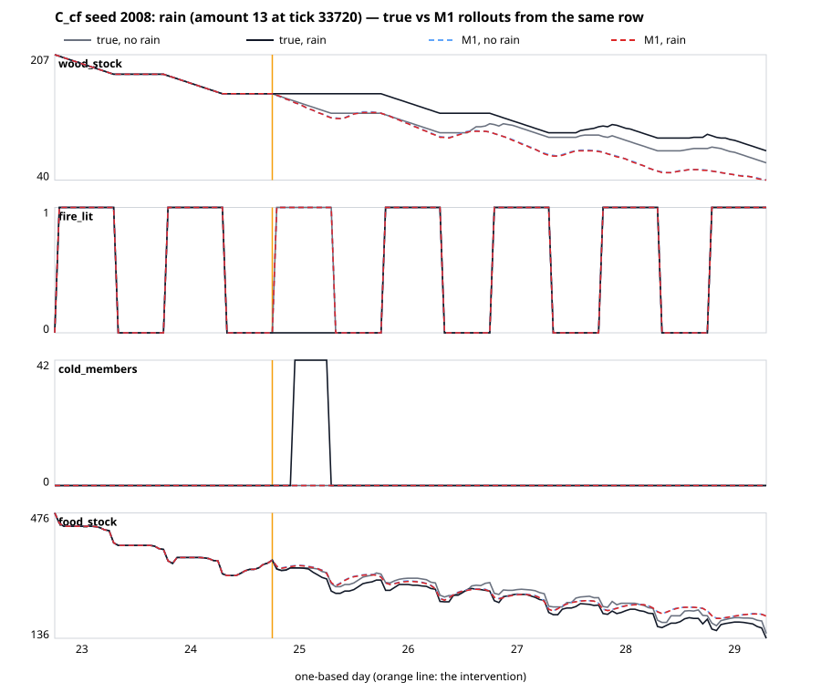

# WM-1 analysis

What the first learned world models on dataset v0 can and cannot do, measured through one harness that reproduces WM-Bench v0 exactly (W1). All numbers are test numbers unless marked *val*; full tables are in `RESULTS.md` (generated from `runs/*/metrics.json`), the run list in `METRICS.md`, the reasons for every choice in `DECISIONS.md`. nMAE = MAE / the bench's split std, mean over the eight variables V (food stock, wood stock, fire lit, cold members, alive, deadwood total, food on bushes, adults working).

## 1. Summary

- **The learned settlement model wins where the simple baselines are weakest: a week ahead.** M1 (2-layer GRU, recipe r3, severity-blind, action-aware; three seeds) reaches T2 168 h nMAE **0.275 / 0.272 / 0.277** on A test / B test / OOD_long (seed range 0.24–0.33) against the best baseline's 0.541 / 0.549 / 0.528 — about half the error, and also on every hour of the start days (T2-any 168 h 0.340 vs the action ridge's 0.596). It beats persistence at 24 h (0.131 vs 0.139) and is level with the ridge over all start hours (T2-any 24 h 0.188 vs 0.191).
- **It does not win the next hour.** T1 is 0.123 against the ridge's 0.100 (+23 %, W2's T1 clause fails): `adults_working` (0.58 vs 0.40) and `food_on_bushes_total` (0.26 vs 0.18) — the two noisy counts the ridge predicts from its 24-hour lag — carry almost all of the gap; M1 is better than the ridge on fire, cold members, alive and deadwood and slightly worse on the two stocks.
- **It does not answer "what if".** On the C_cf counterfactuals M1's predicted effects on dark nights and cold member-hours are almost always zero, so its T4 normalized MAE is ≈ 1.0 — the zero-effect baseline — and below the best baseline in 0 of 4 variants on dark nights (1 of 4 on cold member-hours, by 0.001). In the rain example (§7, figure) the true fire goes out within the hour and all 42 members are cold by 23:00; M1's "rain" rollout keeps the fire lit. Interventions sit on 0.28 % of the B_act rows (8 per 120-day episode) and 0.09 % of all training rows (384 of 414,864); the model never learned their effects (W3 fails, three recipes).
- **The winter is still a label.** The severity-blind model infers little of the winter from what it sees: T3b (five-night outlook) MAE 0.568 vs the ridge on observables 0.130 and the severity oracle 0.134 (W4 fails). Given the label, the same architecture gets 0.203 (r3) and 0.047 (r1). A five-feature ridge on two observed nights does the inference that the GRU does not.
- **A day at a time is easy; an hour at a time compounds.** The text model M3 (LoRA on Qwen2.5-0.5B, one JSON line per day) predicts the next day's 06:00 state with nMAE 0.056 (daily naive 0.139, M1's 24 hourly steps 0.131); a linear model on the same inputs does not (0.155) (§9).
- **Agents are learnable.** M2 (set transformer over the living agents of a row) predicts the next state tag with 0.902 accuracy (persistence 0.723) and positions with 2.04 tiles Chebyshev error (2.54) on A test (W6 passes).
- **Reproducible.** The same-seed reruns of r2 and r3 reproduce every test number exactly (3,765 numbers each, the predicted T4 effects included; max |diff| 0) on the GPU (W7).

## 2. The benchmark itself (baselines through the WM-1 harness)

- **W1 holds.** Every bench number (T1, T2 24/168 h on four splits, T3 rule/logistic, T4 zero/val-mean) is reproduced by the WM-1 harness to 3.5e-10 (`W1_REPRO.md`).
- **06:00 starts flatter persistence.** At the bench's 06:00 starts persistence is exact for `fire_lit`, `cold_members` and `adults_working` at whole-day horizons (T2 24 h 0.139 on A test). Over all 24 start hours of the same days (T2-any) persistence is 0.199 at 24 h and 0.665 at 168 h; at 24 h it ranges from 0.114 (23:00 starts) to 0.340 (11:00).
- **Where the ridge fails at 168 h is the season boundary.** The action ridge's T2-any 168 h nMAE on A test is 0.228 / 0.249 for summer / autumn target rows but 0.964 / 0.942 for spring / winter targets (persistence 0.812 / 0.730).
- **T3 is arithmetic** (logistic Brier 0.0015, AUC 1.000) **and T3b nearly so.** The T3b ridge on observables (wood stock at 06:00, deadwood total, the stock drop over each of the two previous nights, the deadwood change over the two previous days, members) reaches MAE 0.130 (exact 0.94) on A test, *better* than the severity oracle (train mean per severity 0 / 1.04 / 2.48 dark nights → MAE 0.134): two observed nights reveal the burn rate and so the label; the oracle only loses because it predicts a mean, not a count.
- **T4 normalized.** Mean |true effect| on C_cf test (dark nights / cold member-hours / food): gift wood 0.75 / 223 / 9.9, rot wood 0.79 / 277 / 12.8, rain 0.46 / 146 / 8.7, cold snap 0.33 / 115 / 5.3; deaths 0 for every variant and seed, so deaths have no normalized MAE and are not ranked. Best baseline normalized MAE (dark nights / cold member-hours): gift wood 0.79 / 0.72 and rot wood 0.79 / 0.69 (val-mean effect), rain 1.00 / 1.00 (zero), cold snap 1.00 / 0.89.

## 3. M1: what the three recipes did

| Recipe | What changed | Main s0 *val* T1 (A/B) | *val* T2-24 | *val* T2-168 | *val* T3b MAE | Best step / stop |
|---|---|---:|---:|---:|---:|---|
| r1 (GOAL 8 as written) | windows 168, rollout k 1→24, Gaussian NLL | 0.113 / 0.114 | 0.115 / 0.119 | 0.844 / 0.822 | 0.45 / 0.50 | 11,600 / max steps |
| r2 | windows 336, k 1→168 from a full 168-row context, + L1 on the mean, non-negative clamp | 0.129 / 0.131 | 0.141 / 0.148 | 0.483 / 0.490 | 0.61 / 0.63 | 1,200 / patience |
| r3 (main) | r2 + the eight V variables weigh 5× in the L1 and rollout losses | 0.120 / 0.123 | 0.120 / 0.124 | 0.265 / 0.272 | 0.38 / 0.38 | 3,200 / max steps |

*Val* persistence for reference: T2-24 0.130 / 0.131, T2-168 0.527 / 0.534. The main recipe is the one with the best *val* T2-168 of its seed-0 run (r3, `DECISIONS.md` D2.5); three strikes (r1, r2, r3) are spent on W2 and W3.

- **r1 learns the next day and loses the week.** Trained on rollouts of at most 24 steps from short contexts, r1 beats persistence at 24 h (test A 0.118 vs 0.139) and is the best M1 at T1 (0.114) and T3 (Brier 0.0027), but its 168-step rollouts leave the training distribution: test T2-168 0.838 / 0.850 / 0.862, with `wood_stock` 1.47, `deadwood_total` 1.22, `fire_lit` 1.02 — worse than persistence.
- **r2 learns the week and forgets the state.** Unrolling 168 steps fixes the drift (seed-0 test T2-168 0.486 / 0.486 / 0.472, at the W2 thresholds 0.4867 / 0.4938 / 0.4756) but the model becomes a seasonal-mean trajectory: its predicted T4 effects are exactly 0 on every seed (normalized MAE 1.000 = zero effect), its T3b prediction is almost always 0 dark nights (MAE 0 / 1.00 / 2.12 against true means 0 / 1.0 / 2.38 per severity), its T3 Brier rises to 0.041.
- **r3 keeps the week and wins back the day.** Weighting the eight scored variables 5× gives the best 168-hour model (three-seed T2-168 0.275, T2-any 168 h 0.340) and recovers most of the short horizon (T2-24 0.131 beats persistence; T1 0.123, between r1 and r2). It still does not respond to interventions (§7).
- **Where early stopping lands decides the seed.** GOAL fixes early stopping on *val* T2-24. Under r2/r3 a run that keeps improving T2-24 late in the k = 168 phase is also much better at 168 h: r2 seed 2 (best step 3,400) has test T2-168 0.311 where seeds 0 and 1 (best steps 1,200 and 1,600) have 0.486 and 0.461; r3 seeds 0 and 1 (best 3,200 and 3,600) 0.254 and 0.243, seed 2 (2,000) 0.327. The three-seed range of the main configuration (0.24–0.33) is mostly this.
- **Calibration.** Share of true normalized one-step changes within ±2σ of the predicted Gaussian on *val* windows: r1 0.936, r2 0.964, r3 0.957–0.959 (nominal 0.954). The least calibrated features are the rare intervention-driven ones (`cold_snap_tonight` 0.60, `rain_ticks_left` 0.64, `settlements_under_rain` 0.73 in r1) — the model is overconfident exactly where it has seen few events.

## 4. Where M1 beats the baselines and where it does not (r3, A test)

| Task | Best baseline | M1 main (3 seeds) | Verdict |
|---|---:|---:|---|
| T1 | 0.100 (ridge) | 0.123 [0.121, 0.127] | loses (+23 %) |
| T2 24 h (06:00) | 0.139 (persistence) | 0.131 [0.124, 0.143] | wins on average (2 of 3 seeds) |
| T2-any 24 h | 0.191 (ridge) | 0.188 [0.187, 0.190] | level |
| T2 168 h (06:00) | 0.541 (action ridge) | 0.275 [0.243, 0.327] | wins (−49 %) |
| T2-any 168 h | 0.596 (action ridge) | 0.340 [0.307, 0.399] | wins (−43 %) |
| T3 Brier | 0.0015 (logistic) | 0.0091 / 0.0142 / 0.0212 | loses (AUC 1.000 for all) |
| T3b MAE | 0.130 (ridge) | 0.568 [0.438, 0.766] | loses |
| T4 normalized MAE | 0.69–1.00 | ≈ 1.00 | loses or ties |

- **By variable (seed 0).** T1: M1 is better than the ridge on fire (0.005 vs 0.018), cold members (0.032 vs 0.089), alive (0.011 vs 0.021) and deadwood (0.046 vs 0.061) and worse on food stock (0.029 vs 0.022), food on bushes (0.258 vs 0.177) and adults working (0.577 vs 0.396). T2 168 h: far better on food stock (0.166 vs 0.584), food on bushes (0.346 vs 0.653), fire (0.000 vs 0.434), cold members (0.000 vs 1.153), adults working (0.039 vs 0.209) and deadwood (0.407 vs 0.549); worse on wood stock (0.590 vs 0.534) and alive (0.482 vs 0.210 — the ridge extrapolates the slow population trend better).
- **By season (T2-any 168 h, target season).** M1 wins where the ridge fails — spring 0.211 vs 0.964, winter 0.274 vs 0.942 — and loses where the ridge is good: summer 0.364 vs 0.228, autumn 0.408 vs 0.249. At 24 h M1 wins winter targets (0.171 vs 0.292) and loses autumn ones (0.249 vs 0.191).
- **By start hour.** M1's T2-any 168 h error is lowest from late-evening starts (23:00: 0.243 / 0.220 for seeds 0 / 1) and highest from 11:00 starts (0.424 / 0.431), the same shape as persistence's (0.572 at 23:00, 0.811 at 11:00).
- **By severity (T2-any 168 h, target-row severity).** 0.252 / 0.289 / 0.303 for mild / normal / harsh winter rows, 0.328 outside winters (seed 0).

## 5. Severity: does the blind model infer the winter? (W5)

| | sev-blind (main, 3 seeds) | sev-on (r3) | sev-on (r1) |
|---|---:|---:|---:|
| T3b MAE (A test) | 0.568 [0.438, 0.766] | 0.203 | 0.047 |
| T3b by severity (mild / normal / harsh), seed 0 | 0.28 / 0.75 / 0.44 | 0.00 / 0.81 / 0.00 | — |
| T2-any winter targets, 24 h | 0.172 [0.171, 0.174] | 0.187 | — |
| T2-any winter targets, 168 h | 0.321 [0.273, 0.417] | 0.544 | — |
| T2 168 h overall | 0.275 [0.243, 0.327] | 0.398 | 0.590 |
| T4 dark-night normalized MAE (mean of variants) | 1.06 [1.00, 1.16] | 1.03 | — |

- **No, not from observations.** The blind model's five-night outlook (T3b) is four times worse than a ridge that reads the burn rate off two nights (0.568 vs 0.130); the label makes the same GRU near-perfect on mild and harsh winters (sev-on: 0.00 / 0.81 / 0.00). The winter is decided by a variable the blind model does not reconstruct, and v0's observations do not force it to.
- **But the label hurts long rollouts that cross a season.** On 168-hour targets in winter the *sev-on* model is worse (0.544 vs 0.321) and overall at 168 h too (0.398 vs 0.275). The bench holds the severity at the start row's value: a rollout that starts in autumn carries "no winter" (−1) into the winter, and one that starts in winter carries the winter's level into spring — inputs the sev-on model never saw with those calendars in teacher forcing. A fair sev-on protocol would feed the true future severity (an oracle) or a forecast; v0's protocol tests a different question.
- **T4 does not separate them** (both ≈ zero effect).

## 6. Actions: action-aware vs action-blind

The action-blind models (A train only, no action inputs; they still read the observable consequences of an intervention once it has happened — `rain_ticks_left`, `settlements_under_rain`, `cold_snap_nights_left`, the `interventions_applied_total` difference — so on B rows their warm-up shows a past intervention) are as good as the action-aware ones on everything except what actions change — and the action-aware ones do not change anything either: r2 action-blind T2-168 0.354 (best step 4,000) vs action-aware 0.486 / 0.461 / 0.311 (best steps 1,200 / 1,600 / 3,400); r3 action-blind test T2-168 0.283 (A) vs the action-aware main's 0.254 / 0.243 / 0.327. On B test, which has 8 interventions per episode, the r3 action-blind model (T1 0.131, T2-24 0.142, T2-168 0.281) sits inside the action-aware seed range (0.125–0.131, 0.129–0.146, 0.241–0.327). The action-blind models are much worse at the fire tasks, which are scored on A test (no interventions), so this is not about actions: r2's and r3's action-blind runs predict the fire lit at 02:00 on every winter evening (T3 accuracy 0.879 = 1 − the dark-night rate, Brier 0.117–0.119, AUC 0.09–0.11 — their small probability differences even rank the nights backwards) and 0 dark nights in every T3b case (MAE 0.84). Trained on A only (96 episodes instead of 144), they settled on the seasonal-mean trajectory that r2's main runs also showed (§3). On T4 the action-blind models are exactly the zero-effect baseline by construction; the action-aware ones are within 0.01 of it on cold member-hours and 0.0–0.38 above it on dark nights and food store (normalized MAE). With 384 interventions among 414,864 training rows (0.09 %; 0.28 % of the B_act rows), the action inputs carry too little of the loss to be learned.

## 7. T4 per variant, with the error cases

*C_cf seed 2008 (a mild winter), rain 13 h at day 24 18:00: true factual (grey) and true rain (black) vs M1 main seed 0's rollouts without (blue dashed) and with (red dashed) the rain, both from the factual row at the intervention tick. The true fire goes out at once, the stock stops burning and all 42 members are cold five hours later (23:00); M1's two rollouts are identical to within one unit of wood: true effect +1 dark night, +336 cold member-hours, −19 food; predicted 0, 0, 0. Data: `runs/fig/cf_r3_s0_2008_rain.json`.*

| Variant | Target | Best baseline nMAE | M1 main nMAE (3 seeds) | M1 sign acc |
|---|---|---:|---:|---:|
| gift wood | dark nights | 0.79 (val mean) | 1.00 | 0.38 |
| gift wood | cold member-hours | 0.72 (val mean) | 1.00 | 0.42 |
| rot wood | dark nights | 0.79 | 1.00 | 0.38 |
| rot wood | cold member-hours | 0.69 | 1.00 | 0.36 |
| rain | dark nights | 1.00 (zero) | 1.12 [1.00, 1.27] | 0.50 |
| rain | cold member-hours | 1.00 | 1.00 | 0.36 |
| cold snap | dark nights | 1.00 (zero) | 1.12 [1.00, 1.38] | 0.65 |
| cold snap | cold member-hours | 0.89 (val mean) | 1.00 | 0.35 |

- **Error cases follow the severity.** In mild first winters (9 of 24 test seeds) gift and rot wood change nothing (true effect 0) and every model is right by predicting nothing; in normal and harsh winters the mean |true effect| is 1.0–1.5 dark nights and 340–450 cold member-hours, and every r2/r3 M1 predicts nothing there. Rain is the mirror image: in mild winters it adds exactly one dark night and 336 cold member-hours on every seed (the only dark night of the winter), in harsh ones it mostly saves fuel (−36 to −42 cold member-hours on 6 of 8 seeds, one fewer dark night on one) — r1 predicted the mild-winter rain effect correctly (dark-night MAE 0 there), r2 and r3 do not.
- **Food store** is the one target with non-zero predicted effects (r3: normalized MAE 0.99–1.31), small and of uncertain sign (sign accuracy 0.15–0.47).
- **Deaths** are 0 in truth and predicted 0 by r2/r3 (count rounding); r1, without the clamp and rounding of r2, predicted spurious death effects of 1–4.

## 8. OOD_v12 and OOD_long

M1 does not degrade on either shift: T2-168 0.269 (OOD_v12) and 0.277 (OOD_long) vs 0.275 on A test; T1 0.126 / 0.126 vs 0.123; on OOD_long the eight winters behave like the training winters by target season (spring 0.224, winter 0.262 for seed 0). OOD_v12 (the Pass 6 rules: no severity, unbounded claims) is slightly *easier* at 168 h for M1 (0.269) and for the action ridge, whose 0.419 there is its best split. The one task that breaks is T3b on OOD_v12 (blind M1 0.57–1.00 vs the ridge's 0.175): v12 winters burn differently and the model's dark-night count is not transferable.

## 9. M1b, M2, M3

**M1b (causal transformer).** See `RESULTS.md` (run `m1tf_main_r3_s0`, recipe r3 with batch 32 and one rollout start to fit the GPU memory cap, 3,000 steps). (The M1b run was still training when review round 1 started; its numbers are added here and in `RESULTS.md` when its test evaluation finishes.)

**M2 (agents, T5).** The set transformer (chosen on *val* over the MLP: score 1.109 vs 1.222) on A test / B test:

| Metric | persistence | 24 h earlier | M2 (A test) | M2 (B test) |
|---|---:|---:|---:|---:|
| next state tag, accuracy | 0.723 | 0.750 | **0.902** | **0.899** |
| next target kind, accuracy | 0.700 | 0.731 | **0.885** | **0.882** |
| next position, mean Chebyshev error (tiles) | 2.543 | 4.529 | **2.038** | **2.022** |
| next position exact | 0.307 | 0.301 | 0.326 | 0.324 |
| hunger / thirst / fatigue nMAE | 0.452 / 0.611 / 0.257 | 1.226 / 0.699 / 0.163 | **0.184 / 0.145 / 0.034** | 0.183 / 0.147 / 0.036 |

Needs are nearly deterministic given the last hour (drift rates, resets at meals and sleep). Positions stay hard: a third of agents end exactly where predicted (0.33 vs 0.31) because the target choice draws on each agent's random stream, which is not exported. Summing M2's predicted working agents gives `adults_working` at t+1 with nMAE 0.43 (persistence 0.67); the same count on the *true* agent states reaches only 0.18 against the settlement column (the agent-level definition — adult, member, target kind site / gather food / gather wood — does not see every activity the column counts), which bounds that check.

**M3 (text world model).** LoRA (rank 16) on Qwen2.5-0.5B-Instruct (already on the DGX), trained on A-train day pairs (each day's 06:00 row as one JSON line → the next day's line) for 276 of 714 steps (39 % of one epoch) before the 2-hour cap, CPU. On A test's 272 bench starts it parses **100 %** of its answers and reaches 24 h nMAE **0.056** against daily naive's 0.139 — the best 24-hour number of the run, better than every hourly-rollout model (M1 main 0.131, r1 0.118):

| Predictor (A test, 06:00 starts, 24 h) | food | wood | fire | cold | alive | deadwood | bushes | working | mean |
|---|---:|---:|---:|---:|---:|---:|---:|---:|---:|
| daily naive | 0.184 | 0.255 | 0.000 | 0.000 | 0.146 | 0.164 | 0.366 | 0.000 | 0.139 |
| direct daily ridge on M3's inputs (analysis reference) | 0.078 | 0.168 | 0.069 | 0.345 | 0.113 | 0.166 | 0.298 | 0.000 | 0.155 |
| M1 main seed 0 (24 hourly steps) | 0.091 | 0.186 | 0.000 | 0.000 | 0.146 | 0.250 | 0.316 | 0.013 | 0.125 |
| **M3** | 0.077 | 0.120 | 0.000 | 0.000 | 0.049 | 0.043 | 0.157 | 0.000 | **0.056** |

The direct formulation alone does not explain it: a ridge on exactly M3's inputs (the 06:00 V, season, day of season → the next day's V; fit on A train, λ on A val; `tools/worldmodel/wm1/direct_ridge.py`, `runs/analysis/direct_ridge.json`) scores 0.155, worse than persistence, because it predicts fractional cold members where the truth is exactly 0. M3 emits integers, keeps the variables that are fixed at 06:00 exact, and learns non-linear day-to-day maps (deadwood 0.043, alive 0.049). Its evaluation is narrow — one horizon, day granularity, no history, no actions (A test has none) — but it says the one-day transition of v0 is close to a lookup table, and that the hourly models lose their 24-hour accuracy to compounding.

## 10. What v1 needs (input to Pass 8's dataset v1)

Concrete changes to the simulation and the dataset that would make the benchmark harder and fairer, each tied to a WM-1 measurement.

1. **Many more interventions, at many times and doses.** WM-1's action-aware models did not learn a single intervention effect (T4 ≈ zero effect, the rain example) with 384 interventions in 414,864 training rows. v1: B_act with ≥ 10× the intervention rate (one every one or two days), amounts on a grid (dose–response), every kind in every season, and pairs of interventions; C_cf with ≥ 96 test seeds and several lead times (a week before winter, mid-winter, early spring), and food interventions large enough to matter for starvation (no v0 intervention changes deaths).
2. **Make the winter a process, not a label.** In v0 the severity draw fixes the burn (2/3/4) and the fall (8/6/4) for all seven nights, so two nights reveal the winter (T3b ridge 0.130 ≤ oracle 0.134) and the label alone makes the GRU near-perfect (sev-on T3b 0.05–0.20). v1: draw the burn and the fall per night from a severity-dependent process (e.g. a two-state weather chain with persistence) so that the label explains part of the variance and the observation history the rest; drop `winter_severity` from `global.npy` or replace it by a noisy forecast the player also sees.
3. **Stop leaking the severity through derived fields.** `wood_target` in winter is 4 × burn × 13 (104/156/208) and `latent.wood_winter_acc` changes by the day's fall. v1: compute the winter target from the settlement's estimate of the burn (a running mean of past nights) and mark regrowth accumulators `hidden` in the schema.
4. **A fair severity-on protocol.** Holding the severity at the start row's value (the bench's T2 rule) feeds a sev-on model "no winter" inside winters and the old level inside spring; that made the sev-on GRU worse at 168 h (0.398 vs 0.275). v1's bench should give sev-on models the true future severity (an oracle track) or a forecast field, and report both.
5. **Give T3 a real lead time.** The 18:00 stock and the night's rate decide 02:00 (logistic AUC 1.000); refuelling by members carrying wood, deliveries after dark or a stochastic burn would make the 8-hour outcome uncertain. Keep T3b (five nights ahead) as the ranked dark-night task.
6. **Rollout starts at every hour by default.** At 06:00 three of the eight variables are trivially persistent (T2 24 h persistence 0.139 vs 0.199 over all hours); WM-1's T2-any protocol should be the default, and the ranking should not rest on one start hour.
7. **Report units that do not cancel.** Ship the per-target normalized T4 score (MAE / mean |true effect|) in the bench and drop the cross-unit mean.
8. **More than one settlement and more agents.** One settlement of ≈ 40 agents per world makes settlement dynamics low-dimensional; several settlements sharing deadwood and trading, and a larger population, would give aggregate surrogates (WM-2) something to learn and test.
9. **Export the agent decision state.** T5 shows a strong learnable signal, but positions are capped by the unexported random stream and decision timers; export timers / cooldowns (or mark them hidden) so agent models can be scored against the Markov state as well as the observable one.
10. **A parameter shift inside the rules.** OOD_v12 removes the severity entirely and turned out *easier* at 168 h; v1 should hold out a shift the model must extrapolate (a fourth severity level, a longer winter, a different burn rate).
